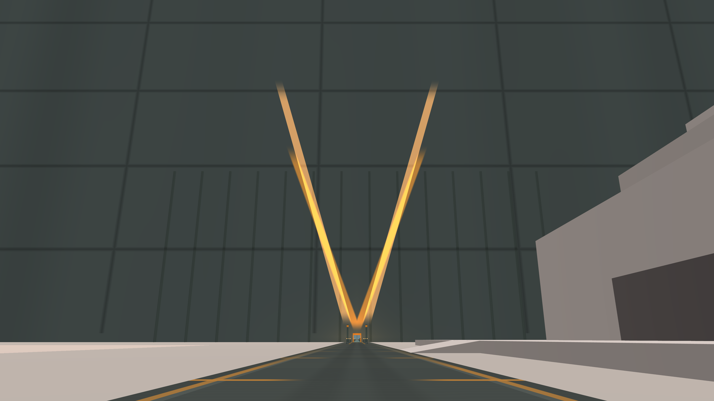
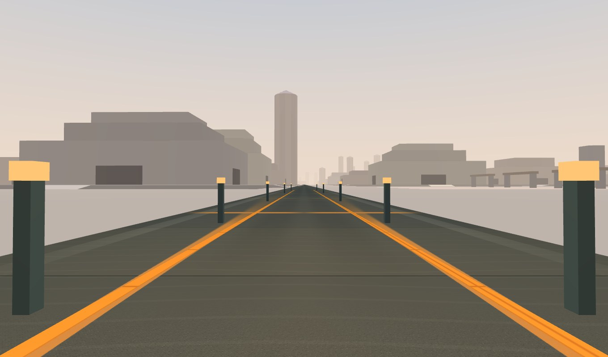
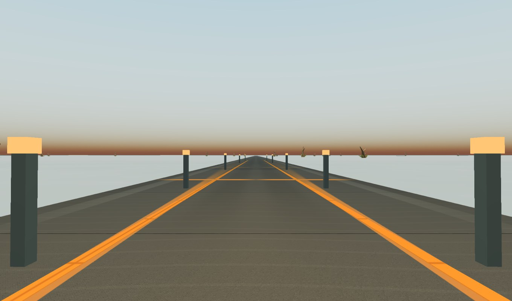
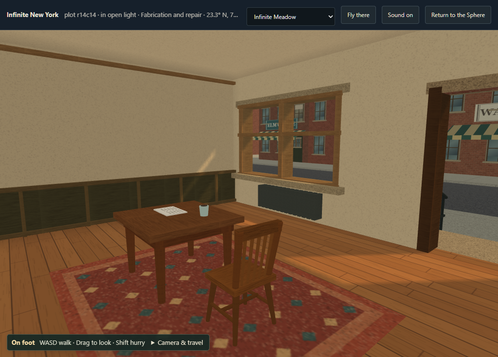

# The Sphere Observatory

From the open cavity of a Dyson sphere, the inhabited surface curves overhead. Descend beneath the **Duck Blind** and a projected sky takes its place. At 27 Orchard Street you can move a dining chair, take a flight to the other side of the world, and come back to find the chair where you left it.

**Version 1.8.9** follows that trip through Date Line Exchange. The amber V marks a service door. The Sideways City lies outside one face of the station, and Rustwater Marsh lies outside the other. Between them is a 48 km freight gallery you can cross on foot.



## Run it

Use Node.js 20 or newer, Git and a desktop browser with WebGL 2. The application runs from the checkout.

```sh
git clone https://github.com/JoeCauley/sphere-observatory.git
cd sphere-observatory
npm start
```

On Windows you can also double-click **Launch Observatory.cmd**. Once the server is running, open [apartment 1A and the Date Line itinerary](http://127.0.0.1:8766/?apartment=1A&start=room&trip=date-line) or [start in the Observatory](http://127.0.0.1:8766/). If the launcher reports a different port, use that port in the links. The itinerary prepares its destinations in a fresh save. An existing City on a different plot keeps its surveyed address.

## Walk from the apartment to the forked snag

1. **Leave something to come home to.** In 1A, face the dining chair and use **Pick up**. Carry it to the other marked position and choose **Place**. Under **Explore → Atlas places**, name and mark the room.
2. **Fly to the Exchange.** Choose **Date Line Exchange** in the room’s destination picker and press **Fly there**. On the City apron, press **F** to land. Look through the amber Service opening at rest, then hold **W** as you cross. Step back outside and mark the City door.
3. **Find the Marsh.** Follow the lighted lane through the station. Use **128×** surface pace on the long straight, then return to **1×** at the sill. The forked snag stands about 355 m beyond the Marsh face, roughly 50 m off the road. Mark its base. From the reeds, the amber V shows the way back.
4. **Go home.** Retrace the gallery to your City mark. Use **Atlas places** to revisit the snag or the room. Reload at 1A to see the chair in its saved position.

| City face | Marsh face |
| --- | --- |
|  |  |



## Controls and photographs

| Action | Control |
| --- | --- |
| Walk or fly, look around, move faster | **WASD**, drag to look, hold **Shift** |
| Descend, climb, land, lift off | **Q**, **E**, **F** near a supporting surface, **Space + E** to lift off |
| Return to a place or inspect coordinates | **Explore → Atlas places** for marks. **Exact address, lens & speed** shows the live camera. |
| Fill the display with the world | Choose **Fullscreen**. **Esc** or the top-edge **Exit fullscreen** control restores the previous view. |
| Take a field photograph | Choose **Screenshot** in the Observatory. The Windows launcher listens for unmodified **Print Screen** when its browser window is in front. |

The camera writes one lossless PNG per exposure into the `Screenshots/` folder at the root of the **running checkout**. It renders the active scene at physical display resolution even when the walking view uses a lower render scale. The saved filename appears after the write finishes. A first 4K exposure can take tens of seconds.

## More places to visit

| Destination | What to look for |
| --- | --- |
| [Bay 0 forest walk](http://127.0.0.1:8766/?border=forest) | Start by the Meadow tree, cross the station, then walk from the Jungle buttress to the exposed roots of a fallen giant. |
| [R1 rolling mill](http://127.0.0.1:8766/?mill=R1) | Start a slab at the forming bay, watch its 45-second cycle, and collect the coil. The rack and in-progress job survive a return visit. |
| [Border wall approach](http://127.0.0.1:8766/?border=wall) | Descend toward a solid interstation wall. Land on its roof and look up through vacuum at the far side of the Sphere. |
| The Outfall | Under **Explore**, install **Border Biome** and choose **Visit The Outfall**. Follow its dry aisle, turn the handwheel and watch the drainage stages. |
| Violet Labyrinth | Follow the crystal spires from street scale to their local branch points. Save a viewpoint in the Atlas and return after visiting another habitat. |

## How the world keeps its place

The Atlas assigns geographic addresses on a shell one astronomical unit in radius. Biome packs supply the nearby streets, vegetation, machinery and walking surfaces. The station chooses the habitat assigned to each opening and prepares its renderer on approach. At the threshold the incoming view inherits the camera and held controls.

The local server keeps installations, Atlas marks and furnishing records with the world’s install register. The browser profile also holds local viewpoints and bookmarks. Reopen the same server and profile to resume a pilot. The seven catalogue packs cover selected sites on the shell. The forest frontier, freight stations and apartment are surveyed places in a procedural prototype. [Pack interface](packs/CONTRACT.md) · [Surface navigation](docs/Surface-maturity.md) · [Border construction and addresses](docs/Builder-border-crossings.md)

### Date Line measurements

Three fresh Chrome processes on an RTX 5080 each flew from 1A and crossed the City Service door three times in both directions. The interval below runs from the last moving frame outside the handoff to the first moving frame on the other side. The drawing buffer was 944 × 734, at noon, with recording off.

| Median gap in movement | Before | With approach preparation | Crossings per build |
| --- | ---: | ---: | ---: |
| First exit into the City | 2,249 ms | 34.6 ms | 3 |
| Repeat exit into the City | 431.4 ms | 35.6 ms | 6 |
| Return into the station | 421.7 ms | 268.5 ms | 9 |

Movement resumed within one displayed frame of taking control on all 18 crossings. The full-resolution field camera produced 3840 × 2160 PNGs on that display. Cold loads remain visible elsewhere. In one Super Jungle landing, terrain support took 36 seconds to become available.

## Field recordings and engineering checks

| Expedition | Recordings |
| --- | --- |
| From the shell to a local street | [Industry skyline to service lane](examples/industry-field/skyline-to-service-lane.mp4) · [Outfall to Industry](examples/transitions/outfall-to-industry.mp4) |
| Across the wall | [Fly from the Border to Meadow](examples/border-crossing/border-to-meadow.mp4) · [Land and walk over the roof](examples/border-crossing/manual-roof-crossing.mp4) · [Walk the gallery back from Jungle](examples/border-crossing/outfall-return.mp4) |
| At ground level | [The Meadow service door](examples/transitions/meadow-service-door.mp4) · [The final 2.7 km to Outfall](examples/biomes/meadow-outfall.webm) · [Emerge in Violet Labyrinth](examples/transitions/into-violet-labyrinth.mp4) |

For development, install dependencies with `npm ci`, then run `npm test`. For the browser checks, install Chromium with `npx playwright install chromium`. The focused browser checks exercise the same controls used during a visit.

| Check | Command |
| --- | --- |
| Fly from a fresh apartment save and see the City at rest | `npm run test:apartment:date-line` |
| Keep walking while crossing a station doorway | `npm run test:border:approach` |
| Walk a complete circuit through ten native habitats in the default world | `npm run test:walks:default` |
| Walk surveyed globe circuits through the installed landscapes, the Outfall and every native surface region | `npm run test:walks:browser` |
| Verify the field gallery | `npm run test:gallery` |

[Transition survey](docs/Transition-audit.md) · [Earlier visitor guide and field films](https://github.com/JoeCauley/sphere-observatory/blob/2a11a1d69684db18216cab4524cc61d223a18a0d/README.md)
