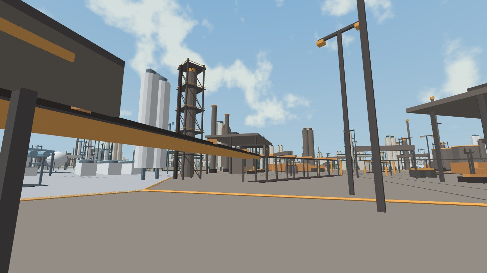
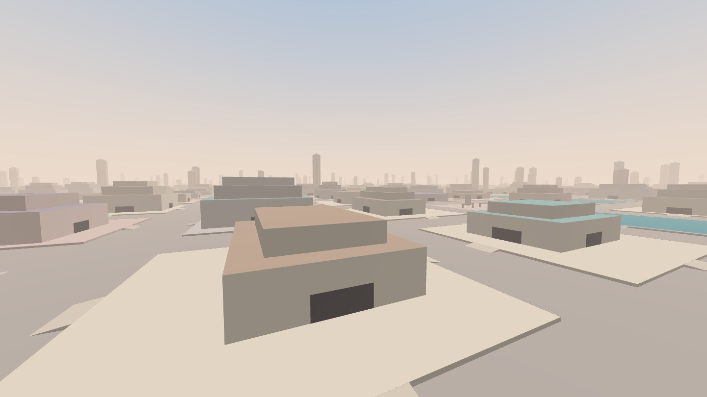
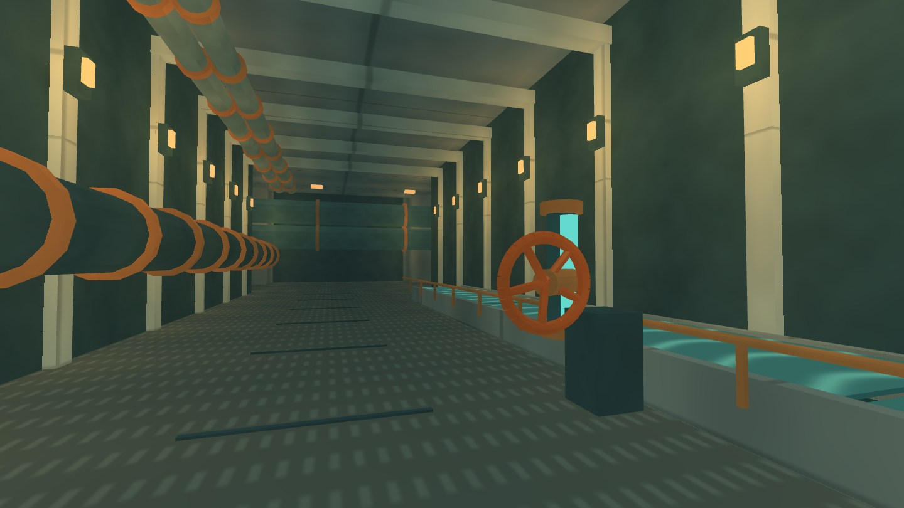
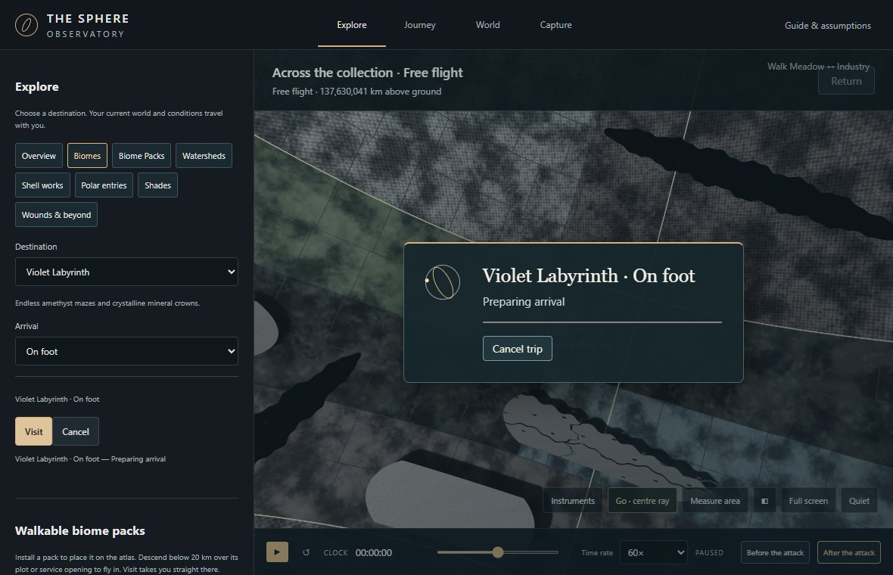

# The Sphere Observatory

Walk the inner surface of a Dyson sphere with a radius of one astronomical unit. Follow a track through windblown grass to a service door in a 1,400-metre wall. Inside, a handwheel still controls the water. Beyond it, a straight tunnel runs 1,000 km to the next landscape.


The Atlas places the four optional packs on the same globe as the original habitats. You can cross a region on foot, lift off from the roof of the Outfall, or bank and turn back midway through an atmospheric handoff. [Transition tests and measurements](docs/Transition-audit.md)

## Builder transport study

Follow four different-sized travelers across one Border, or watch the same scheduled freight from a footbridge and a lane refuge. The study includes three station layouts and records each visited station in its Atlas. [Open the station in a running checkout](studies/border-crossing/index.html) · [Watch both views](examples/border-crossing/freight-views.mp4) · [Scale drawings and test results](docs/Builder-border-crossings.md)

## Watch the transitions

| Demo | Length | What to watch |
| --- | ---: | --- |
| [Outfall to Infinite Industry](examples/transitions/outfall-to-industry.mp4) | 0:57 | Watch the Outfall wall fall away, cross the shell, then descend through works vapour until individual factory roofs and conveyors resolve. |
| [Through the Meadow service door](examples/transitions/meadow-service-door.mp4) | 1:10 | Level cruise reaches the foot of the wall, the pilot lands, and the walker enters the pipe gallery and operates the valve. |
| [Through the tunnel into Violet Labyrinth](examples/transitions/into-violet-labyrinth.mp4) | 0:19 | Walk the accelerated 1,000 km passage and emerge at eye height among the purple crystal spires. |

The flight survey covers all twelve directed links between installed packs. The walking survey uses three sets of bearings across three installation states. [Download all 48 recordings and camera traces](https://github.com/JoeCauley/sphere-observatory/releases/download/transition-films-44875365674/Sphere-Transition-Survey.zip) · [Read the frame analysis](docs/Transition-audit.md) · [Compare the Ruin and Violet outlets before and after the repair](examples/transitions/outlet-before-after.jpg)

## Run it locally

Use Git, Node.js 20 or newer, and a desktop browser with WebGL 2. The demo runs directly from a clone.

```sh
git clone https://github.com/JoeCauley/sphere-observatory.git
cd sphere-observatory
npm start
```

Open **[http://127.0.0.1:8766](http://127.0.0.1:8766)**. On Windows, you can also double-click **Launch Observatory.cmd** in the checkout. The first opening prepares graphics. When you choose a destination, a card over the scene names the place and shows which phase is running.

## A first trip from Meadow to Outfall

1. Open **Explore** and find **Walkable biome packs**. Click **Install** beside **The Outfall**. That also installs **Infinite Meadow** on its adjoining plot.
2. Click **Visit** beside **Infinite Meadow**. In the Meadow controls, choose **Fly the final 2.7 km**. The camera lines up with the service opening and cruises at 180 km/h. The approach takes about 54 seconds. Look around as the grass gives way to the dry strip at the foot of the wall.
3. Cruise stops outside the door. Hold **Q** to descend, press **F** near the ground to land, then use **WASD** and drag to look. Walk through the opening. At the handwheel, press **E** and watch the three water sections respond in sequence.
4. Follow the dry aisle straight across the pipe gallery. In the through-tunnel, the **Developer walk clock** goes up to **10,000×**. The far door opens onto the neighbouring landscape when its ground can support the walker. You can save halfway and return to the same tunnel.

The short approach is available even when the Meadow's full **Level cruise to the Outfall** route would take years at ordinary speed. The recording shows the last 2.7 km and the walk through the door. [Watch the 70-second crossing](examples/biomes/meadow-outfall.webm)

## Four places to explore

| Infinite Meadow · 1.3.0 | Infinite Industry · 1.4.1 |
| --- | --- |
|  |  |
| Pass the survey posts on foot, then rise a few metres and watch the grass resolve into patches that follow the hills. | Select **Inspect the hot bar transfer**. Three bars travel between two hexagonal facilities. Walk under the belt or pause the machinery with a bar over the seam. |

| The Sideways City · 1.0.0 | The Outfall · 1.0.0 |
| --- | --- |
|  |  |
| Look at a doorway from street level, then lift above the roofs. The same broad proportions repeat across a city built for people who moved sideways. | Outside, you can land on the wall. Inside, the service gallery follows the Border in both directions. The dry through-aisle crosses it. |

For more views, see the factory districts from above, the city tower from the street, and the same Meadow field at four heights. [Biome photographs and films](examples/biomes/README.md)

## Travel and saves

**From the Sphere.** In **Explore**, choose **Biomes**, select a habitat such as **Violet Labyrinth**, choose **On foot**, and click **Visit**. You can cancel a Main trip or retry a failed load. To enter an installed pack in free flight, descend through **24 km** over its footprint. The Atlas and local views overlap down to **18–20 km**, depending on the atmosphere. A level lateral entry below **20 km** also opens the pack. Climb through **24 km** to rejoin Sphere flight. The Outfall entrance occupies the shared border of its anchor plot. [Original habitats and their development plan](docs/Biome-Pack-Migration.md)

**Between packs.** Install two destinations to see **Fly to** controls in the scene bar. Try **Fly to Infinite Industry** from the Meadow. Meadow mist and industrial vapour each have their own procedural cloud layer. The City and Outfall use clear-air altitude layers. The camera keeps its geographic position and bearing through the exchange. **Return to the Sphere** leaves the pack.

**On foot.** Most changes of surface region open an Outfall passage. The surveyed Outfall roof and ramps also let a walker cross over the structure, and connected watershed banks preserve their own walking path. Both doors use the adjacent landscapes' coordinates and colours. If a building obstructs the proposed outlet, the entrance aims the straight tunnel at nearby open ground. The far door also works in reverse.

| A Visit to Violet Labyrinth | Halfway through a border crossing |
| --- | --- |
|  |  |

**Coming back.** The local server records installed plots in `installed-biomes.json`. Your browser profile remembers the active scene, manual viewpoint, bookmarks and local machinery state. Use **Save this place** for a bookmark. To resume after quitting, start the server and reopen the same address in the same browser profile. A second profile shares plot assignments and starts with its own camera.

## Earlier 1.8.0 walking measurements

**Nine accelerated browser walks** each made a signed 360° revolution. Together they crossed **159 rendered tunnels** and **168 ground legs**, visiting all **four installed packs** and **14 Main surface regions**. The largest distance from a starting point after a full lap was about **0.17 mm**. The test advances the camera in long strides on the globe, samples local ground on each leg and exercises both doors of every crossing. [Walk records, bearings and rendering checks](examples/biomes/surface-walks.json)

On the same RTX 5080 and Chrome 157, the first on-foot Visit to Violet Labyrinth went from **96.36 s to 42.27 s**. A fresh opening still took about **38.4 s** to reach its first prepared frame. Reopening a saved place took **5.07 s** in the release. These are individual browser runs against the preceding local build. [Measurement conditions and reproduction](docs/Surface-maturity.md#measurements)

## Run the checks

The demo needs only Node.js at runtime. To run the development checks, use the following commands from the checkout.

```sh
npm ci
npm test
npm run test:gallery
npx playwright install chromium
npm run test:transit
npm run test:border:browser
npm run test:walks:browser
```

The browser suites use their own server, profile and install register. `SPHERE_WALK_SEED` selects another reproducible set of bearings. [Walking test guide](docs/Surface-maturity.md#reproduce) · [Pack interface](packs/CONTRACT.md) · [Persistence and factory tests](docs/biome-demo.md)
