> Current progress: [Validated handoffs, current-state reuse and native Source checks](docs/Observatory-Main-Validated-Handoffs-2026-10-23.md). Root30 source and combined controls pass; complete constructor/caller work, current Q, selected-world prelude, provider complete-view admission and ordinary Main remain held. P05 OPEN.

> Current progress: [Main staged state reuse and bounded display preparation](docs/Observatory-Main-Staged-State-Reuse-2026-10-23.md). Current222-row source join and scoped controls pass; complete work/ownership/native Main remain held and P05 OPEN.

> Current progress: [Main retained-state startup and Kernel handoff](docs/Observatory-Main-Retained-State-Startup-2026-10-23.md). Original Host/Binding/Kernel handoffs pass scoped checks; complete work/ownership/native Main remain held and P05 OPEN.

> Current progress: [Main resource inputs, completion and reuse](docs/Observatory-Main-Resource-Startup-2026-10-23.md). The joined source is functionally checked; complete funding/native Main remain held and P05 OPEN.

> Current joined-startup record: [Surface observation reuse and reviewed Source child](docs/Observatory-Main-Joined-Startup-2026-10-23.md). Fresh checks remain; complete shared funding/host/native Main are held and P05 OPEN.

> Current continuation: combined startup caller and corrected weak actual-App inputs pass scoped checks; Source-only work/lifetime proposals pass independent review. Complete helper/shared entry/work/host/native Main remain open. P05 OPEN. See [the caller report](docs/Observatory-Main-Startup-Caller-2026-10-23.md).

> Current continuation: corrected Source/surface/Target/Preview preparation joins pass scoped independent review; failed restoration witnesses are preserved. Actual scheduled caller, full ownership/work/host and native Main remain open. P05 OPEN. See [the preparation report](docs/Observatory-Main-Preparation-Join-2026-10-23.md).

> Current continuation: immutable-state reuse and actual scheduled Source loading are joined and independently component-checked. Complete startup ownership/work and genuine Main resource/drawing integration remain open; P05 is OPEN. See [the startup reuse report](docs/Observatory-Main-Startup-Reuse-2026-10-23.md).

> Current continuation: private cold-profile builders pass independent component checks; actual scheduled Source integration and complete builder funding are now active. P05 remains OPEN. See [the builder report](docs/Observatory-Main-Cold-Builders-2026-10-23.md).

> **Next Main startup step — 23 October 2026:** The selected texture handoff is backed up. A source scan guard and fresh-profile proposal pass scoped review; complete cold staging remains unimplemented and unpriced. The next concrete work is actual host/program/Base profile builders, then paid source/setup/import visits with fresh checks. P05 remains OPEN. Read the [cold-entry report](docs/Observatory-Main-Cold-Entry-2026-10-23.md) and [work plan](docs/Observatory-Current-Work-Plan.md). Earlier records below retain their original scopes.

> **Texture handoff component — 23 October 2026:** Main now transfers its four textures across six visits, retaining fresh checks, original reader limits and paid cleanup. Selected source and scoped component controls pass independent review; the delivered walk and simulation are unchanged. Complete cold/caller/host and native Main proof remain open, so P05 is OPEN. Read the [handoff report](docs/Observatory-Main-Texture-Handoff-2026-10-23.md) and [current work plan](docs/Observatory-Current-Work-Plan.md). Earlier dated records below retain their original scopes.

> **Main startup component — 22 October 2026:** The genuine drawing helper and owned App/loader handoff pass 52 targeted model checks and a real Chrome startup/cleanup check. Complete Main remains held; P05 is OPEN. The next gate is the exact current four-key content-bridge work contract. See the [startup report](docs/Observatory-Main-Startup-2026-10-22.md) and [current work plan](docs/Observatory-Current-Work-Plan.md). Earlier evidence below keeps its original scope.

> **Bounded continuation - 22 October 2026:** Owned Canvas shutdown is reviewed, explicitly funded and connected to the combined candidate; 52 controlled scenarios pass. The delivered Meadow-Industry walk is unchanged. See the [integration report](docs/Observatory-Owned-Context-Retirement-2026-10-22.md). P05 remains OPEN.

<!-- main-reuse-advancement-2026-10-21 -->
> **Main integration — 21 October 2026:** The complete prepared-view prefix passes the 810-pair model. A repaired authenticated view planner and bounded image copies now pass 23 integrated controls with exact original image bytes. Dedicated Canvas preparation passes 15 actual Renderer/Target model cases plus 38 existing facts/import checks. Current work joins content, genuine source/bootstrap ownership and the complete Canvas/finite Target budget before native Main proof. Earlier failed approaches remain preserved. P05 remains OPEN; see [current progress](docs/Observatory-Main-Reuse-Progress-2026-10-21.md) and [work plan](docs/Observatory-Current-Work-Plan.md). Earlier reports keep their original cutoffs.

<!-- industry-display-preparation-2026-10-20 -->
> **Industry display preparation — 20 October 2026:** The [successor implementation](docs/Observatory-Industry-Display-Preparation-2026-10-20.md) uses verified bounds before detail uploads, origin copies, draws and moving-geometry preparation. A public walk crossed both ways, hidden graphics stopped while the clock advanced, and exact saved return/tracked cleanup passed. Original content remains exact. Required image/performance qualification and formal P05 remain OPEN; see the [current work plan](docs/Observatory-Current-Work-Plan.md). Earlier reports and results remain exact below.

<!-- repository-safety-checkpoint-2026-10-20 -->
> **Project safety checkpoint — 20 October 2026:** Meadow–Industry walking is delivered; formal P05 remains OPEN. The latest Main candidate completes input compilation but defers before drawing on its unqualified work contract. Read [current status and completion path](docs/Observatory-Project-Checkpoint-2026-10-20.md). Source/progress backups preserve the unfinished candidates separately from the working application; raw archives remain local by owner selection.

<!-- Current full-pack shared-world route — 20 October 2026. Earlier bodies remain exact below. -->

> **Meadow ↔ Industry now works on foot.** The native walk covered 576.9 m with two physical crossings, exact save/reopen and complete tracked scene cleanup. Both full packs share one world through new 1.1.0 adapters. See the [current shared-world report](docs/Observatory-Meadow-Industry-Shared-World-01.md). Use **Walk Meadow ↔ Industry** in the Sphere, or the launch link in that report. All 45 original pack/runtime/catalogue files remain byte-identical. Formal service **P05 remains IN_PROGRESS**, P06–P08 NOT_STARTED; the original 51-byte catalogue, failed gates, Meadow H1 and prior evidence remain unchanged. Biome Border is next and has not started.

---

<!-- Current Biome Pack Service pointer — 13 October 2026. Previous exact bytes preserved below. -->

Current report: docs/Observatory-Biome-Pack-Service-Implementation-09.md; continuation ledger08. Correlated CPU perspective/canonical cell/X proof passes13 groups/20 refusals. Native Industry/Track/Both current02 pass15/17,15/17,15/21; full bulk API invoked, complete bulk raw readback NOT_RUN; actual CPU reference ownership remains UNKNOWN. Final isolated40 service children (989 sources),61 standard children and16 accepted separate-scene pack checks (444 sources) PASS,870 dependencies unchanged. The first live final run passed40 children but failed its source census on two preserved concurrent runtime additions. WORK: I:\Sphere\work\biome-pack-service-main-2026-10-13T21-35-09-434Z-1acb8fb3; read-only component viewer http://127.0.0.1:9027/review-final-01/index.html.

P05 IN_PROGRESS; P06–P08 NOT_STARTED; Phase One NOT_ACCEPTED/NOT_RELEASED. Full48/53 matrix0 full PASS,52 NOT_RUN,T45 UNMEASURED;16 gates retain all14 inherited, initial9025 absence and concurrent live source association INCOMPLETE. Frozen40/61/16/native147 results do not certify later shared Main/package changes. Frame/native rays/AA/resolve/two-pixel, complete fragments/materials/receivers, shared Main ownership/accounting/ordinary replacement/public footprints/arrival/session/head/ACK/export/native peaks/quiet timing remain open. Catalogue51B empty. Canonical Phase-01, accepted Meadow/HR-09/H1 states/caps and failures are preserved. No acceptance or release claim.

---

<!-- Current Biome Pack Service pointer — 13 October 2026. Earlier bytes preserved below. -->

Current browser Phase One report: `docs/Observatory-Biome-Pack-Service-Implementation-08.md`; continuation ledger07. Actual Main uncertain-travel autosave suppression and owned GL cleanup/cancellation are corrected (4/27 groups). Directed whole CPU ray-box geometry and authentic complete linked uniform transport are admitted prerequisites. Individual Industry/Track and current06 combined initial-construction native controls pass; earlier04/05 combined32MiB cap failures remain unwaived and replacement is unqualified. Final39 service children (983 sources),61 standard children and16 accepted separate-scene pack checks (442 sources) PASS with870 dependencies unchanged. Evidence: `I:\Sphere\work\biome-pack-service-main-2026-10-13T10-04-21-871Z-48ef1e62`; viewer `http://127.0.0.1:9026/review-final-01/index.html`.

P05 IN_PROGRESS; complete Frame/viewport/fragment/material/receiver proof, Main R baseline/child lifetimes/public footprints/single arrival/session/head/ACK/export and native peaks/quiet timing remain open. P06–P08 NOT_STARTED; Phase One NOT_ACCEPTED/NOT_RELEASED; full48/53 matrix0 full PASS,52 NOT_RUN,T45 UNMEASURED. Catalogue51B empty. Initial9022/9023/9024 absence and all older preservation UNKNOWN gates remain unwaived. Accepted Meadow/HR-09/H1 states and Phase Two/Unreal exclusions are unchanged. This pointer supplies no acceptance or release claim.

---

> **Later preservation observation — 12 October 2026:** Port9023/PID29136/parent58484 was present at the initial observation and absent at the final check. Time and cause remain UNKNOWN; the continuity gate is UNWAIVED. No stop, restart or recreation was issued. Port9022 remains an initial absence. Six requested continuing servers and new9025 retain their observed identities. Read the current [implementation07](docs/Observatory-Biome-Pack-Service-Implementation-07.md), [ledger06](docs/Observatory-Biome-Pack-Service-Continuation-Ledger-06.md) and `I:\Sphere\work\biome-pack-service-resume-2026-10-12T23-51-47-961Z-4aad6eae/qualification/current-02/matrix.json`. P05 remains open; Phase One NOT_ACCEPTED/NOT_RELEASED. Earlier bodies retain their complete exact bytes.

> **Current Biome Pack Service authority — 12 October 2026:** [Implementation07](docs/Observatory-Biome-Pack-Service-Implementation-07.md) and [continuation ledger06](docs/Observatory-Biome-Pack-Service-Continuation-Ledger-06.md) retain authentic precharged byte inputs and exact native parents, three actual12-group WebGL/browser-IDB controls, and fresh37/59/16 regression scopes. Phase One remains PARTIAL/NOT_ACCEPTED/NOT_RELEASED; P05 open, P06–P08 NOT_STARTED. Whole-view/fragment/Main/facade/session/export/native peak/quiet gates remain open. Port9022 was absent at this interval’s first observation; its loss remains UNKNOWN and unwaived. Every earlier body below retains its exact bytes.

> **Current Biome Pack Service authority — 12 October 2026:** [Implementation06](docs/Observatory-Biome-Pack-Service-Implementation-06.md) and [continuation ledger05](docs/Observatory-Biome-Pack-Service-Continuation-Ledger-05.md) retain current prepared-reader/source/program/transform coupling, three actual WebGL/browser-IDB11-group results and fresh35/59/16 regression scopes. Phase One remains PARTIAL/NOT_ACCEPTED/NOT_RELEASED; P05 open, P06–P08 NOT_STARTED. Whole-view/fragment/Main/session/export/native peaks/quiet gates remain open. Every earlier body below retains its exact bytes.

> **Current Biome Pack Service authority — 12 October 2026:** [Implementation05](docs/Observatory-Biome-Pack-Service-Implementation-05.md) and [continuation ledger04](docs/Observatory-Biome-Pack-Service-Continuation-Ledger-04.md) retain current native shared source/state/support/target ownership for both families separately and together, typed classic authority refusals and fresh35/59/16 regression scopes. Phase One remains PARTIAL/NOT_ACCEPTED/NOT_RELEASED; P05 open, P06–P08 NOT_STARTED. Whole-view/fragment/Main/session/export/native heap/driver/quiet gates remain open. Earlier bodies below retain their exact bytes.

# The Sphere Observatory

<!-- infinite-meadow-pack-01-2026-10-10 -->
> **New Observatory pack track - 10 October 2026:** [Infinite Meadow Pack 01](docs/Observatory-Meadow-Pack-01.md) packages the accepted Study 12 appearance and Study 13 level cruise as `infinite-meadow` 1.0.0. Browser Observatory only: Explore → Biome Packs → Infinite Meadow → Visit, with a direct opening link and Return to Observatory. Versioned saves, asset checks, an eye-following stage and explicit cleanup form the shared foundation for Infinite Industry. Local delivery is verified: all 59 standard Observatory suites and 16 pack contract checks pass; public native Visit, portable startup, saves, exact full reveal/return and resource cleanup pass. The [delivery viewer](http://127.0.0.1:8890/review.html), portable ZIP and sealed evidence are under `I:/Sphere/work/meadow-biome-pack-01-2026-10-10`. Infinite Industry content is next, not yet implemented. The bounded Watershed Meadow below remains a separate frozen representation: HR-09/H1 remains failed/in progress, HR-10 not started, I-K blocked, B1 not accepted and M1 withdrawn. Its dated source hashes and evidence are historical, not fresh certification of this new menu/pack build.


<!-- current-meadow-progress-2026-10-03 -->
> **Current Meadow status (2026-10-05 bounded HR-09 map/preparation continuation):** Runtime `7ca67b137100b81c10c3ae173ffab90f0b9054aac99d1bf199fee7e145e59116` is unchanged. Ready-map winner reuse is rejected for observable object identity effects; SHA64 remains unpromoted with no dependable complete preparation gain. Fresh integrated regression/contracts/seven ownership states and independent thirteen-pair audit PASS in their scopes. Complete quiet H1 retains six 900-frame windows/5,400 unique valid GPU samples/protocol PASS and numerical FAIL with twelve unchanged-limit failures. Original-order raw native diagnosis repeats the elevated-turn first-canonical 376-row material mismatch; all 54 raw captures and every changed channel are retained, cause UNKNOWN/unwaived. Retained F/G media re-review is complete; fine-edge/shimmer/filter/shadow feedback and human acceptance remain open. HR09/H IN PROGRESS; HR10 NOT STARTED; I-K blocked; B1/acceptedBy NOT ACCEPTED; M1 WITHDRAWN. Current baseline bytes are preserved in the pre-docs audit; the historical missing PID/server and absent process/context qualifications remain INCOMPLETE/NOT_CONFIRMED/UNKNOWN. See [current map/preparation report](docs/Observatory-Meadow-HR09-Map-Preparation.md) and its authoritative final after-docs audit/seal. Integrity sealing does not waive failed numerical/native/human/preservation gates.

**Explore a world wrapped around a star. Find a place in it. Return with a story.**

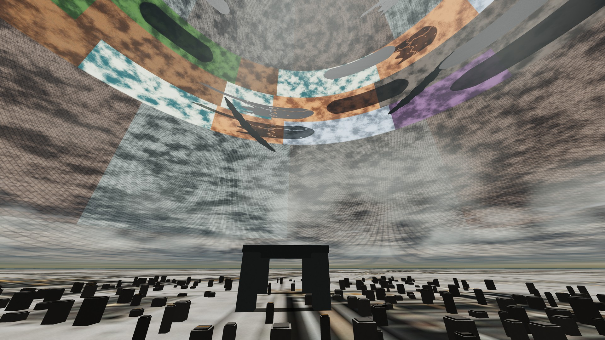

*The Sphere from the polar court, freshly photographed in v1.6. [Original 4K image](examples/observatory/hero.png) · [Return to this scene](examples/observatory/hero.json).*

The Sphere is an inhabited Dyson shell enclosing a Sun-sized star at the radius of Earth's orbit. Stand on its inner surface and a world curves above you: continents across the cavity, vast moving Shades between land and star, and Wounds opening into space.

The Observatory is a local exploration app for developing that world. Walk through biome field sites, follow a river from its catchment to a garden terrace, fly beside exposed megastructure engineering, and save a photograph that remembers where you were. It brings worldbuilding, visual storytelling and questions of scale into one navigable instrument.

**v1.6 makes those journeys easier to keep and smoother to explore.** Explore, Journey, World and Capture now share a persistent location strip and clock. Arrivals prepare their destination before committing, Return survives a reload, Wound openings stay clear of stray terrain, and the rendering and traversal pipeline does less repeated work.

**[Download the current build](https://github.com/JoeCauley/sphere-observatory/archive/refs/heads/main.zip)** · **[Run the Observatory](#run-the-observatory)** · **[Take your first journey](#your-first-journey)** · **[Browse the new photographs](examples/observatory/README.md)**

## A journey you can return to

Choose a category, destination and arrival in **Explore**, then Visit. Browsing is a draft: changing a selector does not redirect the trip already being prepared. Cancel stops that trip; Retry keeps the submitted destination. Normal visits preserve your world and lighting choices.

**Journey** remembers committed arrivals, including their world and time. Return retraces them while keeping your current playback and speed preference. Up to 24 earlier visits survive a browser reload, and reopening pauses the clock. Named viewpoints and exported scene files let you keep the places that matter.

| Choose an arrival | Keep the journey |
|---|---|
| 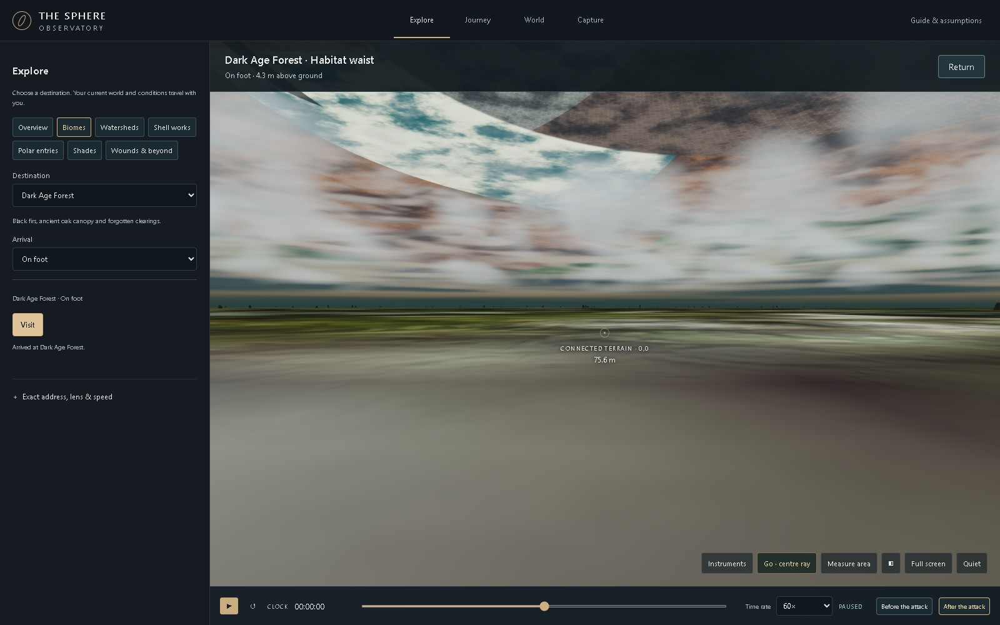 | 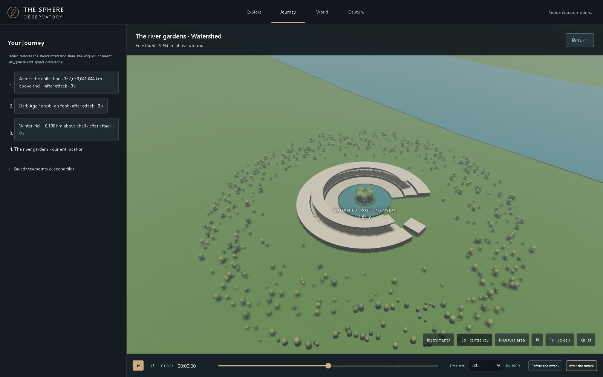 |

The location strip tells you where you are and whether you are walking, flying or following a Shade. Return stays beside it. The clock owns time, playback, rate and historical era. **Instruments** holds speed, altitude, measurement and rendering diagnostics. **Quiet** clears the view; Show controls or Escape brings the interface back.

## Ten landscapes under one sky

The habitat waist contains **Dark Age Forest, Super Jungle, Ultra Desert, Winter Hell, The Ruin, Machine Expanse, Rustwater Marsh, Chalk Archipelago, Mycelium Sea and Violet Labyrinth**. Their geographic regions, surface materials, local formations and atmospheric colours give each a distinct identity.

Arrive **on the ground**, **near the clouds** or **high above the landscape**. Walk across adjoining terrain, jump, lift off and look back. Ground, nearby structures, picking and collision share local geometry; terrain is prepared as you move. These are procedural sample environments, not finished environments across the whole Sphere.

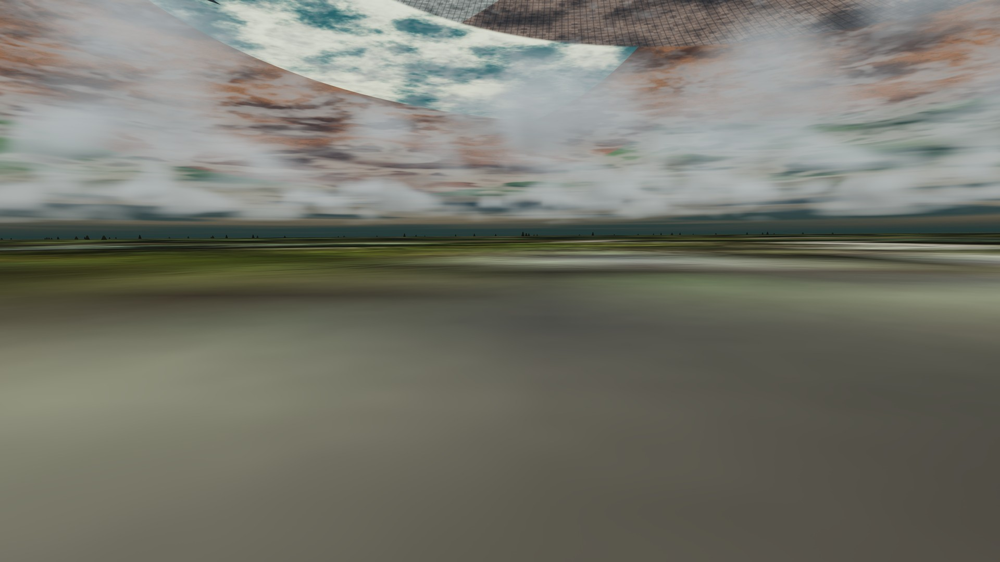

*[On foot in Dark Age Forest](examples/observatory/forest-ground.png) · [Restore the viewpoint](examples/observatory/forest-ground.json).*

| Ultra Desert | Winter Hell |
|---|---|
| 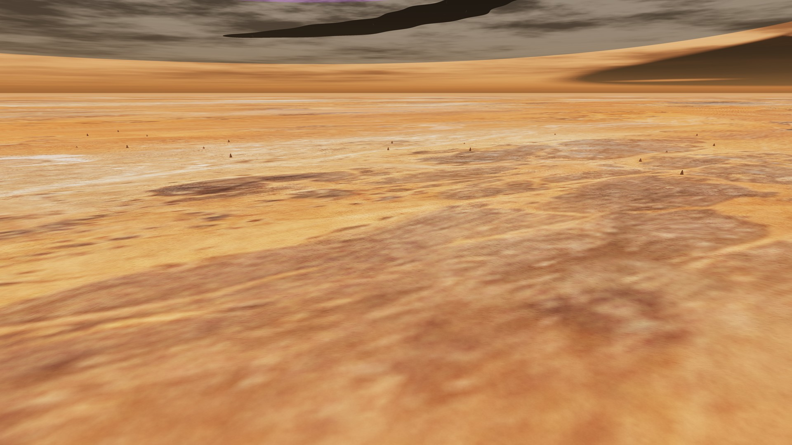 | 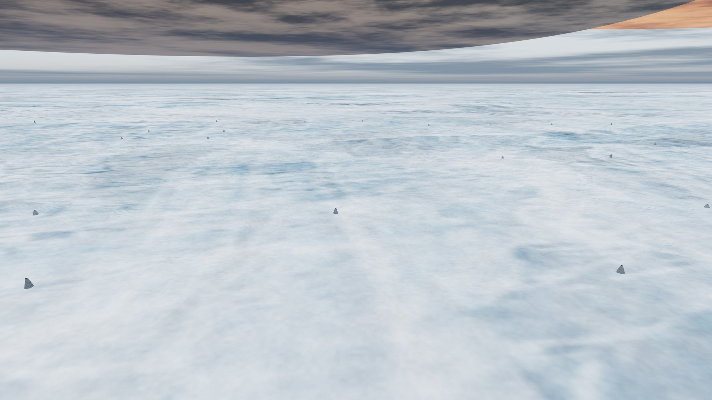 |
| [4K photograph](examples/observatory/ultra-desert.png) · [Scene](examples/observatory/ultra-desert.json) | [4K photograph](examples/observatory/winter-hell.png) · [Scene](examples/observatory/winter-hell.json) |

## Follow a Watershed down to the garden

A connected neighbourhood surrounds the **640 km river-garden province**. Catchments lead toward receiving reaches, river country, water gardens and curved Builder terraces. Geography has a saved address and seed, so moving between scales brings you back to the same country.

Choose **Explore → Watersheds → Watershed · the river gardens**, then an arrival. The six view presets descend through 40,000 km, 10,000 km, 1,100 km, 48 km, 1 km and a terrace view 6 m above its floor. **On foot** is a separate seventh arrival.

| Connected catchments · 40,000 km | Receiving reaches · 10,000 km |
|---|---|
| 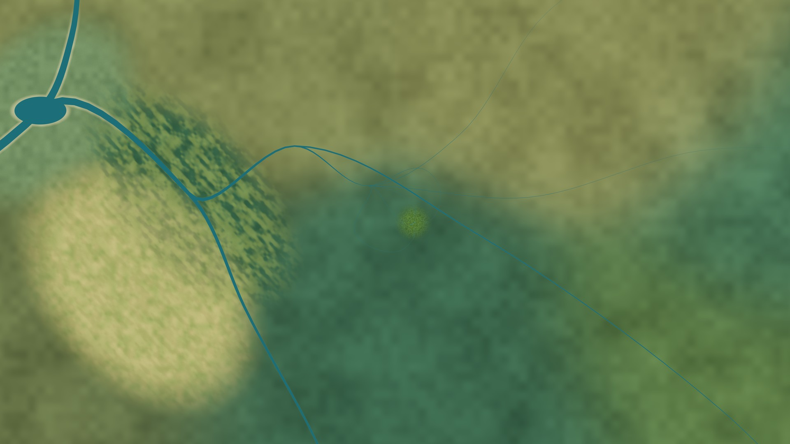 | 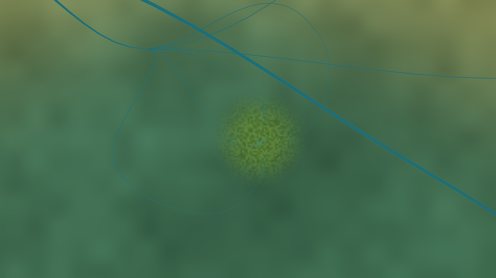 |

| Province · 1,100 km | River country · 48 km |
|---|---|
| 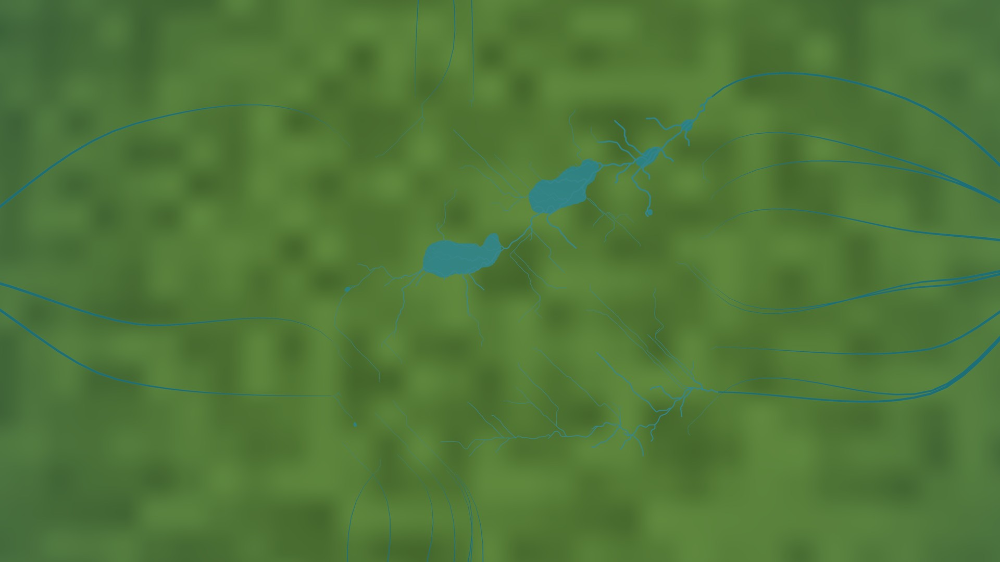 | 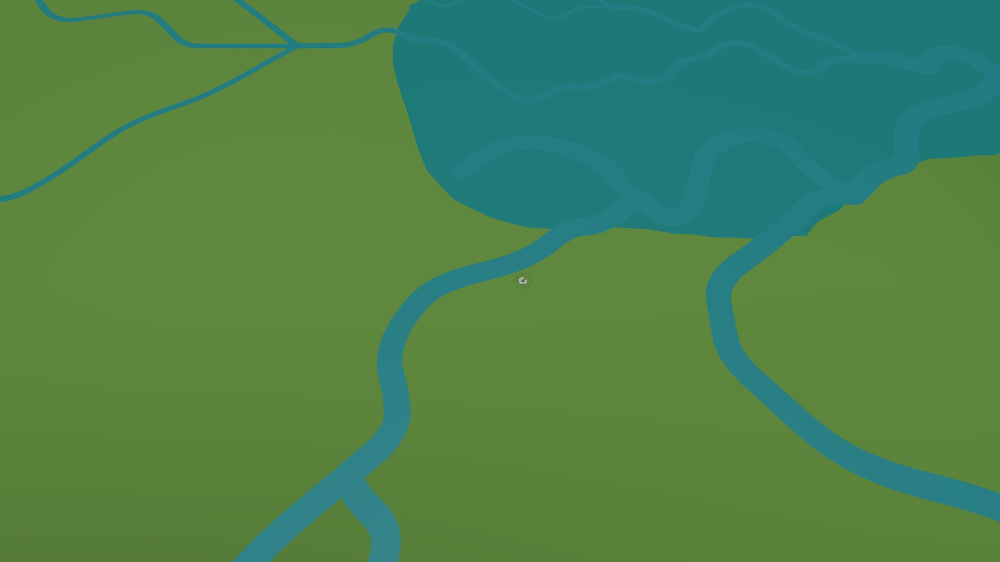 |

| Water garden · 1 km | Open terrace · 6 m above its floor |
|---|---|
| 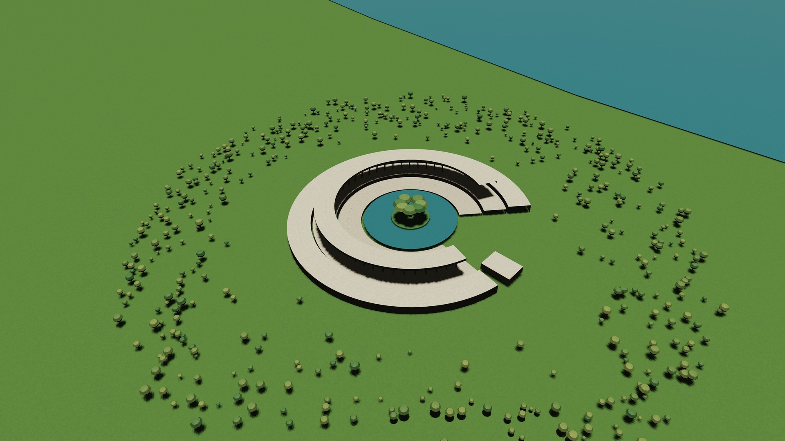 | 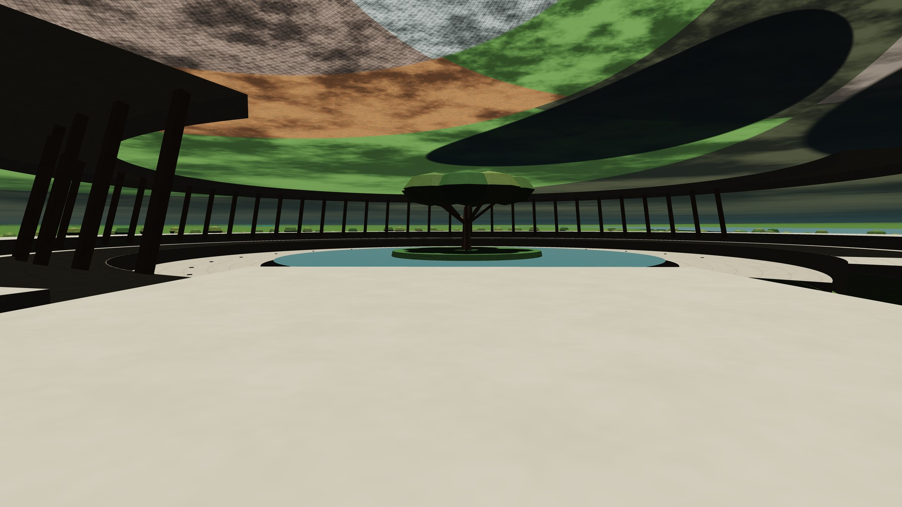 |

The **receiving lake, quiet reach and open meadow** provide three more regional compositions and dry-bank arrivals in that connected neighbourhood. The original garden has the most developed local architecture; detailed shore environments throughout the wider country remain future work.

| Receiving lake | Quiet reach | Open meadow |
|---|---|---|
| 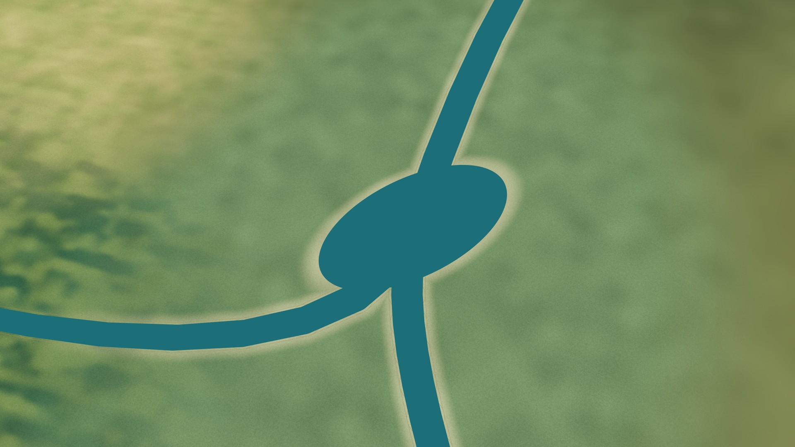 | 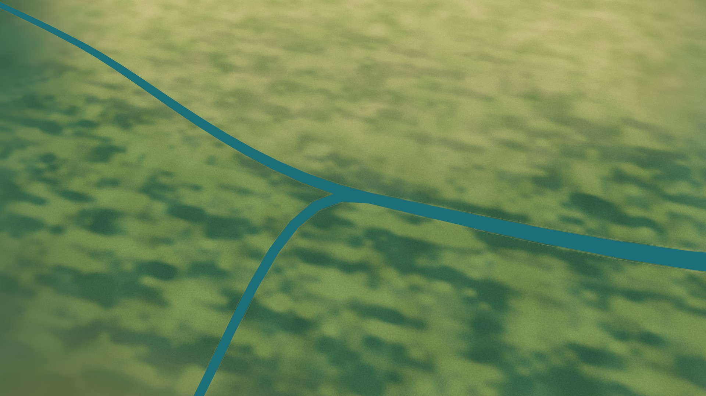 | 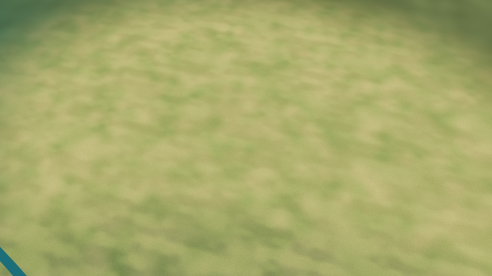 |

**[Restore any of these photographs and arrival heights](examples/observatory/README.md#watersheds-at-six-scales).** Water is a rendered surface over designed geography, not a flowing hydrodynamic simulation.

The current local meadow study is reached through **Explore → Watershed · Open meadow → Meadow study · on foot → Visit**. Explicitly select that arrival after reopening the app, which restores the last scene. IB-075-A–G are complete under their recorded bounded criteria. F2 combines curved detailed blades, many-blade clumps and the actual terrain material, with reviewed walking, rotation, elevation, local-edge and changed-light continuity. G adds coherent geographic wind and continuous pause/resume, rate, scrub, save and capture phase behavior. See the [reviewed G report](docs/evidence/meadow-proof-01/g-wind-timeline-v1-2026-09-30/g-reviewed-report-v2.md), [hands-on lessons](docs/Observatory-Meadow-Progress-and-Lessons-2026-09-30.md), [reviewed F report](docs/evidence/meadow-proof-01/f-canopy-continuation-v2-2026-09-30T20-41-39-185Z/f-reviewed-report.md) and [current ledger state](docs/Observatory-Infinite-Biomes-Ledger-STATE.md). Moving-window integration, seamless infinite walking/flight and overall meadow acceptance remain later work; H measurement implementation is PASS; fixed-resolution performance/resource certification is FAIL, retained CPU-memory attribution is INCOMPLETE and H remains IN PROGRESS. I export/UI certification remains PENDING and I–K remain blocked; B1/acceptedBy are NOT ACCEPTED and M1 is WITHDRAWN. Read [H measurements and required redesign](docs/Observatory-Meadow-Performance-H-01.md).

The selected [H redesign implementation sub-ledger](docs/Observatory-Meadow-H-Redesign-Ledger.md)
will now guide a shared vegetation service: small rendering blocks, persistent
records, compact draw references and progressive replacement, with reusable
interfaces for later Biome Packs. HR-00 through HR-08 are DONE; HR-09 is IN PROGRESS; HR-10 is NOT STARTED. Continue at HR-09 for fresh unchanged-limit H1 certification.
The original planning publication changed documentation only. HR-03 implements
the persistent backend and HR-04 implements [progressive readiness](docs/Observatory-Meadow-HR04-Progressive-Readiness.md).
The retained failed H1 measurement remains unchanged.

Runtime integration uses `SphereMeadow.createProgressivePopulation(state, options)`,
`population.lifecycle.setDemand({fallback, detail})` and
`renderer.setVegetationPopulation(population)`. F2 keeps canonical one-metre
coverage inside the fixed chart. Ordinary Meadow study now explicitly selects
resource/packet/selection tuple (2,2,2) and uses [conservative production selection](docs/Observatory-Meadow-HR05-Selection.md); untagged saved scenes retain their preserved route.
Run `npm run test:ib075:hr05` for selection, native submission and pixel checks.
Run `npm run test:ib075:hr04` for CPU and native
worker/WebGL2 lifecycle checks; use a fresh `IB075_HR04_OUTPUT` to preserve evidence.

The report photograph uses seed 713, Clear weather, Connected walking terrain and a fixed 80° camera. A normal visit preserves your seed, weather and terrain choice; Original local patches can therefore add legacy conifer meshes even with the new grass. The G2 exported scene disables walking and automatic landing for its stationary-camera wind test. To walk the same study, revisit the named on-foot arrival; to land after later flights, enable **Explore → Exact address, lens & speed → Walk when descending below 100 m**. Import portable scene JSON through **Journey → Saved viewpoints & scene files → Import scene**.

The meadow proof occupies a fixed 256 × 256 m area. Nearby grass geometry transitions to clumps and terrain shading with distance; after a high flight, returning may require worker preparation and uploads. Joe reported that grass eventually returned at ground level without entering walking mode. That observation has no measured latency and does not certify seamless return. Read the [progress and lessons](docs/Observatory-Meadow-Progress-and-Lessons-2026-09-30.md) before interpreting a controlled report image as the default arrival.

## Walk beside a Wound. Fly beside a Shade.

Six enormous **Wounds** open through the damaged shell. Surviving terrain stops at the opening; the exposed wall reveals the shell's layered structure. The v1.6 repair removes detached ground slabs and collision floors from the void, while traversal keeps the adjoining terrain prepared.

| On foot beside the opening | Across the exposed shell wall |
|---|---|
| 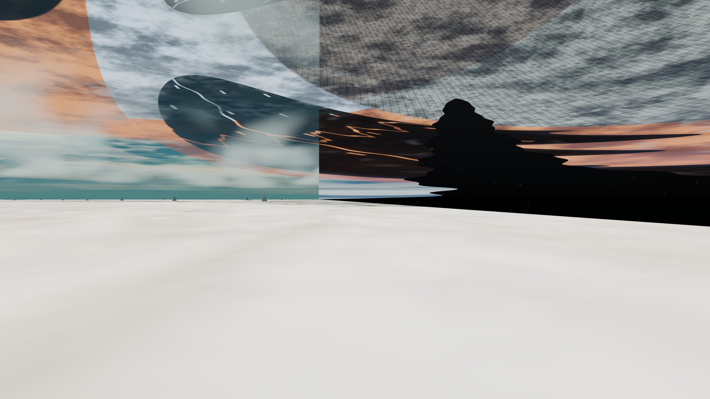 | 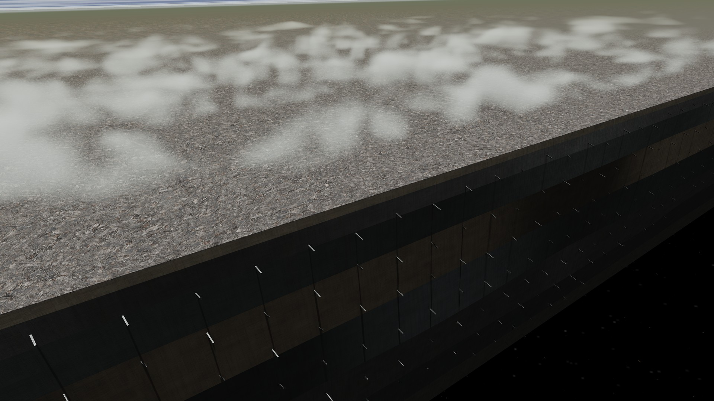 |
| [4K photograph](examples/observatory/wound-ground.png) · [Scene](examples/observatory/wound-ground.json) | [4K photograph](examples/observatory/wound.png) · [Scene](examples/observatory/wound.json) |

**Shades** bring a different kind of scale. Eighteen intact positions occupy three maintained routes, with successive passages at 24, 36 and 60 hours. A Shade's continuous body has two faces **180 m apart**, layered intact perimeters, and exposed braces and recessed layers around damaged boundaries. Edge detail prepares automatically during close flight, including approaches that are not attached to a Shade.

| Finished perimeter | Broken boundary |
|---|---|
| 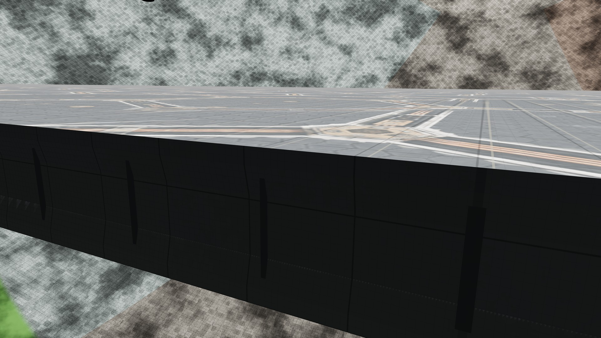 | 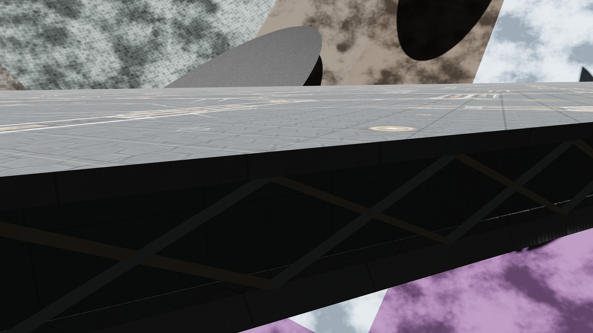 |
| [4K photograph](examples/observatory/shade-intact.png) · [Scene](examples/observatory/shade-intact.json) | [4K photograph](examples/observatory/shade-broken.png) · [Scene](examples/observatory/shade-broken.json) |

Close inspection can follow the moving parent. Full landscapes and walking across both Shade faces remain later work. The current Shade arrival is close flight, and the engineering dimensions are provisional.

Switch **Before the attack** and **After the attack** on the clock to compare the maintained and damaged collection. These are authored historical states. The attack itself does not unfold dynamically. Beyond the openings are exterior debris studies; toward the centre are the star's service rings, and at the poles are bounded entry complexes.

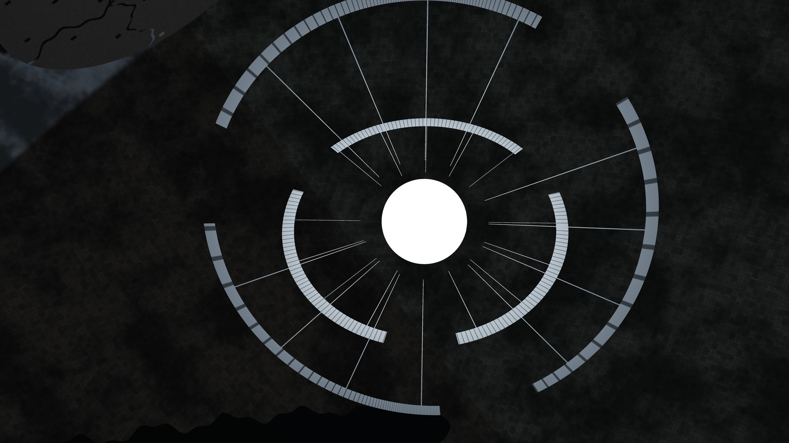

*[The stellar conservatory](examples/observatory/interior.png) · [Restore scene](examples/observatory/interior.json).*

## Light, weather and the far side of the world

Watch the finite stellar disk disappear behind a Shade, or follow its shadow across the shell. Station and Shade occlusion share sampled stellar rays. Coloured first-bounce **ShellShine**, atmospheric scattering and volumetric weather give distant surfaces and local air a changing presence.

In **World**, choose weather or an artistic illumination study, adjust exposure, or open the rendering controls. Ordinary travel keeps those choices. An illumination study changes rendered brightness without changing eclipse geometry.

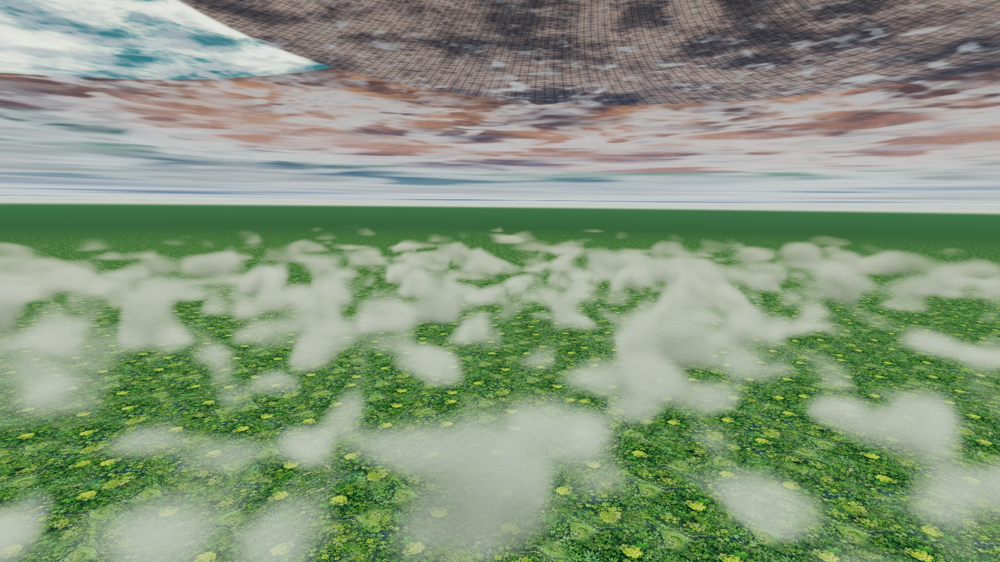

*[Nine kilometres above Super Jungle](examples/observatory/clouds.png) · [Restore scene](examples/observatory/clouds.json).*

## A smoother Observatory

This build fixes preview-frame pacing and terrain-worker restarts at chunk boundaries. It reuses identical lighting and readiness calculations, skips off-camera meshes in the colour pass, and reduces unnecessary station-shading work. Shadow casters, geometry detail, lighting samples and photograph resolution are preserved.

The measured traversal pass used Chrome with hardware-accelerated WebGL 2 on an **RTX 5080**:

| Test | Before | Optimized build |
|---|---:|---:|
| Mycelium Sea ground traversal, 1600 × 900 window | 44 fps | 60 fps |
| All 10 biomes, 6 Wounds and 8 Shade approaches, same window | Some routes missed the target | 59.8–60.1 fps |
| Wound route, fixed-resolution 4K window | 48 fps | 55 fps |
| Heavy inner Shade view, fixed-resolution 4K window | 40 fps | 47 fps |
| Four representative 4K-window routes with adaptive resolution | — | About 60 fps after settling |

These are warm preview draw rates on the tested machine. The 4K window's scene raster was 3504 × 2094 because the controls occupy part of the window. Adaptive preview trades internal resolution for frame rate; exports keep their selected resolution. Cold shader preparation can still take tens of seconds or longer, and the most demanding fixed-resolution views remain GPU-limited.

**[Read the complete evaluation, every route and the remaining limits](docs/Observatory-Performance-2026-09-15.md).** Quality defaults were not lowered to obtain the fixed-resolution results.

## Keep the photograph—and the place

**Capture** can save clean HD, 4K and supported 8K photographs, 360° panoramas, browser-recorded motion studies and named viewpoints. A photograph package contains the image and a scene file with camera, world, time, seed, place identity and build metadata. Capture prepares its assets before drawing, and offers cancellation while preparing.

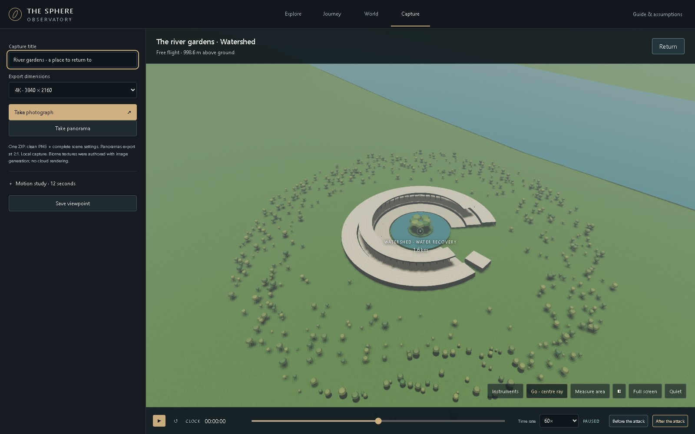

Save portable scenes through **Journey → Saved viewpoints & scene files**. Import a scene there to restore it. Browser history and bookmarks are convenient, but exported JSON is the independent record. Hardware and later renderer changes can affect exact image reproduction.

The [new gallery](examples/observatory/README.md) contains **19 freshly rendered 3840 × 2160 photographs**, their importable scenes, and **three new interface screenshots**. Smaller JPEGs keep this README light; linked PNG originals are untouched app output. Every accepted photograph finishes with two identical prepared frames, and its metadata records all earlier comparisons. This does not claim a general solution to cold-capture repeatability.

No photograph was externally retouched, composited or replaced with a generated image. Some material artwork used inside the app was made with AI assistance; the app performs no runtime image generation. The [v1.5 photographs](examples/archive/v1.5/README.md) and [earlier galleries](examples/archive/README.md) remain available.

## Run the Observatory

Download the [current repository ZIP](https://github.com/JoeCauley/sphere-observatory/archive/refs/heads/main.zip) and extract it. Install **Node.js 20 or later**. On Windows, double-click **Launch Observatory.cmd** to start the server and open the app. Use **Stop Observatory.cmd** when finished.

Or, from the extracted folder:

```sh
npm start
```

Open [localhost:8766](http://127.0.0.1:8766/). Stop the terminal server with Ctrl+C. For another port, run `node serve.cjs 8767` and open that port instead.

Use Chrome or Edge with **hardware-accelerated WebGL 2**. Start at default quality and allow the first view to prepare. World contains preview quality, the frame limit and adaptive resolution. Settled views stop drawing and hidden tabs pause.

There is no application compilation step, runtime dependency installation, account, API key, telemetry or cloud-service requirement. Serve the app over localhost so workers and textures load correctly. Settings stay in this browser; exported scenes preserve them separately.

### Your first journey

1. In **Explore**, choose **Biomes → Dark Age Forest → On foot**, then Visit. Wait for the prepared arrival.
2. Drag to look. **W/A/S/D** move; **Shift** runs or accelerates. In flight, **Q/E** descend/climb and **Z/X** turn. Scrolling selects manual speed.
3. On foot, **Space** jumps and **Space + E** lifts off. In flight, **Space** controls the clock. Descending below about 100 m over solid ground prepares a walking arrival.
4. Click to mark a place and use the pointer action, or press **G** toward the centre ray. Marks retain their geographic or moving-Shade address as you look around. Use **Return** to retrace an arrival.
5. Visit the river gardens at several scales. Compare the eras on the clock, then give your photograph a title in **Capture** and save it.

**Instruments** also offers surface measurements. A rectangle or freehand outline integrates rays over the curved shell, excluding openings and foreground blockers, and reports square kilometres and Earth surfaces. It measures a visible outline on the smooth shell, not mountain relief or unseen connected land.

## A world on an extraordinary scale

| At the default scale | Dimension |
|---|---:|
| Star to inner shell | 149,597,870.7 km — one astronomical unit |
| Across the cavity | 299.2 million km |
| Around a great circle | 940 million km |
| Inner spherical surface | 281 quadrillion km² |
| Equivalent Earth surfaces, including land and oceans | About 551 million |
| Central star's diameter | 1,391,400 km |
| Light crossing the cavity | 16 minutes 38 seconds |

These dimensions describe the mathematical shell before subtracting its openings. They do not imply finished terrain on every square metre. Light-crossing time is a scale reference; the renderer evaluates light instantaneously. The free camera can exceed light speed because it is an exploration tool.

## What is established, and what remains

| Implemented foundation | Present boundary |
|---|---|
| Analytic shell, star and measured intersections | Finite GPU precision and pixel resolution |
| Shared local geometry for rendering, picking and collision | Most of the shell is still an analytic surface with illustrative materials |
| Finite-source eclipses and overlapping blockers | Sampled shadows and uniform stellar brightness |
| Coloured ShellShine, atmosphere and volumetric weather | Approximate transport; no converged global illumination, climate or radiative equilibrium |
| Saved geography, scene revisions and recoverable journeys | Bounded terrain residency; complete authored environments remain future work |
| Maintained Shade routes and historical eras | Prescribed motion; no orbital solution or evolving destruction |

Artificial gravity, shell support, material strength, atmosphere retention, propulsion and heat disposal remain stipulated engineering. Exposure is artistic rather than calibrated photometry. Older scenes keep their saved geometry and art revisions. Strict cold-capture repeatability remains an open diagnostic; prepared gallery repeat checks are narrower evidence.

## Development and further reading

This repository is the runnable browser Observatory. The broader [Sphere project](https://github.com/JoeCauley/Sphere) holds adopted requirements and a separate Unreal application direction. This prototype does not establish that application's acceptance.

Run `npm test` for **52 dependency-free numerical and contract suites**. Browser checks additionally need Playwright and a Chromium-family browser. Configure `SPHERE_URL`, `SPHERE_BROWSER` and, when needed, `SPHERE_PLAYWRIGHT` or `NODE_PATH`. Run GPU checks sequentially.

- `npm run test:integration` — actual journeys, anchored marks, Return and Retry, saved history and responsive controls.
- `npm run test:ib075:hr03` — persistent GPU/slot ownership, real-worker shader/pixel parity, compatible draws and matched blade/clump timings. Use a fresh `IB075_HR03_OUTPUT`; the [GPU contract](docs/Observatory-Meadow-HR03-Persistent-GPU.md) records scope and continuation.
- `npm run test:ib075:h` — fixed 1080p off/on production performance and resource certification; exits nonzero on failed or incomplete budgets. Use a fresh `IB075_H_OUTPUT` directory; `IB075_H_NATIVE_ONLY=1` records a separate adaptive viewport observation.
- `npm run test:performance` — all-biome, Wound and unattached Shade traversal measurements.
- `npm run test:performance-visual` — station-ray parity and culling image comparisons.
- [v1.6 build notes and verification](docs/releases/v1.6.0.md)
- [Performance evaluation](docs/Observatory-Performance-2026-09-15.md), [travel integration](docs/Integration-2026-09-15.md) and [Wound repair](docs/Wound-edge-repair-2026-09-15.md)
- [Project documentation index](docs/README.md)
- [Infinite Biomes ledger](docs/Observatory-Infinite-Biomes-Ledger.md), [current state](docs/Observatory-Infinite-Biomes-Ledger-STATE.md), [bounded meadow specification](docs/Observatory-Meadow-Bounded-Proof-01.md) and [reviewed F continuation](docs/evidence/meadow-proof-01/f-canopy-continuation-v2-2026-09-30T20-41-39-185Z/f-reviewed-report.md)
- [Roadmap](docs/Observatory-Roadmap.md), [Biome Packs](docs/Observatory-Biome-Packs.md) and [Watershed design](docs/Observatory-Watershed-Province.md)
- [Shade bodies](docs/Observatory-Shade-Body-03.md), [lighting and materials](docs/Observatory-Materials-13.md), and [technical evidence](docs/evidence/)

Created by **Joe Cauley**, with AI-assisted development. Reproducible rendering reports, scientific corrections and hardware/browser results are welcome; include a saved scene when possible.

No reuse license has been selected. Public repository access does not itself grant a software license.

## Hands-on wind appearance feedback · 30 September 2026

Joe reported that at **1×** the wind looked good, with abundant grass visibly waving. He also observed **alias shimmer** and said **shadows still need work**. This is positive qualitative appearance/motion feedback with two unresolved visual issues, not a measured frame result or explicit B1 acceptance. The existing production light/visibility/shadow connections do not prove that the visible meadow has sufficient cast/self-shadow detail. Retain shimmer and shadow adequacy as follow-up observations within the authoritative work order; no shader fix or new gate closure was made in this documentation update. See [progress and lessons](docs/Observatory-Meadow-Progress-and-Lessons-2026-09-30.md).

## HR-08 integrated review - 3 October 2026

**Completion - 3 October 2026.** HR-08 is DONE. [Integrated contracts and F/G review](docs/Observatory-Meadow-HR08-Integrated-Review.md), [delivery report](docs/evidence/meadow-proof-01/hr08-integration-v1-2026-10-03T12-41-49Z/hr08-report.md) and [verification receipt](docs/evidence/meadow-proof-01/hr08-integration-v1-2026-10-03T12-41-49Z/hr08-verification.json) record bounded record-pressure replacement, pinned-reader fragmentation/splitting, cancellation, corruption/worker failure, backing aliases, incremental compaction, stale generations and full disposal. Real production workers complete a direct 21 m jump, the metre-by-metre return, turn/elevation and 722 packed-byte revisits without reconfiguration. The repeated F density/coverage, 37 frozen still conditions, 381 motion requests and retained native/lossless review pass their bounded criteria. G live motion, frozen/far-only negative controls, roots, rate/scrub/save and latched capture phases pass. Fresh retained/replacement CPU upper bounds are 57.95 / 63.74 MiB under the recorded scope. Full regressions and focused native checks PASS. This is integrated regression evidence, not fresh H1 certification or I/B1 acceptance; HR-09 is next.

Run `npm run test:ib075:hr08` with a fresh `IB075_HR08_OUTPUT` for integrated failure/readiness and ordinary F/G regressions. Visual review receipts are separate from numerical/runtime checks. H1 certification remains HR-09.

## HR-09 certification attempt - 3 October 2026

The [integrated H1 certification runner](docs/Observatory-Meadow-HR09-Certification.md) is implemented and full regressions PASS. The [fresh production result](docs/evidence/meadow-proof-01/hr09-certification-v1-2026-10-03T20-14-59Z/hr09-report.md) is **FAIL**, with all 5400 matched frames, valid unique GPU samples, complete CPU ownership and no page/worker/GL/resolution errors. Resource limits and the measured 63.77 MiB CPU replacement bound pass; CPU, preparation, frame intervals and incremental GPU limits fail. **HR-09 and parent H remain IN PROGRESS; HR-10 NOT STARTED; I-K blocked; B1/acceptedBy NOT ACCEPTED and M1 WITHDRAWN.** The current certification entry point is `npm run test:ib075:hr09` with a fresh `IB075_HR09_OUTPUT`. H1 and E/F/G fixture bytes and numerical limits remain unchanged.


<!-- infinite-industry-ii001-2026-10-13 -->
## Infinite Industry — II-001, 13 October 2026

Infinite Industry 1.0.0 is implemented as a peer of Infinite Meadow in Explore → Biome Packs. The 150 m water works includes a covered hall, operating clarifiers and filtration, a supported 9 m gallery, a recovery routing control and two authoritative hex-boundary corridors. The final contract suite passes nineteen groups; actual browser integration passes twenty-two groups, including exact save/reload pixels, both boundary walks, flight arrival, three clean exits/revisits and the unchanged Meadow adapter. Read [II-001 completion report](docs/Observatory-Infinite-Industry-II001.md) for precise evidence, performance, preservation scope and limits. The review is http://127.0.0.1:8970/. The bounded Watershed Meadow, H1, Biome Pack Service and Unreal statuses remain separate. II-002 through II-006 are not started and require authorization.
