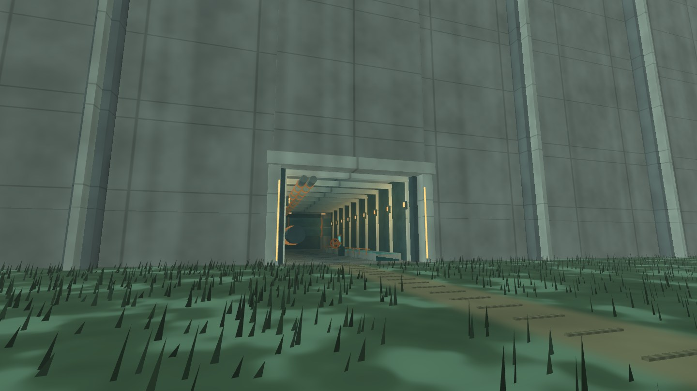
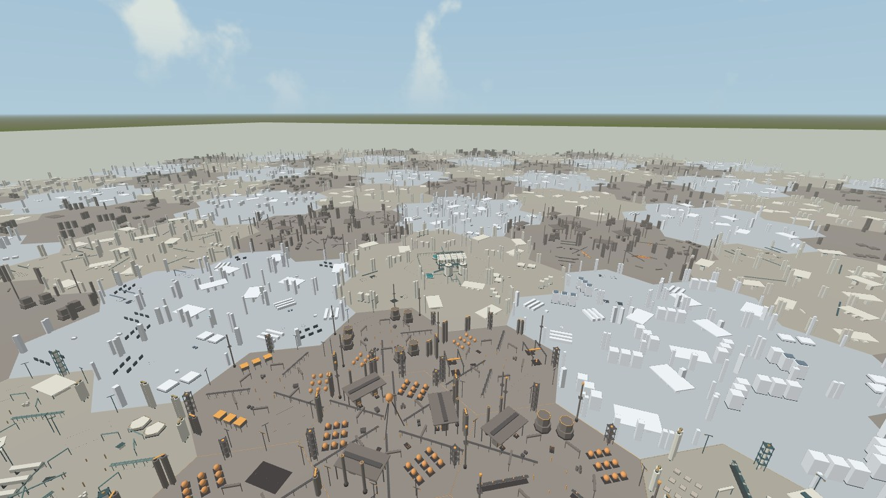
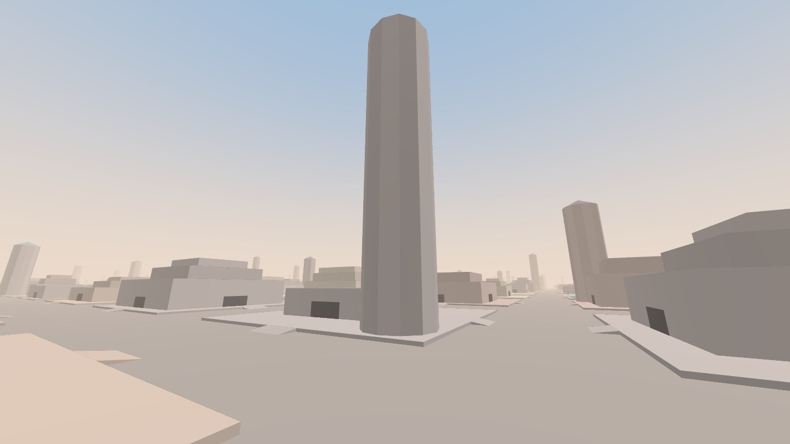

# The Sphere Observatory

Explore four places on the inner surface of a Dyson sphere. Walk through windblown grass, follow hot steel from one factory into the next, and look up at a city built for inhabitants fifty feet across. At the edge of the Meadow, a dry strip of ground leads into an immense wall.



## Run it locally

You need Git, Node.js 20 or newer, and a desktop browser with WebGL 2 enabled. The app runs directly from the checkout.

```sh
git clone https://github.com/JoeCauley/sphere-observatory.git
cd sphere-observatory
npm start
```

Open **[http://127.0.0.1:8766](http://127.0.0.1:8766)**. In **Explore → Biomes**, click **Install**, then **Visit**. Installing **The Outfall** also installs its Meadow. The first visit prepares shaders and terrain. Use the same browser profile and address when you come back.

## A first trip

1. **Start in Infinite Meadow.** Install Meadow and Industry. Visit Meadow, press **F** near the ground to land, and walk past the survey markers. From the scene bar, choose **Fly to Infinite Industry**. The Meadow rises into its Duck Blind and Main carries the camera above the shell to the next plot.
2. **Follow something being made.** In Industry, select **Inspect the hot bar transfer**. Three bars travel from the process outlet to the forming line across a shared hex edge. Walk beneath the belt. Use **Place & inspection → Pause machinery** to stop a bar over the seam.
3. **Try coming home.** Save a distinctive viewpoint, quit the browser, stop the server with **Ctrl+C**, and run `npm start` again. Reopen the same address. The active scene and your last manual position return. A saved bookmark gives you a second position to revisit.
4. **Visit the Border.** Choose **Return to the Sphere**, install **The Outfall**, and visit. Land outside. Follow the dry strip through the opening. When you reach the handwheel, press **E** and watch which section of the channel responds first.
5. **Finish in the Sideways City.** Return to Main, install the City, and visit. A doorway looks unusually wide from street level. Lift above the roofs to see that proportion repeated across the district.

## Inside the biomes

### Infinite Meadow · 1.3.0

At foot height, blades move past the survey posts. From a few metres up, individual blades give way to broader patches that follow the hills. The linked field study holds the camera heading and wind phase fixed while changing the clearance. [Four heights and a moving pan](examples/biomes/README.md)


### Infinite Industry · 1.4.1

A pod has a core and six surrounding facilities. Its temperature, product and scale determine what the district makes. The original water works still lets you divert water to recovery. A nearby hot bar pod now carries its product through two adjoining facilities. In a roofed hall, the developer camera finds a clear exit before climbing.




### The Sideways City · 1.0.0

The roads, plinths, ramps and doorways belong to people who moved sideways. Start at walking height, then look back from the roofline. Empty streets continue into the haze.



### The Outfall · 1.0.0

On the default seed, the opening sits on the northern edge of Meadow plot `r12c35`, adjoining `r13c34` at **13⅓° N, 60° E**. A bypass feeds three channel sections in sequence. Shut it and the downstream section keeps draining. At the back of the gallery, the larger trunk turns along the Border. This visit reaches one service installation on its near side.


## Controls and saves

| Action | Control |
| --- | --- |
| Move and look | **WASD** and drag on the scene. **Shift** moves faster. |
| Fly or land | **Space** starts lift-off. **E/Q** adjust height in flight. **F** lands when the local surface is within reach. |
| Operate equipment | **E** at the Outfall handwheel. **R** at the Industry routing wheel. Both also have on-screen controls. |
| Move between places | The scene bar offers **Fly to…**, **Return to the Sphere**, and the flight sound toggle. |
| Revisit a viewpoint | **Save this place** records a bookmark. Use the pack’s return-to-saved control to recall it. |

The local server writes plot assignments to `installed-biomes.json` beside the app. Each browser profile keeps its own camera, bookmarks and local machinery state. Changing the world seed selects that world's installations and saves. Switching back restores the original set. A second browser profile sees the same installed plots and begins with a fresh camera.

## Verify the build

```sh
npm ci
npm test
npm run test:pods
npm run test:gallery
npx playwright install chromium
npm run test:restart
npm run test:outfall
```

Browser checks launch their own server, profile and temporary install file. Windows users with Chrome installed can run the browser checks with that installation. The restart route, failure recovery, transfer walk, and matched RTX 5080 measurements are documented in the [demo notes](docs/biome-demo.md). The [biome interface](packs/CONTRACT.md) describes how a pack reports readiness, hands off its camera, and saves a place.

The Observatory uses a developer camera to connect local scenes across the shell. The four destinations are playable. Long-distance player transport and passage across the full Border remain design work.
