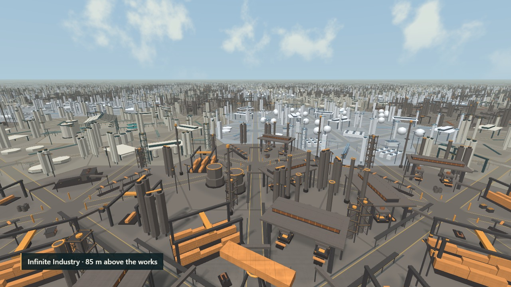
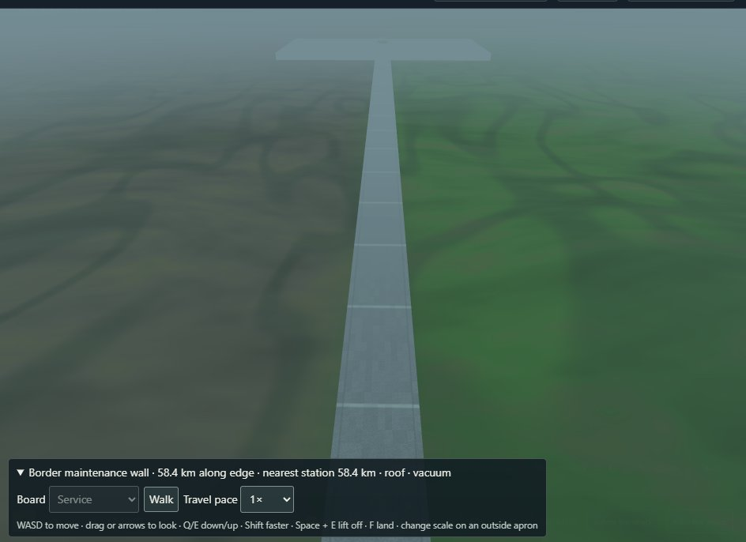
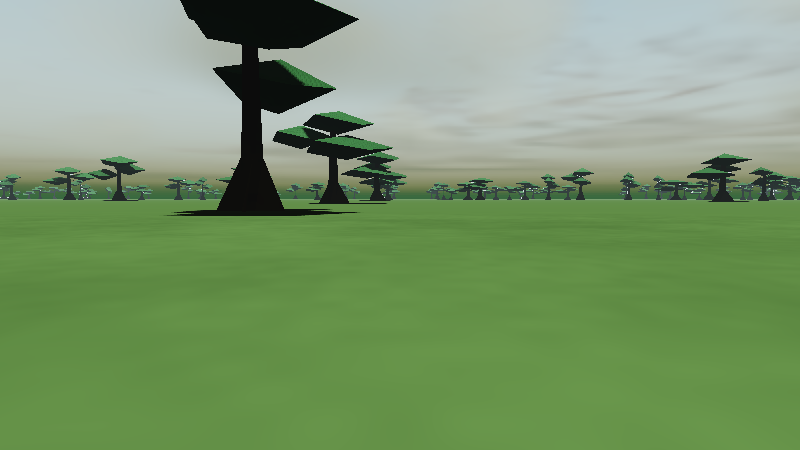
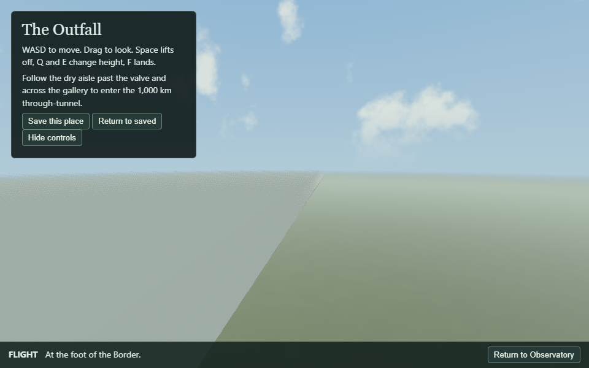
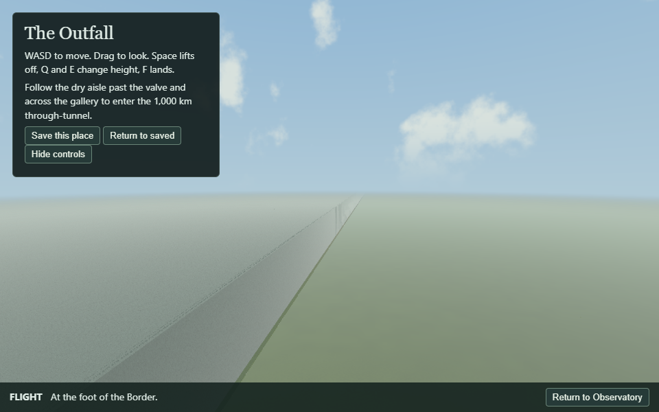
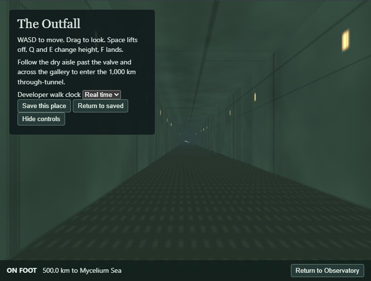

# The Sphere Observatory

Fly inside a Dyson sphere one astronomical unit in radius. From the cavity you can see the inhabited inner surface curve overhead. Descend until the artificial sky takes over, land in the grass, and walk up to a door you could see from kilometres away. The Observatory is a browser-based experiment in making that journey feel like one continuous place.



## Run it locally

Use Git, Node.js 20 or newer, and a desktop browser with WebGL 2. The demo runs directly from a clone.

```sh
git clone https://github.com/JoeCauley/sphere-observatory.git
cd sphere-observatory
npm start
```

Open **[http://127.0.0.1:8766](http://127.0.0.1:8766)**. On Windows, you can also double-click **Launch Observatory.cmd** in the checkout. The first opening prepares graphics. When you choose a destination, a card over the scene names the place and shows which phase is running.

## 1.8.6 · From the roof to the grass

During a manual descent over the Border, the sky and distant steel change together through the approach. From Meadow, the habitat reaches the exterior face. Walk up to a solid panel or enter through a door with sufficient clearance. Grass grows between the paved service approaches. On the native Super Jungle side, patches of climbing vegetation follow the lower concrete.

The Border now uses the familiar biome controls: **WASD** to travel, **Q / E** to descend or climb, **Shift** for speed, **Space + E** to lift off, and **F** to land near a supporting surface. Drag or use the arrows to look. The station travel-pace selector still supports long journeys.

| Descent at 18.4 km | Same approach at 17.8 km |
| --- | --- |
|  |  |

## At the Border · 1.8.5

A Border has two addresses for the neighbouring habitats and a station between them. At a surveyed hall or connecting wall, the same cross-section determines which side owns the air and projected sky.

| Where you stand | Air | What you can see overhead |
| --- | --- | --- |
| Outside either facing wall | The adjoining habitat's air | Its Duck Blind sky |
| Inside the enclosed station | Station air | The structure above you |
| On the roof or inside the open freight well | Vacuum | The real cavity through the opening |

Try approaching a station at eye level from an original habitat, then visit the roof. On foot the native renderer blends distant surfaces into the projected sky using their distance from your eye. Nearby architecture retains its contrast and the local weather passes in front. The surveyed station and its adjoining wall are the implemented cross-section. Corners and unsurveyed edges remain future work.

Super Jungle now grows broad, staggered crowns on the original terrain. Each tree belongs to a fixed geographic cell and shares the resident terrain mesh. The image below is an eye-height capture from a native jungle clearing. The canopy and forest floor are an initial art pass.



## New in 1.8.4 · Follow the wall into Meadow

Fly off the Meadow side of the ordinary freight roof. You can descend to the grass at that same point along the line and look back at the structure. Meadow reuses the surveyed wall mesh between stations. At the station apron, a concrete verge meets the grass. From an original habitat such as Mycelium Sea, the wall now receives Main’s depth-aware atmosphere without a second layer of station fog.

At The Outfall, distant concrete now fades into the terrain and sky along the same line of sight. These captures use the same camera 2.65 km above the apron.

| Earlier build | 1.8.4 |
| --- | --- |
|  |  |

[View back from the grass after leaving the interstation roof](examples/border-frontage/meadow-landing.jpg)

### Try the interstation approach

Try **Fly the seed 713 wall approach** in the installed Border Biome row, or open the link below after starting the server. This reproducible trip selects seed 713 and installs Meadow and Border there. It starts in clear air, 36 km above the surface, aimed obliquely along a maintenance trunk. Its intended landing point is 94 km from the central station. The three stations in this district are spaced 200 km apart.

1. Hold **W** in Main. Watch the roof resolve and the HUD identify the maintenance wall as you descend.
2. Once the Border controls appear, keep flying forward or change your bearing. Use **F** to lower yourself onto the roof, then choose **Walk**. The readout gives your distance along the edge and to the nearest station.
3. Look along the roof. This reach carries freight between halls. Landing here leaves the station discovery record untouched.

[Start the wall flight on localhost](http://127.0.0.1:8766/?border=wall) · [Try the earlier freight-quay approach](http://127.0.0.1:8766/?freight=along)

The surveyed roof, local geometry and flight-entry check use the narrow trunk between the wider halls. The rest of the Atlas shows a much larger transport network. Detailed free-flight encounters currently cover the installed district. This build also includes Meadow apron depth corrections, legacy terrain occlusion, distance fog on the walls, a condensation effect during humid handoffs, and a separate walkable spiral-interchange design study.

## What you can explore

| Experience | What to try |
| --- | --- |
| The shell | Fly the cavity, inspect moving Shades, survey Wounds and polar entries, or mark a point and fly to it. Measure a curved surface area and adjust illumination, weather or simulation time. |
| Original habitats | Visit the Atlas regions, walk on local terrain, follow watershed banks and explore the Violet Labyrinth. |
| Infinite Meadow | Walk among procedural grass, lift off, skim the terrain or cruise toward the Border. |
| Infinite Industry | Follow a working hot-bar transfer across two factory districts, walk under the feed line and pause the machinery. |
| The Sideways City | Follow broad streets and low doorways through a city built for inhabitants with different proportions. |
| The Outfall and Border Biome | Operate the gallery handwheel, cross the long tunnel, enter a freight hall through its service door, or land between stations. |
| Journey and capture | Return to saved viewpoints, revisit a station by address, export a scene, photograph a panorama or record a short 4K clip. |


## Border Biome 0.10

In **Explore → Walkable biome packs**, install **Border Biome** and choose **Visit**. The guided flight lines up with the service door and stops 12 metres outside it. Select **Walk** and press **W** to enter. On either apron, **Board** changes your scale and takes you to the matching doorway. The service footbridge overlooks the moving freight, the heavy route passes below it, and the monumental route crosses the lane at grade. Follow the covered trunk to another addressed hall. The Atlas records a hall on first entry and uses that record when you return. [Open the engineering study](studies/border-crossing/index.html) · [Watch freight from the bridge and the lane](examples/border-crossing/freight-views.mp4) · [Fly from Meadow, walk through the door and look back](examples/border-crossing/meadow-to-border.mp4) · [Fly from the Border to Meadow](examples/border-crossing/border-to-meadow.mp4) · [Scale drawings and test results](docs/Builder-border-crossings.md)

You can also approach from above. This flight starts on foot in Meadow, leaves the atmosphere under manual control, lands off-centre on a 48 km station, and crosses the far wall into native ground. The camera follows the walker off the concrete and up the adjoining terrain. [Watch the manual roof crossing](examples/border-crossing/manual-roof-crossing.mp4) · [Route and measurements](docs/Builder-border-crossings.md#manual-flight-over-the-roof)

The return film begins at that last frame in **Super Jungle**. Cross the far apron toward the amber V, pass between Outfall's ribbed concrete walls and pipework, then follow the service bridge over the freight lane. The last turn looks back through the opposite door from Meadow. Captions show the travel pace and playback speed. [Walk the 48 km station from Super Jungle to Meadow](examples/border-crossing/outfall-return.mp4) · [Compare the service doorway before and after](docs/Builder-border-crossings.md#on-foot-from-super-jungle-to-meadow) · [Industry streaming and the Super Jungle renderer plan](docs/Surface-renderer-plan.md)

## Infinite Industry

Descend 4.2 km into the hot bar district, turn back at 85 m, then land on the service lane and walk under the feed line. The shafts and roofs visible on approach are the same structures you reach on foot. At the presses you can see through the four posts to the die. Select **Infinite Industry** in **Walkable biome packs** to visit. [Watch the 52-second flight and walk](examples/industry-field/skyline-to-service-lane.mp4) · [Compare the two builds on ALPHA](docs/Surface-renderer-plan.md#industry-from-skyline-to-service-lane)


## Watch the transitions

| Demo | Length | What to watch |
| --- | ---: | --- |
| [Outfall to Infinite Industry](examples/transitions/outfall-to-industry.mp4) | 0:57 | Watch the Outfall wall fall away, cross the shell, then descend through works vapour until individual factory roofs and conveyors resolve. |
| [Through the Meadow service door](examples/transitions/meadow-service-door.mp4) | 1:10 | Level cruise reaches the foot of the wall, the pilot lands, and the walker enters the pipe gallery and operates the valve. |
| [Through the tunnel into Violet Labyrinth](examples/transitions/into-violet-labyrinth.mp4) | 0:19 | Walk the accelerated 1,000 km passage and emerge at eye height among the purple crystal spires. |

The earlier four-pack flight survey covers all twelve directed links in that release. The walking survey uses three sets of bearings across three installation states. [Download all 48 recordings and camera traces](https://github.com/JoeCauley/sphere-observatory/releases/download/transition-films-44875365674/Sphere-Transition-Survey.zip) · [Read the frame analysis](docs/Transition-audit.md) · [Compare the Ruin and Violet outlets before and after the repair](examples/transitions/outlet-before-after.jpg)

## A first trip from Meadow to Outfall

1. Open **Explore** and find **Walkable biome packs**. Click **Install** beside **The Outfall**. That also installs **Infinite Meadow** on its adjoining plot.
2. Click **Visit** beside **Infinite Meadow**. In the Meadow controls, choose **Fly the final 2.7 km**. The camera lines up with the service opening and cruises at 180 km/h. The approach takes about 54 seconds. Look around as the grass gives way to the dry strip at the foot of the wall.
3. Cruise stops outside the door. Hold **Q** to descend, press **F** near the ground to land, then use **WASD** and drag to look. Walk through the opening. At the handwheel, press **E** and watch the three water sections respond in sequence.
4. Follow the dry aisle straight across the pipe gallery. In the through-tunnel, the **Developer walk clock** goes up to **10,000×**. The far door opens onto the neighbouring landscape when its ground can support the walker. You can save halfway and return to the same tunnel.

The short approach is available even when the Meadow's full **Level cruise to the Outfall** route would take years at ordinary speed. The recording shows the last 2.7 km and the walk through the door. [Watch the 70-second crossing](examples/biomes/meadow-outfall.webm)

## Photographs from the four earlier packs

| Infinite Meadow · 1.3.0 | Infinite Industry · 1.4.1 |
| --- | --- |
|  |  |
| Pass the survey posts on foot, then rise a few metres and watch the grass resolve into patches that follow the hills. | Select **Inspect the hot bar transfer**. Three bars travel between two hexagonal facilities. Walk under the belt or pause the machinery with a bar over the seam. |

| The Sideways City · 1.0.0 | The Outfall · 1.0.0 |
| --- | --- |
|  |  |
| Look at a doorway from street level, then lift above the roofs. The same broad proportions repeat across a city built for people who moved sideways. | Outside, you can land on the wall. Inside, the service gallery follows the Border in both directions. The dry through-aisle crosses it. |

For more views, see the factory districts from above, the city tower from the street, and the same Meadow field at four heights. [Biome photographs and films](examples/biomes/README.md)

## Travel and saves

**From the Sphere.** In **Explore**, choose **Biomes**, select a habitat such as **Violet Labyrinth**, choose **On foot**, and click **Visit**. You can cancel a Main trip or retry a failed load. To enter an installed pack in free flight, descend through **24 km** over its footprint. The Atlas and local views overlap down to **18–20 km**, depending on the atmosphere. A level lateral entry below **20 km** also opens the pack. Climb through **24 km** to rejoin Sphere flight. The Outfall entrance occupies the shared border of its anchor plot. [Original habitats and their development plan](docs/Biome-Pack-Migration.md)

**Between packs.** Install two destinations to see **Fly to** controls in the scene bar. Try **Fly to Infinite Industry** from the Meadow. Meadow mist and industrial vapour each have their own procedural cloud layer. The City and Outfall use clear-air altitude layers. The camera keeps its geographic position and bearing through the exchange. **Return to the Sphere** leaves the pack.

**On foot.** Most changes of surface region open an Outfall passage. The surveyed Outfall roof and ramps also let a walker cross over the structure, and connected watershed banks preserve their own walking path. Both doors use the adjacent landscapes' coordinates and colours. If a building obstructs the proposed outlet, the entrance aims the straight tunnel at nearby open ground. The far door also works in reverse.

| A Visit to Violet Labyrinth | Halfway through a border crossing |
| --- | --- |
|  |  |

**Coming back.** The local server records installed plots in `installed-biomes.json`. Your browser profile remembers the active scene, manual viewpoint, bookmarks and local machinery state. Use **Save this place** for a bookmark. To resume after quitting, start the server and reopen the same address in the same browser profile. A second profile shares plot assignments and starts with its own camera.

## Earlier 1.8.0 walking measurements

**Nine accelerated browser walks** each made a signed 360° revolution. Together they crossed **159 rendered tunnels** and **168 ground legs**, visiting all **four installed packs** and **14 Main surface regions**. The largest distance from a starting point after a full lap was about **0.17 mm**. The test advances the camera in long strides on the globe, samples local ground on each leg and exercises both doors of every crossing. [Walk records, bearings and rendering checks](examples/biomes/surface-walks.json)

On the same RTX 5080 and Chrome 157, the first on-foot Visit to Violet Labyrinth went from **96.36 s to 42.27 s**. A fresh opening still took about **38.4 s** to reach its first prepared frame. Reopening a saved place took **5.07 s** in the release. These are individual browser runs against the preceding local build. [Measurement conditions and reproduction](docs/Surface-maturity.md#measurements)

## Run the checks

The demo needs only Node.js at runtime. To run the development checks, use the following commands from the checkout.

```sh
npm ci
npm test
npm run test:gallery
npx playwright install chromium
npm run test:transit
npm run test:border:browser
npm run test:walks:browser
```

The browser suites use their own server, profile and install register. `SPHERE_WALK_SEED` selects another reproducible set of bearings. [Walking test guide](docs/Surface-maturity.md#reproduce) · [Pack interface](packs/CONTRACT.md) · [Persistence and factory tests](docs/biome-demo.md)
