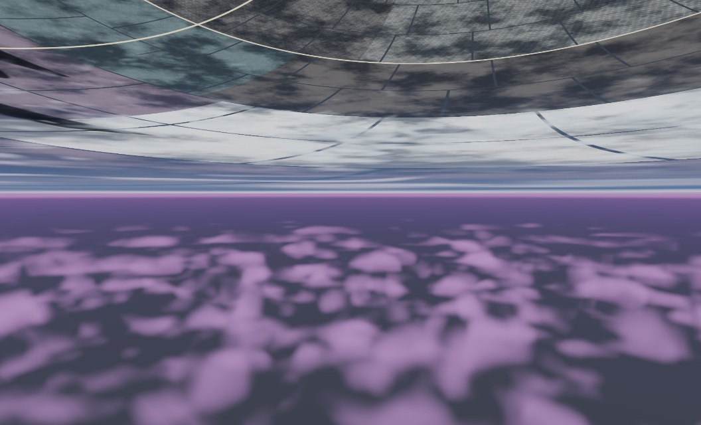
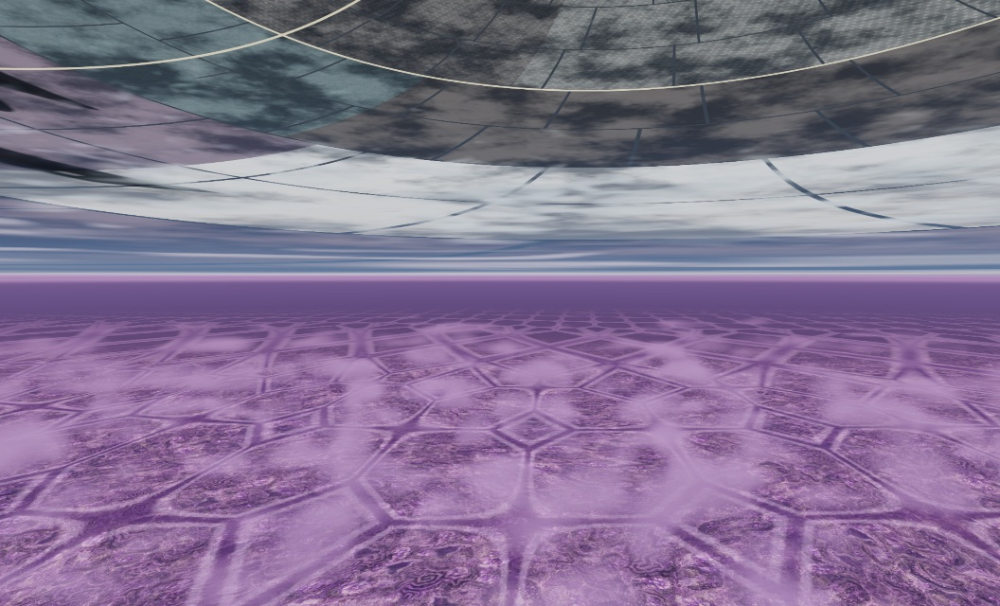

# Bringing the ten original habitats into the walkable Sphere

The original Observatory gives each habitat a name, a geographic distribution, a palette and a surface study. An installable pack adds somewhere you can actually land, walk and return to. The first conversion should be **Violet Labyrinth**. Joe’s flight at 11.4 km exposes the distance where a mineral province must still read as connected terrain. The same place should make sense from 200 km, from either side of a streamed ground tile, and from the bottom of a canyon.

## The flight that exposed the gap

These two native WebGL frames use the same Violet Labyrinth position, viewing direction, 80° horizontal field of view, 11.355 km altitude and mineral-aerosol weather. The earlier atlas substituted its soft orbital colour pattern for the distant ground. Main now carries the geographic surface and kilometre-scale mineral fractures through low flight, including across the edge of detailed terrain. As new artwork loads, the shell and the terrain tiles also use the same blend on each frame.

| Earlier local renderer | Current low-flight renderer |
| --- | --- |
|  |  |

A second pass loaded all 25 connected terrain tiles around the Violet landing site. The same view was checked on the first frame of new artwork and again at full detail. [View the flight with all 25 tiles loaded](../examples/biomes/violet-ground-handoff.jpg)

## What stays fixed

Keep the habitat IDs, seeds, saved addresses and original art. An explorer who revisits a marked location after an upgrade should recognize the same drainage, ridges, clearings or machinery. The original studies are available in [the archived Observatory revision](https://github.com/JoeCauley/sphere-observatory/tree/770fe91549bbfa4955c5b7250f33a9e2f82649ce). The ten habitat names describe geographic regions. A separately installed site can occupy one plot within a region. For example, Infinite Meadow can be installed in one Super Jungle plot. The other Super Jungle plots still need their own habitat.

## Conversion order and field tests

| Order | Habitat and stable ID | First walkable landscape | Follow one feature between scales |
| --- | --- | --- | --- |
| 1 | Violet Labyrinth · `violet-labyrinth` | Amethyst ridges with exposed facets, branching passages and crowns at ridge junctions | Pick a fork from 11.4 km, descend beside one arm, walk through the fork and climb out along the other. |
| 2 | Ultra Desert · `ultra-desert` | Long dune crests, interdune salt and exposed basalt | Follow a dark outcrop down through a dune saddle to a salt hollow. |
| 3 | Winter Hell · `winter-hell` | Broken ice shelves, crevasse walls and a wind-scoured upper surface | Follow a fracture seen from altitude to a walkable margin and measure the drop. |
| 4 | Chalk Archipelago · `chalk-archipelago` | Stepped limestone, tide lines, shoals and lagoon water | Circle a single island, land on its chalk shelf and approach it again from the lagoon. |
| 5 | Rustwater Marsh · `rust-marsh` | Copper shallows, raised banks, dark channels and algae | Follow a channel junction seen from above into the reeds and cross where the banks meet. |
| 6 | Dark Age Forest · `dark-age-forest` | Black fir ridges, old oak stands and open glades | Find a canopy gap from above, land in its clearing and walk beneath its surrounding trees. |
| 7 | Super Jungle · `super-jungle` | Distinct crown groups, layered canopy, buttresses and openings to the floor | Descend through a mapped opening to a particular trunk and see that crown on the way back up. |
| 8 | Mycelium Sea · `mycelium-sea` | Branching luminous beds, raised fruiting bodies and darker low ground | Follow a luminous branch from flight to a junction on foot under two lighting conditions. |
| 9 | The Ruin · `ruined-shell` | Broken districts, exposed foundations, debris and traversable streets | Identify a collapsed block from above, enter the ruin through a street and exit by its foundation. |
| 10 | Machine Expanse · `machine-expanse` | Service trenches, linked machines and amber conduits | Follow one visible conduit down to a working machine and trace its return through the trench. |

The first four exercise terrain silhouette, collision, water and ice. The vegetation habitats then add canopy and ground-level cover. The last two need connected structures you can enter. Infinite Industry and the Outfall already provide examples of moving equipment and walkable service galleries. Walking across a geographic habitat edge opens a 1,000 km Outfall passage with local colours from both sides. The accelerated circuit tests cover the native habitat surfaces while their individual packs are developed. [Surface walks](Surface-maturity.md)

## How a conversion reaches the main flight view

1. **Establish the place.** Select a real seeded habitat plot and an adjoining unoccupied plot. Record both addresses, the flight heading, a bookmark, and reference images at 200 km, 11.4 km, 100 m and eye height.
2. **Give orbit and the ground the same terrain.** Generate ridge lines, rivers, canopy gaps or trenches from the same world coordinates. Render the broad features in Main and progressively add height, occlusion, material and collision in the pack. A feature crossing a tile or plot edge uses the same samples on both sides. Draw a simplified view of each recognizable landmark before its detailed mesh comes into range.
3. **Fly in and back out.** Descend by hand at the centre, in a corner and along a shared border. Fly out at the original bearing. Land on both sides of a tile seam, save, restart and walk back to the mark. Compare another seed and a low-detail graphics setting. Keep the historic address working when its pack is absent.
4. **Roll out by habitat.** Expose the pilot as an installable pack for its own habitat. Bind additional occurrences to their own seeded plot data and per-place saves after the pilot passes. Keep special installations such as Meadow, Industry and City as individual sites. A border can own its structure and still draw terrain and vegetation from its two neighbours, as the Meadow side of Outfall does today.

Acceptance for Violet is a flight from the exact low-orbit view to a recognizable fork and a walk back out. The material handoff repair in Main is a step toward that flight. A complete Violet pack still needs landform geometry, landmarks, collision and a versioned save of its own.
