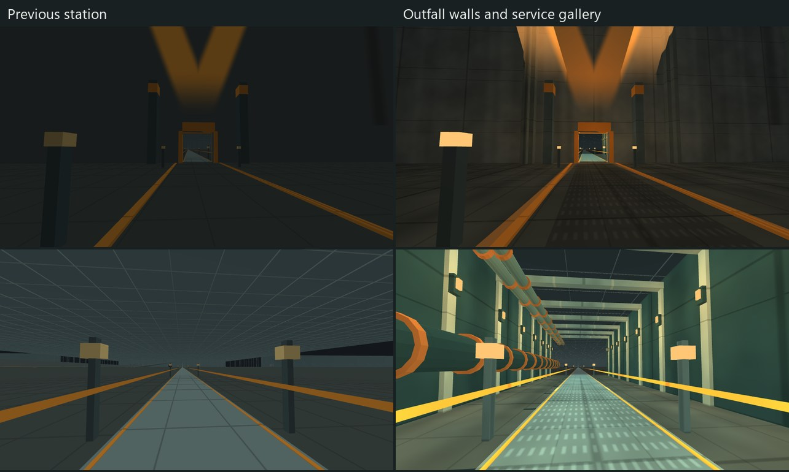

# Builder Border crossings

A walker who approaches a wall from the other biome should find the same doors. For each load size, the doorway, turn, ramp, crossing and outlet must fit the traveler. A narrow maintenance door can lead to a valve and stop there. A traveler can follow the wall to a crossing that goes through.

[Watch the same freight passage from the bridge and lane](../examples/border-crossing/freight-views.mp4) · [Open the interactive study in a running checkout](../studies/border-crossing/index.html) · [Previous transition audit](Transition-audit.md)

## Installed district in 0.10.0

Install **Border Biome** in the Observatory’s **Explore** panel. **Visit** descends through clear air to the middle station’s service apron. Select **Walk**, then use W/S to advance or back out and A/D to move sideways. Drag or use arrow keys to look. **Fly** and R/F let you explore vertically. The roof underside is at 1,700 m and its walkable top is at 1,745 m. A flyer can land there from above. The station’s artificial lighting guides the traveler under a shaded sky.

The pack selects an east–west plot pair, preferring a shared edge beside Meadow when it is already present. Either neighbor may remain native. Three surveyed halls have centers 200 km apart on a sufficiently long edge. A 3.8 km wide covered freight line connects them. Each hall is 32 km along the line and 40, 48 or 56 km across it. The Atlas uses the active sphere radius to fit the district to the available edge and can fit fewer halls on a smaller world. Main and the pack render the same roof footprint. Junctions with further edges and a planet-wide connected interior remain future work.

On an apron, **Board** selects one of the four traveler envelopes and its marked portal. Travel pace accelerates the traveler. The freight follows the Observatory clock. Pausing Main holds the load in place while you can keep walking. The first physical entry or landing on a station roof records its layout. A flyover only reads the survey. The local Observatory keeps this journal beside its install register. Static hosting keeps it in the browser. A remembered viewpoint is separate from the shared station record.

The production movement test crosses 144 routes using the collision solver, including all four scales from both sides, three layouts and two sphere radii. Twelve additional walks follow the freight line end to end at service eye height. Each of these walks covers 432 km and crosses both joins. The browser test installs from Explore, uses Visit, walks through the service door, backs out into the adjacent renderer and walks back to the same station. The older study remains available for synchronized freight observations, opposite-direction clearance tests and reproducing its film.

The pack keeps one hall and one freight mesh resident. Assigning an Atlas record to an unchanged preview reuses both GPU buffers. Freight moves through a draw offset. A paused, stationary view reuses its last rendered frame. On ALPHA, five timed runs of 200,000 route length and position queries gave a median of 180 ms in the study and 15 ms with cached segment lengths. The summed positions agreed. This measurement covers CPU route queries.

On ALPHA the middle Transfer Yard opened onto Infinite Meadow. Walking back through its service door recovered the same discovery timestamp after restarting the server. In a fresh world, a separate flight entered above a different bay, landed at an eye height of 1,746.7 m and climbed back into Main. The eight pack files total 49,402 bytes. [Installation and traversal measurements](../examples/border-crossing/installed-0.10.json) · [Service entrance in the installed build](../examples/border-crossing/installed-service-door.png)

The clear-air departure prepares the regional view while the camera is still on the apron. In the five-pack browser run, the first camera motion came at 6.35 seconds. The 18–24 km dissolve then produced 87 compositor pictures with a longest gap of 29 ms. Before warming the view, the same band produced three pictures with a 2,786 ms gap. The 48.25-second delivery contains 1,158 decoded frames. The analyzer flagged zero cuts, black frames or graphics-context losses. [Watch the Border-to-Meadow flight](../examples/border-crossing/border-to-meadow.mp4)

### Meadow approach and doorway

From Infinite Meadow, choose **Border Biome** as the flight destination. The camera turns toward the surveyed service apron as it descends. Regional flight and the local station use the same bearing, lens and roof outline in the 18–24 km overlap. The final approach follows the marked pavement to a hover 12 m outside the opening. [Watch the full Meadow flight and doorway return](../examples/border-crossing/meadow-to-border.mp4) · [Read the before-and-after measurements](../examples/border-crossing/meadow-flight.json)

The original flight reported success despite a climb from 1,000 to 1,500 km during descent. On foot, crossing 14 m outside the door gave control to Meadow, erased the station and lowered the eye by roughly 5 m on seed 713. Meadow now grades its ground to the station slab and draws the surveyed hall into its own depth buffer. The field, pavement and door share the same sightline when the walker changes biome.

The browser regression measures descent height, checks that the projected roof appears above the local overlap, and samples the two amber jambs and adjacent concrete after Meadow takes control. It then walks forward into the same recorded station and flies back to Meadow. The separate native-ground test backs out on a world with only Border installed and checks that the station remains visible there as well.

## What we recovered

The earlier Atlas proposal puts trunks along both edges of the habitat waist and six meridians. It reserves 20,000 km on either side of a plot edge and assigns 60,000 km to a trunk. Those numbers describe an early layout. The earlier transport discussion also included fixed links called Spans and rare multi-destination stations. I found no settled dimensions for the four object exits. [Earlier Atlas proposal](Observatory-Biome-Library-2026-11-12.md)

Three dimensions deserve independent entries in the Atlas. A transport district can contain habitats and sidings over a vast area. A particular walk has a measurable distance between two faces. The central freight hall has a local roof clearance. The study uses **40, 48 and 56 km** between faces and **1,700 m** from the center slab to the underside of the roof. The earlier Outfall service gallery retains its surveyed 1,400 m roof and 1,000 km passage. At 1.5 m/s, walking the 48 km site takes almost nine hours. That is a reason to give a traveler a choice of services.

## Four operating clearances

Sizes are trial engineering envelopes. A transporter with a load uses the widest and highest parts of the whole moving assembly. The study tests door width and height, grades, floor support, overhead structures, and the length of time needed for the trailing end to clear a level crossing. A person can use a larger portal if there is a connected path for a person on the other side.

| Class | Reference moving body, width × height × length | Clear opening, width × height | Route through the yard |
| --- | --- | --- | --- |
| Service | 2.4 × 3 × 3 m | 4 × 4 m | A personnel or small maintenance door leads to a footbridge. A lookout branches off and rejoins the deck. A second service aisle reaches a refuge beside the center lane. |
| Carrier | 12 × 10 × 24 m | 18 × 14 m | Passengers, vehicles or pallet freight use a level loading bay and a broad viaduct above longitudinal traffic. |
| Heavy haul | 80 × 56 × 150 m | 120 × 80 m | A mobile plant or substantial freight carrier descends a ramp into a cut-and-cover passage beneath the working slab. |
| Monumental | 720 × 480 × 1,200 m | 1,000 × 680 m | A complete machine or oversize assembly enters a holding apron. The transfer takes the level slab when a scheduled gap will accommodate the entire load. |

The *longitudinal* freight filmed here is 1,800 m long, 660 m wide and 470 m high. It travels along the Border at 4 m/s. One observer standing still takes 7½ minutes to see that load pass. The reference 1,200 m monumental body in the table travels **across** its path. These two movements make different demands on the building.

The three station layouts vary approach length, the width of the central reservation, bridge heights, depth of the heavy cut, and the length of the level aprons. These change sightlines, grades and waiting time. On the 48 km site the service bridge is 720 m above the slab, the carrier viaduct is 670 m above it, and the heavy floor is 138 m below it. The center floor can be reached through a service aisle from the same service door. Upper and lower spaces have distinct elevations at a shared place.

## How a station keeps its address

The station key contains the world identity, the two adjoining plots in canonical order, and a signed station index along their shared edge. The index advances every 200 km in this study. Where latitude rows have different numbers of plots, the overlap of the particular pair supplies the actual edge segment. The wraparound meridian has one address from both sides. A local coordinate includes the level above or below the freight slab. The station maps both door sockets back to spherical coordinates.

Looking at a place on the survey or preparing a distant view reads a deterministic preview. **Entering the station** writes its resolved dimensions, door and ramp coordinates, layout version and freight timetable to the local Atlas journal. The server publishes one complete record atomically. Simultaneous arrivals from either direction receive the same record. A later generator reads the frozen dimensions when a visitor returns. Current traffic position is calculated from the world clock and a schedule shared along the edge. Installing a pack or entering from the other side supplies no new roll. The study uses one fixed-radius, one-AU world frame. Its journal is shared by browsers using the same Observatory server.

The production walking controller currently creates many ordinary passages at the coordinate where the traveler crossed a habitat boundary. It uses the incoming bearing to project the far mouth. This explains how a complete great-circle walk can pass without establishing that another traveler can independently discover the same entrance. The study exercises fixed station sockets. Its viewer constrains movement to the selected path. Network-wide free walking, joints between consecutive stations, and production collision handoff to these sockets are the next integration work. [Current walking handoff](../stage-frame.js) · [Fixed station model](../studies/border-crossing/station.mjs)

## What Main shows from the cavity

On this branch, the inner surface shader draws a roof deck with longitudinal service strips. Its branch and trunk trial widths are 48 and 96 km. A surveyed roof, including the existing Outfall footprint, overlays the regional material. The old right-of-way widths remain available to the Atlas. A subpixel roof contributes its projected fraction to a pixel. Oblique viewing, resolution and field of view all affect this fraction. The covered freight lane has no visible traffic stripe on the roof. No new texture images are required. The detailed station bulges and junctions still need to be published to Main as surveyed structures. [Main surface material](../biome-surface.js)

## What the second camera caught

The first film put a human on the centerline of the service bridge. At the matched instant the freight occupied **8.6%** of the viewport in the 990 × 690 browser test. The deck hid much of the machine. A physical observation bay now branches off the foot route. Moving the observer to a supported spot close to the outer rail put the load in **20.3%** of the viewport at the same clock time. The lane observer has an eye 1.7 m above the slab and sees the same load from below. The film is a 16-second engineering view with both clocks advanced 40×. It was made on desktop Chrome on ALPHA's RTX 5080. The capture cadence measures the study film.

The visual test renders a second, depth-tested image that identifies visible freight pixels and their surface orientation. A train hidden behind a deck contributes zero pixels through that deck. At the matched instant, 34.3% of visible freight pixels in the bridge view came from upward-facing surfaces. At the lane refuge that fell to 0.3%, and 1.5% showed the underside. The test checks both views at three times and checks the direction the freight moves across each picture. An independent test measures the actual vertices of the cargo against its transport envelope.

The numeric pass exercised **96 station addresses across four world keys**, all three station layouts, **768 directed class crossings**, **192 additional floor-service crossings**, and **1,536 door-fit comparisons**. The steepest measured main-route grade was **3.859%**. In a race between 16 discoveries, the journal produced one station record. A fresh browser load restored it. The older 48 flight and walking films remain attached to their recorded runtime revision. [Measured views and shader samples](../examples/border-crossing/witness-measurements.json)

## Manual flight over the roof

The seed-713 flight begins on foot in Meadow outside the service entrance. The pilot climbs into the cavity, flies across station zero on the edge between `r10c0` and `r10c1`, offsets sideways, and looks down to land. After walking the roof, the pilot lifts off, crosses the far wall, lands on its exterior apron and walks onto the adjoining native terrain. A final turn from the ground looks back at the same station. The setup uses **Visit** to find the near apron before recording. All travel in the film uses the ordinary flight and walking controls. [Watch the complete route](../examples/border-crossing/manual-roof-crossing.mp4) · [Read the measurements](../examples/border-crossing/manual-roof-crossing.json)

The earlier build changed the entire sky as a shallow turn crossed one pitch angle. For the same 0.23° turn in the regression scene, the mean RGB change in the sampled view went from 11.7% to 3.0% of the channel range. The regional station now reveals the cavity by sightline.

The earlier build also generated native terrain through the far apron. In a cold landing probe, the surface stood 7.6 m above the surveyed concrete and 34.8 seconds elapsed before the walker advanced four metres. The Builder survey now supplies the elevation for native terrain triangles and walking support across the paving, then grades into local relief over 96 m. A cold arrival keeps the view visible while it finishes preparing collision. A small status appears in the corner during that interval.

The 92-second ALPHA take peaks at 40.06 km. The walker covers 227 m on the roof at a steady eye altitude of 1,746.70 m, then walks 200 m from the far apron onto the native terrain. At the final position the ground has risen 6.05 m and eye clearance is 1.72 m. The camera turns 179.9° and sees the far facade from 3.61 km away. All 2,211 frames decoded. The analysis found zero candidate cuts or black frames, and the graphics log was clear. The small collision-preparation status was visible for about 0.43 s.

The low-contrast sections still deserve attention. From about 1:07 to 1:26 the walker advanced 114 m off the apron, but successive images in the sampled centre of the viewport changed very little. The shaded roof also offers few cues to altitude when looking straight down. The recording and position trace capture both effects.

To reproduce the film, run `node tools/film-border-roof.cjs films/manual-roof 713`, then `python tools/analyze-transition-films.py films/manual-roof`. The recorder creates a disposable world by default. To record an installed world, set `SPHERE_URL` to its running Observatory and supply its seed. That world needs Meadow beside Border, with native terrain beyond the far apron. The compact demo preserves the full ALPHA timeline. The browser suite also measures a 0.23° turn in both directions, checks the visible service-door jambs and walks from the paving onto supported ground in a second world. [Browser regression](../tests/border-horizon-browser.cjs)

## On foot from Super Jungle to Meadow

The return begins at the last camera position in the manual roof film, on the native ground of seed 713. The service entrance is 3,610 m ahead of the walker and 1,500 m to the side. The station's wide openings are visible first. The amber service marker leads onto the paved approach, where the vertical ribs, form joints, wet streaks and steel grating resolve at walking distance. Both service vestibules use the Outfall's lamp bays, pipe collars and roof crossmembers. The ribs, sidewalls and low pipe stop a walker in the same places they occupy in the picture.

After restoring the starting viewpoint, the recorder runs the ordinary movement controls. The far-apron run is at 6 m/s. Inside, the 128× survey pace takes the walker along the full 48 km service route. At the centre of the Transfer Yard the eye reaches 721.7 m above the freight slab. The camera turns toward the freight lane, then the walker continues through the opposite door and 22 m out onto Meadow's apron. A final turn from Meadow looks back through the near entrance. Both doorways are shown at real-time playback. The captions identify the accelerated stretches. [Watch the return](../examples/border-crossing/outfall-return.mp4) · [Camera positions and performance measurements](../examples/border-crossing/outfall-return.json)

To record the walk in a disposable local world, run `node tools/film-border-return.cjs <output-directory>`. The recorder needs Playwright, Chrome or Chromium and FFmpeg. Set `SPHERE_FFMPEG` to the executable if needed. [Industry streaming, Super Jungle and renderer experiments](Surface-renderer-plan.md)

The film uses a disposable install with the original seed and station address. We compared the generated station field by field with both the saved record used for the outward film and the record in ALPHA's installed Atlas. All three station models matched. The two saved journals also agreed on the original discovery time.

The compositor recorded 15 minutes 51 seconds of travel and camera movement. The published film plays for 2 minutes 2 seconds. Both editions decoded all 2,928 frames, with zero black frames, detected cuts or lost graphics contexts. The final turn measured 179.9° at a fixed position 22.03 m beyond the Meadow-side wall.

## The next connected-world pass

1. Turn each continuous, supported patch of habitat into a node for each movement class. Connect nodes only through fitted physical sockets. Add longitudinal segments, corners, unequal-row junctions, roof access and surveyed detours around breaches. A local service dead end is fine when its habitat still connects to the through network. Compare forward and reverse reachability for the whole graph. Include timed access and a bounded wait wherever a moving load controls a crossing.
2. Film **24 terrestrial traversals** from three layouts × four classes × two directions. Keep common starting poses and clock times for before-and-after comparisons. Include deliberate wrong doors, turnarounds and returns after restart. Rotate empty, placed-only and installed pack states across the cases. Keep the in-between travel available at true speed as well as an explicitly marked survey time-lapse.
3. Film **eight atmospheric and cavity approaches** from two bearings (along and across), in clear and thin haze, with cold and warm local scenes. Each take banks, holds altitude, reverses, then lands or departs. Track the same roof corner in the orbital material, the local scene and the collision model. Record projected corner position, depth, occlusion, world clock, terrain contact, sky lighting and frame times. The same object should disappear behind the same structure from either renderer.
4. Use **four detour films** for a wound bypass in both directions, a T-junction where row counts differ, and a closed loop that returns to the same door after a restart. This makes **36 primary films**. The two synchronized freight views are extra instruments on selected takes. Run the graph tests over many more seeds and bearings than the cameras can cover.

The release criterion for anywhere-to-anywhere walking is a supported path between every pair of reachable walking surfaces in the declared world, with the permitted detours and return journeys. The traveler must be able to find and follow that path through ordinary controls. The last audit showed why destination coordinates, screenshots, and time-series measurements all belong in that proof.

## Try the study

Start this checkout with `node serve.cjs 8792` and open `http://127.0.0.1:8792/studies/border-crossing/index.html`. **Enter and record station** freezes its layout. Choose a class and use W or S, or **Walk forward**. The inspection slider moves the observer to either end. The bridge and lane views share the same clock. **Preview a freight passage** selects an observation time in the existing timetable. The rate control advances passengers and freight together.

`npm run test:border:stations` runs the numerical and browser checks. `node tools/film-border-trunk.cjs` records the synchronized film and its matched frame. The recorder accepts `SPHERE_FFMPEG` for an FFmpeg executable outside PATH.
