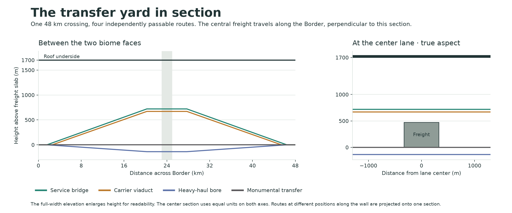

# Builder Border crossings

A walker who approaches a wall from the other biome should find the same doors. For each load size, the doorway, turn, ramp, crossing and outlet must fit the traveler. A narrow maintenance door can lead to a valve and stop there. A traveler can follow the wall to a crossing that goes through.

[Watch the same freight passage from the bridge and lane](../examples/border-crossing/freight-views.mp4) · [Open the interactive study in a running checkout](../studies/border-crossing/index.html) · [Previous transition audit](Transition-audit.md)

## What we recovered

The earlier Atlas proposal puts trunks along both edges of the habitat waist and six meridians. It reserves 20,000 km on either side of a plot edge and assigns 60,000 km to a trunk. Those numbers describe an early layout. The earlier transport discussion also included fixed links called Spans and rare multi-destination stations. I found no settled dimensions for the four object exits. [Earlier Atlas proposal](Observatory-Biome-Library-2026-11-12.md)

Three dimensions deserve independent entries in the Atlas. A transport district can contain habitats and sidings over a vast area. A particular walk has a measurable distance between two faces. The central freight hall has a local roof clearance. The study uses **40, 48 and 56 km** between faces and **1,700 m** from the center slab to the underside of the roof. The earlier Outfall service gallery retains its surveyed 1,400 m roof and 1,000 km passage. At 1.5 m/s, walking the 48 km site takes almost nine hours. That is a reason to give a traveler a choice of services.

## Four operating clearances

Sizes are trial engineering envelopes. A transporter with a load uses the widest and highest parts of the whole moving assembly. The study tests door width and height, grades, floor support, overhead structures, and the length of time needed for the trailing end to clear a level crossing. A person can use a larger portal if there is a connected path for a person on the other side.

| Class | Reference moving body, width × height × length | Clear opening, width × height | Route through the yard |
| --- | --- | --- | --- |
| Service | 2.4 × 3 × 3 m | 4 × 4 m | A personnel or small maintenance door leads to a footbridge. A lookout branches off and rejoins the deck. A second service aisle reaches a refuge beside the center lane. |
| Carrier | 12 × 10 × 24 m | 18 × 14 m | Passengers, vehicles or pallet freight use a level loading bay and a broad viaduct above longitudinal traffic. |
| Heavy haul | 80 × 56 × 150 m | 120 × 80 m | A mobile plant or substantial freight carrier descends a ramp into a cut-and-cover passage beneath the working slab. |
| Monumental | 720 × 480 × 1,200 m | 1,000 × 680 m | A complete machine or oversize assembly enters a holding apron. The transfer takes the level slab when a scheduled gap will accommodate the entire load. |

The *longitudinal* freight filmed here is 1,800 m long, 660 m wide and 470 m high. It travels along the Border at 4 m/s. One observer standing still takes 7½ minutes to see that load pass. The reference 1,200 m monumental body in the table travels **across** its path. These two movements make different demands on the building.

The three station layouts vary approach length, the width of the central reservation, bridge heights, depth of the heavy cut, and the length of the level aprons. These change sightlines, grades and waiting time. On the 48 km site the service bridge is 720 m above the slab, the carrier viaduct is 670 m above it, and the heavy floor is 138 m below it. The center floor can be reached through a service aisle from the same service door. Upper and lower spaces have distinct elevations at a shared place.

## How a station keeps its address

The station key contains the world identity, the two adjoining plots in canonical order, and a signed station index along their shared edge. The index advances every 200 km in this study. Where latitude rows have different numbers of plots, the overlap of the particular pair supplies the actual edge segment. The wraparound meridian has one address from both sides. A local coordinate includes the level above or below the freight slab. The station maps both door sockets back to spherical coordinates.

Looking at a place on the survey or preparing a distant view reads a deterministic preview. **Entering the station** writes its resolved dimensions, door and ramp coordinates, layout version and freight timetable to the local Atlas journal. The server publishes one complete record atomically. Simultaneous arrivals from either direction receive the same record. A later generator reads the frozen dimensions when a visitor returns. Current traffic position is calculated from the world clock and a schedule shared along the edge. Installing a pack or entering from the other side supplies no new roll. The study uses one fixed-radius, one-AU world frame. Its journal is shared by browsers using the same Observatory server.

The production walking controller currently creates many ordinary passages at the coordinate where the traveler crossed a habitat boundary. It uses the incoming bearing to project the far mouth. This explains how a complete great-circle walk can pass without establishing that another traveler can independently discover the same entrance. The study exercises fixed station sockets. Its viewer constrains movement to the selected path. Network-wide free walking, joints between consecutive stations, and production collision handoff to these sockets are the next integration work. [Current walking handoff](../stage-frame.js) · [Fixed station model](../studies/border-crossing/station.mjs)

## What Main shows from the cavity

On this branch, the inner surface shader draws a roof deck with longitudinal service strips. Its branch and trunk trial widths are 48 and 96 km. A surveyed roof, including the existing Outfall footprint, overlays the regional material. The old right-of-way widths remain available to the Atlas. A subpixel roof contributes its projected fraction to a pixel. Oblique viewing, resolution and field of view all affect this fraction. The covered freight lane has no visible traffic stripe on the roof. No new texture images are required. The detailed station bulges and junctions still need to be published to Main as surveyed structures. [Main surface material](../biome-surface.js)

## What the second camera caught

The first film put a human on the centerline of the service bridge. At the matched instant the freight occupied **8.6%** of the viewport in the 990 × 690 browser test. The deck hid much of the machine. A physical observation bay now branches off the foot route. Moving the observer to a supported spot close to the outer rail put the load in **20.3%** of the viewport at the same clock time. The lane observer has an eye 1.7 m above the slab and sees the same load from below. The film is a 16-second engineering view with both clocks advanced 40×. It was made on desktop Chrome on ALPHA's RTX 5080. The capture cadence measures the study film.

The visual test renders a second, depth-tested image that identifies visible freight pixels and their surface orientation. A train hidden behind a deck contributes zero pixels through that deck. At the matched instant, 34.3% of visible freight pixels in the bridge view came from upward-facing surfaces. At the lane refuge that fell to 0.3%, and 1.5% showed the underside. The test checks both views at three times and checks the direction the freight moves across each picture. An independent test measures the actual vertices of the cargo against its transport envelope.

The numeric pass exercised **96 station addresses across four world keys**, all three station layouts, **768 directed class crossings**, **192 additional floor-service crossings**, and **1,536 door-fit comparisons**. The steepest measured main-route grade was **3.859%**. In a race between 16 discoveries, the journal produced one station record. A fresh browser load restored it. The older 48 flight and walking films remain attached to their recorded runtime revision. [Measured views and shader samples](../examples/border-crossing/witness-measurements.json)

## The next connected-world pass

1. Turn each continuous, supported patch of habitat into a node for each movement class. Connect nodes only through fitted physical sockets. Add longitudinal segments, corners, unequal-row junctions, roof access and surveyed detours around breaches. A local service dead end is fine when its habitat still connects to the through network. Compare forward and reverse reachability for the whole graph. Include timed access and a bounded wait wherever a moving load controls a crossing.
2. Film **24 terrestrial traversals** from three layouts × four classes × two directions. Keep common starting poses and clock times for before-and-after comparisons. Include deliberate wrong doors, turnarounds and returns after restart. Rotate empty, placed-only and installed pack states across the cases. Keep the in-between travel available at true speed as well as an explicitly marked survey time-lapse.
3. Film **eight atmospheric and cavity approaches** from two bearings (along and across), in clear and thin haze, with cold and warm local scenes. Each take banks, holds altitude, reverses, then lands or departs. Track the same roof corner in the orbital material, the local scene and the collision model. Record projected corner position, depth, occlusion, world clock, terrain contact, sky lighting and frame times. The same object should disappear behind the same structure from either renderer.
4. Use **four detour films** for a wound bypass in both directions, a T-junction where row counts differ, and a closed loop that returns to the same door after a restart. This makes **36 primary films**. The two synchronized freight views are extra instruments on selected takes. Run the graph tests over many more seeds and bearings than the cameras can cover.

The release criterion for anywhere-to-anywhere walking is a supported path between every pair of reachable walking surfaces in the declared world, with the permitted detours and return journeys. The traveler must be able to find and follow that path through ordinary controls. The last audit showed why destination coordinates, screenshots, and time-series measurements all belong in that proof.

## Try the study

Start this checkout with `node serve.cjs 8792` and open `http://127.0.0.1:8792/studies/border-crossing/index.html`. **Enter and record station** freezes its layout. Choose a class and use W or S, or **Walk forward**. The inspection slider moves the observer to either end. The bridge and lane views share the same clock. **Preview a freight passage** selects an observation time in the existing timetable. The rate control advances passengers and freight together.

`npm run test:border:stations` runs the numerical and browser checks. `node tools/film-border-trunk.cjs` records the synchronized film and its matched frame. The recorder accepts `SPHERE_FFMPEG` for an FFmpeg executable outside PATH.
