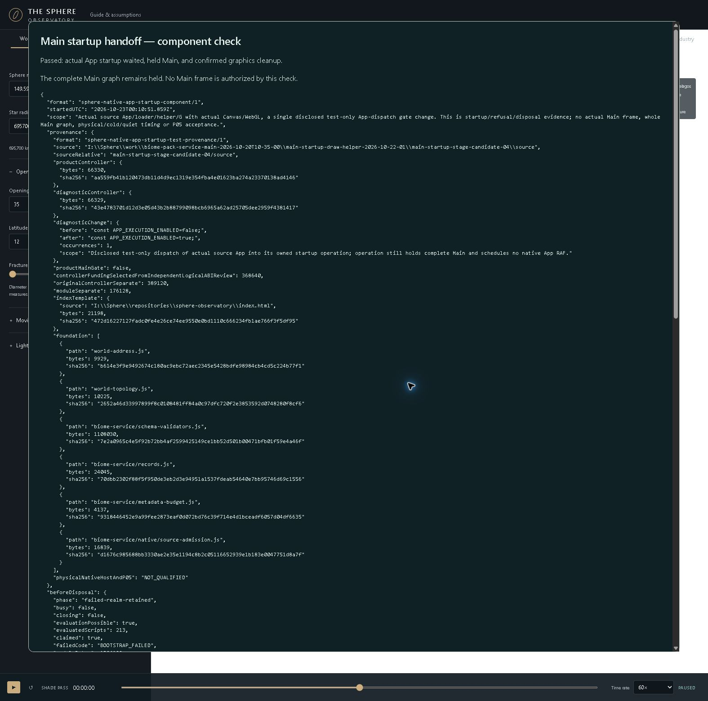

# Main startup drawing helper and App handoff

22 October 2026. Main now has its genuine startup drawing helper and an owned App-to-loader handoff. Chrome confirms that the real App waits for preparation, stops at the incomplete Main gate and cleans up its graphics safely. The delivered Meadow–Industry walk and the separate simulation are unchanged. **P05 remains OPEN.**

The helper compiles the exported positions shaders, links the actual program and prepares its own vertex array on the same owned Canvas and WebGL context as the Renderer. It preserves previous graphics bindings. The App registers its renderer before later UI construction can throw; App and loader share a single startup operation. Reentry, cancellation, source refusal and partial construction retain cleanup roots. Once the real backend has been entered, closing native objects does not falsely erase retained CPU/source ownership.

## Evidence and limits

| Check | Result | What it establishes |
| --- | --- | --- |
| Current C4 source | 521 pinned files; 425 JavaScript parses; three exact source profiles | Exact source identity and closure integrity |
| Focused helper controls | 31/31 PASS | Original helper/Q/S/Renderer paths under disclosed native models |
| App and loader controls | 21/21 PASS | Registration, shared startup wait, refusal, races, captured map disposal and partial cleanup under disclosed DOM/native models |
| Final-stage correction | 18 parent/successor cases, 36 executions; 2 negative original factories PASS | Demanded stage 8 is classified correctly; Main still refuses the unqualified host |
| Current real Chrome component | PASS, 16 helper steps, 213 evaluated scripts, zero Main frames; confirmed native loss and original Renderer disposal | Actual App startup/helper/G and cleanup; complete Main drawing is still held |

The native test has one disclosed change to a copied controller: App dispatch false→true. Product source and prices are unchanged, and the actual startup operation still holds the incomplete graph. This is not the required public fixture/native Main overview/local, assigned-surface, whole-view/fragment/Frame or support proof. It does not qualify original constructor branches, complete cold startup, physical memory or quiet timing. The model and native scopes stay separate.

The first helper-only component also passed two real WebGL cases. Its first module-lifetime allowance had a later counterexample involving the closed helper facade and mutable map dispatch. That attempt remains preserved. The captured-map/App successor and independent review provide the current complete authored-record ownership allowance; earlier functional results were not rewritten.

## Ownership selected for this component

| Logical authored records | Bound | Reserved |
| --- | ---: | ---: |
| New controller/App startup records | 367104 B | 368640 B |
| Inherited controller, separately retained | 387808 B | 389120 B |
| New helper/Renderer/Surface module | 172320 B | 176128 B |
| Live helper | 114848 B | 131072 B |
| Backend and retained realm wrapper | 116576 B | 131072 B |
| Owned Surface including closed helper facade | 79232 B | 131072 B |

Module reservations add to the original 1324128 B and separate retirement 16384 B. Genuine Q bookkeeping and source ownership add separately. These are reviewed logical bounds under the recorded ABI; VM, driver, backing storage and physical heap remain unmeasured. They supply no whole-Main resource cap. The small stage correction adds a future 32 B Baseline capture; full inherited Base work/cold/storage remains unqualified.

## Current bridge scheduling finding

A read-only current-source derivation and independent trace identify a scheduling obstruction **under the explicitly proposed resource/API node vocabulary**. This is not an observed running Main stall: product `ORDINARY_BRIDGE_WORK` is still null and the native Main gate is held earlier.

At stage 7 of the exact joint managed-demanded v7 profile, the visit repeats complete readiness and then retains the four-array batch. Two genuine Surface currency payments are 128 each; the existing batch retain is 3584 and preserves 64 following. Even ignoring every other caller debit, a global bridge visit charge V must satisfy `128+V+128+3584+64 <=4096`, hence `V<=192`. A disjoint subset of the readiness work under the stated node model is 57 native capability rows +54 Construction checks +five Binding.live bodies of 15 +14 fresh Renderer-state records =200. That subset already exceeds 192; it omits the remaining wrapper/native/currentness work. The earlier 42 DemandPort upper envelope was explicitly excluded from this lower-bound proof and is preserved as a corrected attempt. This 192 upper does not apply to standalone demanded v6, which has no Surface lease; its optimistic upper without those fees would be 448.

Actual debits and the conditional source-node lower bound are separate facts. The result does not select a price, certify physical time or prove that the project is impossible. It shows why assigning one flat visit fee to the unchanged source cannot close this proposed work contract.

The next bounded implementation is an exact-profile scheduling/version successor that separates readiness from the expensive batch-retain visit. Reuse the existing private batch cookies, serials, physical keys and admission/native guards. Preserve genuinely fresh demanded completion, plan/origin, context, generation and scope checks; a second ticket is only needed if the existing owned state cannot prove those dependencies. Returning false and repeating the whole readiness path is insufficient. Include metadata/caller prepayment, low-credit deferral, partial faults, replacement and cleanup; independently review the changed graph before selecting its fees. The simulation and delivered walk remain independent and unchanged.

## Defined path from here

1. Implement and verify the exact-profile readiness/batch scheduling split identified above. Complete the four-operation Baseline ledger (admission, visit, use and close), including caller prepayment, original child APIs and partial failure cleanup. Select no table until the changed current-source graph is independently qualified.
2. Compose the genuine demanded-plan/image and Base/Root cold contracts. Reuse the verified planner, exact image/mip recipe and prepared-view prefix; include the external wrappers and preserve the original limits.
3. Qualify the current genuine browser App/World source graph and complete simultaneous viewport/target/Canvas/Field/service/provider/CPU/Q/source resources. A content subtotal is not a whole-host cap. A real nonempty World/Wound demand requires its separately versioned active branch.
4. Demonstrate actual Main overview/local resolving the same assigned surfaces, with whole-view/fragment/Frame and native appearance/support/ownership evidence. This is the remaining P05 exit. P06 public install/continuous travel, P07 session/export/recovery and P08 full conformance/quiet timing/native peaks retain their own later exits.

No broad planner redesign is indicated. The exact C4 four-key graph is now derived and independently checked; the joint managed-demanded v7 stage7 scheduling obstruction has the bounded implementation path above. Product Main execution remains false; P06–P08 are NOT_STARTED and Phase One is NOT_ACCEPTED/NOT_RELEASED.

## Records and preservation

Read the [current component receipt](../analysis/main-reuse-2026-10-22/startup-helper-02/combined-component-receipt-14.json), [native report](../analysis/main-reuse-2026-10-22/startup-helper-02/native-app-report-14.json), [native seal](../analysis/main-reuse-2026-10-22/startup-helper-02/native-app-seal-14.json), [independent funding review](../analysis/main-reuse-2026-10-22/startup-helper-02/independent-review-05.json), [funded source validation](../analysis/main-reuse-2026-10-22/startup-helper-02/funded-selection-receipt-06.json), and [next work map](../analysis/main-reuse-2026-10-22/startup-helper-02/next-work-read-first-01.md). The next-work map predates the separately composed final-stage correction; that tiny correction is now complete. All four substantive bridge fees remain unselected. The subsequent [current-source bridge derivation](../analysis/main-reuse-2026-10-22/bridge-work-03/derivation/CHECK.json) and [independent trace](../analysis/main-reuse-2026-10-22/bridge-work-03/independent-review/CHECK-02.json) identify the scheduling split required by the proposed operation model.

Source lives in `I:/Sphere/work/biome-pack-service-main-2026-10-20T10-35-00/main-startup-draw-helper-2026-10-22-01/main-startup-stage-candidate-04/source`. Earlier C1, unselected C2, funded C3, failed attempts and historical seals remain separate. Source/progress archives are preserved in the private safety checkpoint; historical raw archives remain local by owner selection. Temporary test servers were stopped only after owned script/process checks. The last test-tab close is unconfirmed because browser control became unavailable after saving the pass screenshot; existing user tabs and servers were not operated.

Safety cutoff 9 verifies all 26 source snapshots, 13,452 archived source entries and 2,945 progress records, including a fresh 521-file C4 restore. Earlier snapshot/record rows and the restorer remain exact. The private safety push succeeded at `a7f85f66`; see the [preservation proof](../analysis/main-reuse-2026-10-22/safety-preservation-04.json) and [push/check disposition](../analysis/main-reuse-2026-10-22/check-disposition-05.json). Unrelated Atlas work is preserved.

