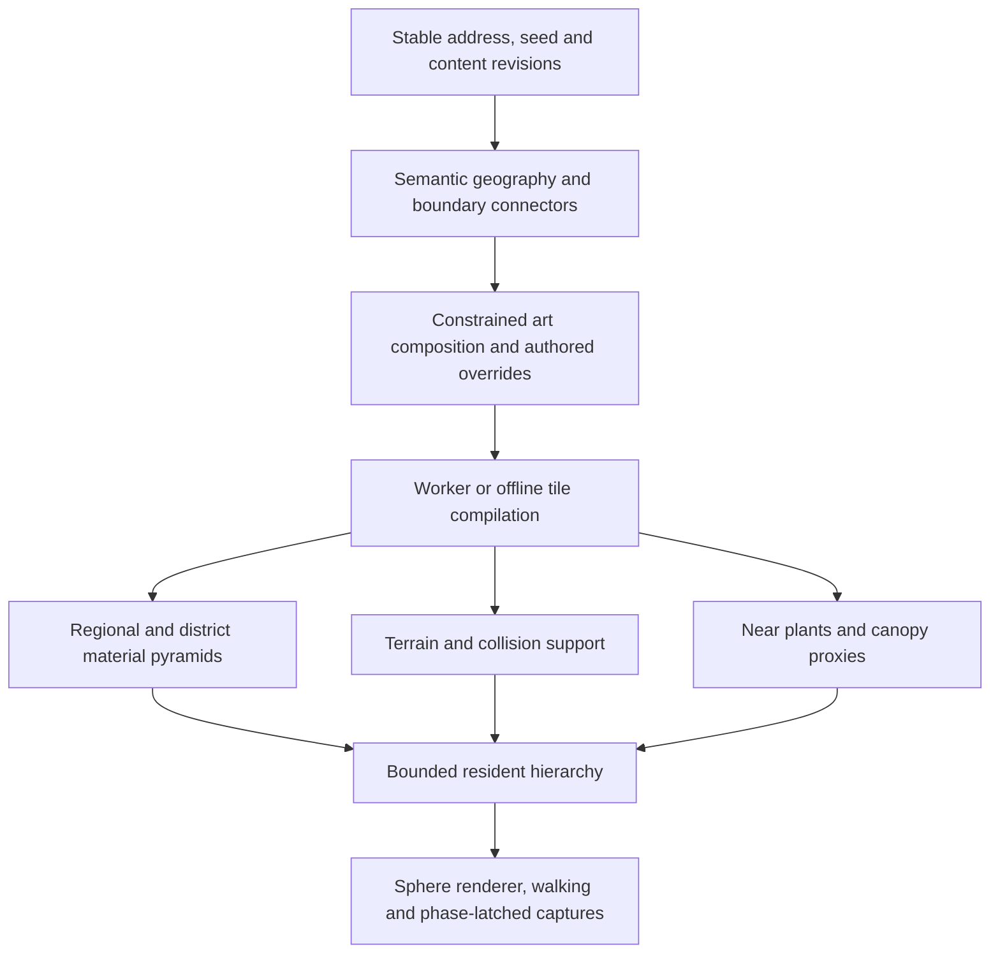

# Endless Meadow and Biome Pack architecture assessment

5 October 2026. Adversarial design review; no replacement implementation or acceptance action.

## Conclusion and decision

**The current implementation does not meet the requirements. The evidence does not establish that the requirements are impossible in WebGL2.** The strongest explanation is an expensive middle-distance representation combined with excessive movement-dependent CPU bookkeeping. Separate measurement and native repeatability problems remain unresolved. Improving one does not dispose of the others.

The design has sound geographic and resource-lifetime foundations. Its middle-distance “clump,” however, still draws 72 individual stems using 1,152 vertices and 864 triangles per instance. Its control path repeatedly constructs coverage preferences and submission plans across a large resident working set. Four grass draws and bounded memory already pass; fewer draw calls or a faster SHA implementation are unlikely to supply the missing factors alone. The latest quiet measurements need approximately 2.2–2.6 times less incremental GPU time, 4.2–5.0 times less moving incremental CPU time, and 7.4–8.5 times less worst-case preparation time.

**Recommended decision:** authorize a small, isolated prototype of a new, explicitly versioned appearance/backend: compiled geographic tiles, updates to changed tiles, retained near blades, and genuinely cheaper middle-distance canopy representations. Keep current performance, density, support, wind, export, continuity and human acceptance requirements. Preserve the old profile and its outstanding failures. First test the expensive representation and scheduling assumptions in isolation; do not start a complete renderer rewrite or nine-pack authoring programme before those tests succeed.

This review supplies that proposal and stop conditions. It does not authorize it, change fixtures, waive the 376-row material failure, promote a candidate, reopen implementation tasks as completed, or advance H/I/J/K, B1 or M1. If the decision instead requires every new implementation to reproduce every F2 float material bit, the proposed new canopy cannot satisfy that additional equivalence constraint. The remaining task would be optimization of the existing representation, with feasibility still unproved.

## 1. Scope, authority and verification

The nested web prototype and the outer project have different contracts. The outer [The Contract](../../../docs/The-Contract.md), [handoff](../../../HANDOFF.md) and [documentation index](../../../docs/README.md) describe the Unreal-oriented local Editor delivery and separate acceptance gates. A passing Observatory meadow would not by itself satisfy that delivery. Moving to Unreal would not automatically discharge its gates either.

For this prototype, requirements come from the [Infinite Biomes ledger](Observatory-Infinite-Biomes-Ledger.md), [state ledger](Observatory-Infinite-Biomes-Ledger-STATE.md), [bounded proof](Observatory-Meadow-Bounded-Proof-01.md), [Biome Packs contract](Observatory-Biome-Packs.md), [H redesign ledger](Observatory-Meadow-H-Redesign-Ledger.md) and immutable fixtures. Earlier dated delivery passages are history, not current acceptance. In particular, older exact-parity PASS statements do not supersede the reopened first-capture failure.

The reviewed checkout was already extensively modified and partly untracked:

| Identity | Reviewed value |
| --- | --- |
| HEAD | 6a52267ddf5d9d49b0f64bc75a6699f671232e77 |
| Runtime source SHA-256 | 7ca67b137100b81c10c3ae173ffab90f0b9054aac99d1bf199fee7e145e59116 |
| Asset-set SHA-256 | 45f67a383ac6ec295844b3bc6ddc40e9a1d661f354d7f406bf82e6519410a91d |
| Version / status | 1.6.0 / local-modified / release false |
| Selection adapter / GPU representation | 3 / 2 |
| H1 fixture SHA-256 | 033caa8013b4c84feb8ef72272afb576a15128df845882796b6eb9a0828d8f71 |

The [latest continuation](Observatory-Meadow-HR09-Map-Preparation.md) was treated as a map to primary evidence. This review independently recalculated the six retained H1 arrays: nearest-rank percentiles, matched nonnegative per-frame off/on increments, completion, pose matching, resolution, GPU validity and 5,400 unique GPU identities. It freshly hashed all 54 retained RGBA32F captures and compared every channel as uint32 bits for all 45 recorded pairs. These calculations agree with the original audits.

The new [offline review receipt](evidence/meadow-assessment-2026-10-05/review.json) records inputs and results; its [reproduction script](evidence/meadow-assessment-2026-10-05/review.cjs) never starts a browser or edits runtime. This is independent analysis of retained measurements, not a new rendering/performance run. Browser row hashes, geometry/depth probes and worker heap attribution were inspected in their original evidence and were not independently rerun here. No all-host/process preservation or historical preservation repair is claimed.

Local skills were consulted for artifact routing and evidence-grounded prose. Their repository-destination rules support saving this report locally; no Library upload or cloud Page was created. No applicable AGENTS.md was found in the inspected ancestor/relevant project paths. Existing runtime, tests, fixtures, assets and documentation were preserved.

## 2. What the requirements actually demand

| Requirement | Concrete contract and implication |
| --- | --- |
| Bounded visual study | A fixed geographic 256 × 256 m domain with a central 32 × 32 m walking/viewing area and ecology boundary blending. Passing this is not an Endless Meadow. |
| Appearance and coverage | Readable curved, tapered near blades; 200–300 blades/m² in eligible near meadow, ordinary study preset approximately 290; no unintended empty eligible 1 m² plots. Foreground grass-ID coverage at least 70% in the frozen ROI, using its depth eligibility and camera protocol. Coverage is necessary, not sufficient for beauty. |
| Placement and support | Stable candidate/root/child identities, half-open 8 m logical ownership, camera/rebase/request-order independent geography, and root support within 2 mm of the owning rendered/collision triangles. Child support matters too. |
| Multiple representations | Near geometry, overlapping middle canopy and far ground/material derived from the same field; genuine UV/alpha atlases are allowed. Initial ranges are design starting points, with projected-size/density/budget evidence required for changes. Floating far cards cannot substitute for terrain. |
| Lighting | Sphere illumination, structures' shadows, fill, exposure and atmosphere; darker bases/tips and two-sided transmission. The contract does not require path tracing or per-blade ray tracing. Quality feedback about shadows remains open. |
| Wind and capture | Geographic wind with fixed roots; coherent playback, pause, rate, scrub and restoration; a single latched phase across photograph and panorama faces. Screen-space random animation cannot supply this. |
| H1 performance | RTX 5080, supported normal browser/settings, 1920 × 1080 internal canvas, 80° horizontal FOV, selected 60 fps, adaptive scaling off. Stationary, 21 m outward/return walk at 2.8 m/s, and 360° turn/elevation up to 20 m; 900 matched frames each off/on. |
| H1 time limits | Full CPU p95 ≤6 ms; matched incremental CPU p95 ≤2 ms; full GPU p95 ≤14 ms; incremental GPU p95 ≤4 ms; drawn fps ≥58; interval p95 ≤18.5 ms and MAX ≤33.4 ms; complete warm main-thread preparation MAX ≤2 ms. |
| H1 residency | Detailed resident ≤500,000, submitted detailed ≤250,000, actual grass draws ≤32; vegetation GPU ≤32 MiB, CPU complete upper bound ≤64 MiB; uploads ≤2 MiB/frame and zero settled stationary uploads. Independent ground budget ≤64 MiB. Physical capacity, retirement and zero-opacity submissions count honestly. |
| Exports and acceptance | I requires actual 3840 × 2160 photograph and 3840 × 1920 panorama, UI/compatibility/visual review and explicit B1 acceptance. It is not a requirement for 4K preview at 60 fps. B1 does not release M1. |
| Endless continuity | J/K require geographic moving-window ownership, page/cube-face seams, revisit/rebase/teleport bounds, full long route and exports. The protected ground baseline includes approximately 11.2 km outward/return, 22 joins and one rebase. |
| Biome Packs | Nine artistic variations per biome, constrained river/road joins, coherent representations through ascent/descent, walkable structures, bounded shared residency, stable saved addresses/revisions, later Shade families and Hero Zones. Nine random image rotations cannot satisfy this. |

The [H1 fixture](../tests/fixtures/meadow-performance-h1.json) also distinguishes selected frame rate from measured drawn cadence and does not infer OS presentation. Its separate native-practical viewport/adaptive run has different scope. This review retains those distinctions.

Current authority remains: HR09/H IN PROGRESS, HR10 NOT STARTED, I–K blocked, B1/acceptedBy NOT ACCEPTED, M1 WITHDRAWN, native equivalence REOPENED_CAUSE_UNKNOWN_UNWAIVED. A design assessment does not modify these states.

## 3. What the primary evidence demonstrates

### 3.1 Complete quiet H1 still fails

All times below are milliseconds; percentiles are p95 unless labelled MAX. Source: six raw arrays under [current v5 H1](evidence/meadow-proof-01/hr09-next-v5-2026-10-05T11-15-44Z/hr09-current-v5-01/h1/h-browser-report.json), independently recomputed in this review.

| On window | CPU | Incremental CPU | GPU | Incremental GPU | Prep p95 / MAX | Interval p95 / MAX | Drawn fps | Off fps |
| --- | ---: | ---: | ---: | ---: | ---: | ---: | ---: | ---: |
| Stationary | 1.10 | 0.70 | 10.834336 | 8.694944 | 0.20 / 0.30 | 18.10 / 18.20 | 56.852638 | 56.840071 |
| Walk | 10.30 | 9.90 | 12.597600 | 10.455680 | 9.30 / 17.00 | 18.20 / 21.90 | 55.717549 | 56.897925 |
| Turn/elevation | 9.00 | 8.40 | 12.616832 | 10.256480 | 8.00 / 14.70 | 18.10 / 20.40 | 56.032175 | 56.874913 |

There are twelve failed criteria: stationary incremental GPU and fps; each moving window's CPU, incremental CPU, incremental GPU, preparation MAX and fps. Absolute GPU, interval and recorded resource limits pass. Eight protocol checks passing establish measurement validity within their stated scope, not numerical success.

Resource peaks are 455,175 detailed residents, 190,087 submitted detail, four draws, 33,030,462 vegetation GPU bytes, 311,184 uploaded bytes/frame and zero stationary uploads. GPU headroom is only 523,970 bytes under 32 MiB. All resident records including coarse peak at 546,439; that is a different count from detailed residents and is not a detailed-count failure. Ground charged/upload bytes are zero at this analytic-support site, not a proof that all terrain is free.

The retained [thirteen-pair ownership audit](evidence/meadow-proof-01/hr09-next-v5-2026-10-05T11-15-44Z/memory-audit-v5-01/memory-audit.json) reports a conservative complete CPU upper bound of 64,157,238 bytes, with 2,951,626 bytes of headroom under 64 MiB. It covers seven main memory/heap pairs and six warm before/after pairs with worker usage/backing receipts. Raw worker heaps were not emitted. This review does not invent a worker identity bijection or a new attribution run. Off arms retain idle capacity, so off/on heap differences do not measure freed grass memory.

The quiet walk's worst preparation frame is route 299: 17 ms preparation, 18.1 ms CPU, 4.3 ms receipt and 308,584 upload bytes. Turn route 1 has 14.7 ms preparation with zero receipt time and zero upload bytes. Therefore neither upload bandwidth nor receipt/hash work alone explains all preparation failures. The quiet run does not contain the component/GC instrumentation necessary to assign every spike.

### 3.2 The expensive clump is supported by a separate native diagnostic

The retained [HR06 correction diagnostic](evidence/meadow-proof-01/hr09-correction-v2-2026-10-03T21-00-31Z/regressions-03/test-ib075-hr06/hr06/hr06-browser.json) uses 32 alternating native GPU samples, the production material/shadow configuration, fixed 1080p/80° settings and no timed readbacks/finish calls. It has source hash bd8325b7401f902922149e14a24bae5e3dc2c8b8161c2ae82819915b650fc99f and selector revision 2, rather than current selector revision 3. GPU representation revision 2 is shared. These are earlier isolated diagnostic medians, not fresh current-source H1 percentiles.

| Probe | Before adapter | After adapter |
| --- | ---: | ---: |
| Near blades, vertex/geometry only | 2.880704 | 1.215520 |
| Clumps, vertex/geometry only | 5.063680 | 5.015936 |
| Near blades, raster/discard/depth | 3.702336 | 1.646880 |
| Clumps, raster/discard/depth | 7.265600 | 6.967360 |
| Near blades, material/shadow | 3.704928 | 1.648896 |
| Clumps, material/shadow | 6.830368 | 6.570080 |
| Combined material/shadow | 11.066400 | 8.719744 |

The diagnostic submits 189,946 near blades and 32,130 clumps: 3,798,920 near triangles and 27,760,320 clump triangles after the adapter. The clump is about 88% of submitted triangles in this pose. Halving coincident near ribbon faces helped materially; the clump remained expensive even with rasterization disabled. Those facts support replacing its representation.

The probes are not additive. Subtracting the material and depth medians does not isolate a shader instruction's cost; timings even reverse slightly in that comparison. The 5.016 ms clump vertex diagnostic is evidence against this workload fitting the entire 4 ms increment without a substantial change, not a universal WebGL lower bound.

Current [instrumented CPU profiles](evidence/meadow-proof-01/hr09-next-v5-2026-10-05T11-15-44Z/profile-components-current-01-review.json) identify substantial target/ready-preference, candidate, plan and accepts/contributes/filter work. Walk preparation p95/MAX is 9.9/19.5 ms; turn is 9.0/14.9 ms. Inclusive timers overlap and cannot be summed. They diagnose a separately instrumented run, not the exact mechanism of every quiet H1 failure.

The latest trials reinforce this prioritization: SHA64 passes focused contracts but supplies no dependable complete preparation gain; ready-winner reuse is rejected because a retained Map.set argument changes identity contents later. Their outcomes do not prove that all caching is impossible. They show that local arithmetic/object reuse under the current observable contract does not solve the larger work pattern.

### 3.3 First-capture material parity remains a real, unresolved failure

The fresh offline audit checks 54 full 1920 × 1080 RGBA32F captures, 1,791,590,400 bytes total, against their retained SHA identities. All 45 bit comparisons match the [original independent audit](evidence/meadow-proof-01/hr09-next-v5-2026-10-05T11-15-44Z/native-original-order-v5-01-independent-audit/audit.json).

At elevated-turn, canonical-first differs from legacy-original, adapted-original, canonical-repeat and canonical-late on 376 rows and 131,205 pixels per pair. Only green differs; maximum absolute difference is 2.9802322387695312e-8, maximum two ordered float ULP. The four comparisons total 524,820 changed channel-pair identities, not 524,820 unique image pixels. Adapted-original versus adapted-repeat matches; all other eight poses' pairs match. Original geometry/tier/LOD and depth probes report zero differences in their recorded scopes.

**Canonical-first versus canonical-repeat also fails.** Therefore the observations do not isolate the ribbon/stem adapter as the cause. They implicate first-render history, omitted state/resource initialization, shader evaluation/driver behaviour, or the capture oracle as possible causes. They establish none of those mechanisms individually.

Browser SHA integrity passes; exact material equality fails. The combined assertion text and later zero-valued mismatchDiagnosis must not hide that distinction. Warming away the first observation, treating two ULP as an authorized tolerance, or blaming WebGL drivers without a counterfactual test would each be unjustified.

### 3.4 Visual progress is real; visual acceptance remains open

This review visually inspected the retained [normal](evidence/meadow-proof-01/hr09-next-v4-2026-10-05T00-12-43Z/regressions-v4-01/test-ib075-hr08/hr08/f/screenshots/f-normal.png), [grazing](evidence/meadow-proof-01/hr09-next-v4-2026-10-05T00-12-43Z/regressions-v4-01/test-ib075-hr08/hr08/f/screenshots/f-grazing.png), [downward](evidence/meadow-proof-01/hr09-next-v4-2026-10-05T00-12-43Z/regressions-v4-01/test-ib075-hr08/hr08/f/screenshots/f-downward.png) and [supplied reference](evidence/meadow-design-01/reference-reddit.png) at original detail. These are retained images, not new runtime captures or a re-review of all 47 images recorded by the continuation.

The meadow now has a dense body and readable tapered foreground blades; it is a substantial improvement over the withdrawn sparse/empty foreground design. The stills also show fine, light, high-frequency edges and comparatively uniform canopy shading. Darker ground patches are visible; saying “no shadows” would overstate what the stills show. Stronger coherent canopy depth, contact shading and edge filtering deserve separate design attention. A still cannot measure shimmer, wind quality or the cause of a distant transition line.

The reference is a small video image inside a screenshot, with unmatched lighting/camera settings and no comparable performance evidence. It is an artistic direction, not a benchmark proving that this renderer should meet 4 ms. The existing fine-edge/shimmer/shadow feedback and recorded rotation-request-047 green wedge remain unresolved. Bounded F/G PASS does not supply B1 human acceptance.

## 4. Distinguishing failure classes

| Class | Established finding | What is not established |
| --- | --- | --- |
| Architectural cost in this implementation | Middle “LOD” still uses 72 individually shaded stems; motion invokes broad coverage/plan/filter work. Independent GPU diagnostics and current profiles support both. | A lower bound for every WebGL meadow, or proof that all CPU filtering is too slow. |
| Implementation/scheduling problem | Production staging/candidate work can proceed despite the preparation deadline; synchronous plans and receipts cannot be preempted by a reference-count chunk limit. Actual MAX is 14.7–17 ms. | That lowering one configured deadline alone can retain coverage and satisfy 2 ms. |
| Telemetry problem | Stationary early reference reuse returns before assigning frame.viewReady, while foregroundReady is true throughout. | That stationary grass is actually missing. |
| Continuity unknown | Latest-demand readiness is rarely current during walk/turn. Existing committed coverage is retained. | That binary not-ready proves holes, or that no holes exist. Age/spatial validity of displayed coverage needs measurement. |
| Cadence/harness uncertainty | All three off arms draw about 56.8–56.9 fps, below 58 despite low CPU/GPU. Headless Chrome/host conditions differ from user presentation. | The responsible RAF, scheduling, driver or host mechanism; a license to waive fps. |
| Native/oracle uncertainty | First canonical material differs from later canonical rendering at one pose; raw capture integrity is independently confirmed. | Adapter causality, harmlessness under the current exact gate, or driver inevitability. |
| Test-contract scope problem | Some historical measurements counted the wrong camera/depth semantics; current H1 is draw-loop timing, not OS presentation or complete input-to-display latency. | That current paired GPU/CPU failures disappear when protocol attribution improves. |
| Incomplete global implementation | Bounded chart, one pack and local neighbourhood do not implement nine variants, globe-wide connectors or moving meadow pages. | That bounded performance success alone would deliver Endless Meadow/Biome Packs. |
| Genuine platform constraints | WebGL2 has finite memory/precision and a CPU-submitted core API; arbitrary infinite residency cannot fit finite resources. | That visible finite windows, stable addresses or the required finite routes are impossible. |

## 5. What should be retained

1. **Geographic identity before rendering.** World Address v2, fixed chart ownership, deterministic seed/version rules and support-independent camera origins are the right basis. Roots should never reroll because a view or worker order changes.
2. **Shared visible/collision support.** Keep actual support triangles, child conformance, pinned coarse terrain and independent ground ownership. Grass acceleration must not resurrect floor gaps or penetration.
3. **Persistent records and explicit lifetimes.** The packed instance arena, generation-checked handles, cancellation, transfer ownership, dual reference banks and last-use fences solve real stale-resource problems. Their physical bytes and pending readers must remain charged.
4. **Compatible batching.** Four current grass draws are already good. Providers still need exact prototype/material/shader/pass compatibility; generic sorted-transparent plants require different treatment.
5. **Geographic wind and capture time.** Keep root-fixed wind phases, current-displayed pause and one capture snapshot across all faces.
6. **Explicit revisions and old-scene replay.** Separate geography, art, runtime packet and backend changes. New material/LOD behaviour must be opt-in. “Keeping IDs” alone does not prove saved-scene appearance compatibility.
7. **Failure-sensitive evidence.** Keep empty/far-only/frozen controls, honest physical ownership, real UI arrival, immutable raw arrays and native original-order observations. These prevented several misleading PASS conclusions.

The initial bounded study was a useful way to establish placement, support and visible blades. Its weakness is using successful local component gates to postpone evaluating the entire representation's production budget and subjective result. Future authoring should evaluate appearance, geometry cost and complete scheduling together at a small scale before expanding the programme.

## 6. What should change in the Meadow design

### 6.1 Middle canopy must actually aggregate appearance

The [F2 clump construction](../meadow-canopy.js) places four clumps/m², with 72 stems per clump. At about 290 represented blades/m², each clump represents roughly 72.5 blades. Its 864 triangles are approximately 11.9 triangles per represented blade, versus 20 near triangles after the ribbon adapter. That is modest geometry reduction while expanding the area being rendered. Fading its material toward mean ground grain at distance still pays much of the full vertex workload.

The proposed middle representation is an independently authored or deterministically baked canopy volume using a small mesh and multi-view alpha cutouts, with albedo/coverage, normals and height information. Test approximately 16–32 vertices per proxy as a design hypothesis, compared with 1,152 now. An approximately 1 m footprint proxy can represent the same dense field; it is not permission to make near meadow sparse. Retain real near blades initially because their isolated material diagnostic is already much cheaper.

Use a low-mesh volume through the difficult near transition and slopes if flat cards fail downward/grazing views. Transition to view-aware atlas proxies only where their projected appearance supports it; far ground remains terrain with a filtered material from the same field. Author mip levels that preserve canopy coverage and coherent low-frequency shade instead of keeping distant subpixel blade noise.

This exchanges geometry/vertex work for texture sampling and alpha raster work. Grazing overdraw, visible planes, atlas repetition, poor downward silhouettes, inaccurate depth, moving-card wind and panorama view changes can defeat it. No nominal vertex reduction predicts GPU milliseconds. The first experiment must test all of these before this approach becomes a production recommendation.

### 6.2 Compile content once; update residency where it changes

The [current lifecycle](../vegetation-lifecycle.js) and [selection](../vegetation-selection.js) are not generating every blade anew each frame. Workers and persistent buffers already address that. The remaining problem is broad **control work**: fresh demand/request structures, one-metre coverage target/preferences, allocation/region scans, erosion/footprint checks, exact-view plans and boundary-record tests.

The current window has about 21,248 coverage regions and 722–723 requests. Half-metre demand bucketing reduces some work, but exact position/basis/FOV/width in the view key invalidates plans during motion. Camera movement is much more frequent than changes to geographic content. A generic effect-preserving Map/object path makes that difference costly.

Replace the ordinary Meadow provider path with compiled, immutable geographic tile products:

- Keep 8 m parents as identity/ownership boundaries; use 1 m population subblocks and small render leaves as storage/selection units, not new world identities.
- A worker compiles root records, bounds including wind, support revision, material/prototype groups, deterministic rank order, LOD subsets and neighbour coverage metadata once per content revision.
- Resident state is indexed by numeric tile IDs and compact typed tables. Dirty queues carry incoming content, retiring tiles, threshold crossings and changed coverage halos. Update neighbour coverage/erosion locally; avoid rebuilding the entire ready-preference graph for an unchanged window.
- Shift a bounded near/middle/far residency window incrementally. Moving one strip updates that strip; rotating the camera changes tile visibility/reference selection, not content. Larger far tiles share the same semantic field.
- Use conservative tile bounds and projected-size bands to select precompiled ranges. Finer boundary handling must remain small, with explicitly measured over-submission and detailed caps. Prefix/subset ordering can reduce copying; it must not silently change accepted density or endpoints.
- Budget validation, plan construction and uploads as resumable operations before committing. Keep valid old coverage until replacement is complete, and report its spatial validity and age. A 4,096-reference loop limit does not bound an earlier unchunked plan.

Incrementally shifted resident windows have an established analogue in terrain clipmaps. Adapting that principle to Meadow is a design inference, not a published foliage performance result. [Asirvatham and Hoppe's GPU geometry clipmap chapter](https://developer.nvidia.com/gpugems/gpugems2/part-i-geometric-complexity/chapter-2-terrain-rendering-using-gpu-based-geometry) supports nested grids, incremental updates and transition handling.

The compatibility boundary needs care. Existing public APIs permit observable callbacks/getters and Map argument identity effects. Do not silently mutate their semantics. Keep their legacy adapter; use a separately defined, frozen-data compiled-provider contract internally. Chunk and validate transferred buffers before activation, with corruption/stale/cancellation controls retained. Moving all verification to workers without validating received content would weaken the existing guarantee.

Do not rebuild/reupload 250,000 full 32-byte detail records on motion: that alone is 8,000,000 bytes, above the 2 MiB/frame upload cap. Retain stable records and update compact references/ranges only where needed. Whether the existing texture indirection or direct attributes is faster is an A/B question; a switch to direct attributes is not required by this proposal.

### 6.3 Remove accidental shader obligations in a new version

The old F2 strict sine-rank comparison permits some nominally zero-weight stems to survive. Preserving that exact behaviour led to native exhaustive seed/stem probes and permanent masks. The current [native probe path](../vegetation-selection.js) records 1,156 cold draws, 18,939,904 probe instances, 75,759,616 readback bytes and a 2,359,296-byte GPU stem mask. This is real cold work outside timed warm H1.

A new profile should define integer geographic ranks and explicit zero/one endpoints, with deterministic subset/transition rules. No native discovery should be necessary merely to determine whether zero means invisible. Keep the old shader/masks for old profiles as required. This is an intentional versioned appearance/contract change, not a bit-equivalent optimization of F2.

The RG32F phase/seed cache also preserves old decoding/rounding behaviour. Retaining it for near blades may be a sensible initial risk reduction; removing it requires separate wind/material tests. Do not add atlas textures on top of today's nearly full 32 MiB budget and assume they fit.

### 6.4 Plan the resource budget before building

An illustrative allocation layout for the new prototype is below. It is a hypothesis to falsify, not a measured bound or a requirement change:

| Proposed capacity | GPU charge |
| --- | ---: |
| 512,000 near slots at 40 bytes, preserving packed records plus float parameters | 19.531 MiB |
| 65,536 new coarse proxy slots at 32 bytes | 2.000 MiB |
| Two 550,000-entry reference banks at 4 bytes | 4.196 MiB |
| Two 512 × 512 RGBA8 atlas planes, complete mip chains | about 2.667 MiB |
| Subtotal | about 28.394 MiB |
| Remaining within 32 MiB | about 3.606 MiB |

The remainder must cover prototype buffers, metadata textures, padding, upload/staging GPU ownership and all retiring allocations. Atlas size/view count may prove inadequate for 4K stills; pending/retired near tiles may prove incompatible with the detailed cap and capacity. If so, this layout fails. It is not evidence that these sizes fit the art. All providers must share the aggregate limit, and CPU heaps/backing copies need a separate ≤64 MiB measured bound.

### 6.5 Treat beauty and antialiasing as design inputs

The coverage gate encouraged dense occupancy, but occupancy can coexist with flat shading and temporal noise. Retain its threshold and add explicit review of contact depth, base-to-tip contrast, transmission, low-frequency colour variation and thin-edge stability. Do not reduce density to mask those weaknesses.

Material filtering and a cheaper distant representation should reduce high-frequency detail before it becomes unresolvable. Wind should deform a geographically anchored canopy coherently without making atlas planes obvious. Any extra grass/contact shadow method must be included in complete GPU and memory measurements. The current custom logarithmic depth and discard path may limit hardware depth optimizations; that is a hypothesis for native comparison, not permission to detach grass from Sphere depth.

## 7. The Biome Pack concept is sound, but implementation is much narrower

The written [pack contract](Observatory-Biome-Packs.md) correctly requires a shared watershed/route graph to determine joins before choosing and orienting art. That should be retained. Current [registry](../biome-packs.js) is essentially one versioned Watershed entry with validated seed/anchor and a bounded chart; [Watershed neighbourhood](../watershed-neighbourhood.js) supplies a bounded catchment graph. Regional rivers outside the detailed core are principally surface representation, not universally walkable channels. Neither implementation delivers nine authored variants, global hydrology, globe-wide interlocking walking patches or Shade/Hero families.

The core risk is treating the pack as a collection of independent pictures and near geometry recipes while “same geography” remains a descriptive promise. That can produce a river in altitude imagery which does not match a local bank, collision level or neighbouring province. Independent CPU/GLSL implementations can also drift despite shared lookup tables.

There is a specific test limitation: [world-geography.js](../world-geography.js) gpuProbe currently casts cpuProbe output to Float32Array, and probeParity compares that with the CPU result. It is not an independent executed GPU query. Real native shader/render tests elsewhere remain valid; this helper alone cannot establish world-wide CPU/GPU or altitude agreement.

The stronger pack architecture has two layers:

1. **Canonical semantic world content.** Addressed height/support, water connectivity, routes, ecological masks, landmark exclusions, biome identity, damage history and authored override ownership, with explicit revisions and deterministic boundary connectors.
2. **Compiled render/collision products.** Regional imagery, province/district materials, terrain meshes, near plants/structures, proxy canopies and collision/traversal data derived from that content. Each has dependency keys, bounds, fallback, readiness and resource costs.

The nine variants become art grammars/compositions chosen subject to connectors, not nine full images tiled independently. Geography may be generated or authored; a compiled artifact needs enough data to explain every representation of the same feature. Feature identity and boundaries survive caching and eviction.

Global ownership should use stable address pages with subcell indices and overlapping local tangent render frames. Keep CPU double precision for address-to-frame conversion, then send small camera-relative values to the GPU. The bounded tangent chart cannot simply be extended around the sphere: area distortion, cube-face transitions and ownership need proof. Shade products need their own parent ID, side and moving frame; a shell tile scheduler alone does not solve them.

The renderer should request products by projected readability and capture union, and the shared service should account for all active providers, pending replacement and retirement. Terrain/collision can be ready before images, and coarse support remains until fine support is valid. Province imagery/mesh/collision budgets are separate from the grass budget but still consume total application resources.

This avoids allocating a blade population for the whole astronomical surface. “Endless” can mean a deterministic world with a finite visible working set. The relevant unknown is whether prefetch and representation transitions can hide compilation latency along the specified routes, not whether infinite geometry fits memory. Arbitrary instantaneous travel cannot guarantee already resident fine detail; existing teleport/fallback contracts must govern cold arrival without pretending terrain disappears.

## 8. Measurement and test contracts needing diagnosis

These are proposed diagnostic improvements, not modifications to existing acceptance.

**Cadence:** off arms also fail 58 fps. The app has its RAF frame limiter and the H runner has pose-playback callbacks; drawn GPU/CPU windows do not include every input/state-update callback. Log RAF timestamps, callback start/end, draw admission and completion separately in an isolated diagnostic. Compare a minimal RAF/no-op page, the app off and on, headed and headless under the same settings. Counterbalance short off/on diagnostics to distinguish order effects. Then use unchanged H1 for certification. An off-arm cadence problem would explain attribution, not erase the large GPU and moving CPU failures.

**Readiness:** independently recomputed current flags are viewReady 0/900 stationary, 1/900 walk and 353/900 turn; foregroundReady 900/900, 3/900 and 272/900. The [stationary early-return source](../vegetation-lifecycle.js) skips the viewReady assignment. Moving flags concern the exact latest demand/view plan; old valid committed coverage can remain visible. Replace diagnosis by coverage age, maximum displacement/rotation since commit, spatially missing near area and time to fresh foreground. Do not read these binary counts as a measured hole rate.

**Native parity:** inspect identical canonical first/repeat inputs and full state/resource initialization, not only adapter differences. Record CPU-side binding/uniform/upload tapes without inserting new pre-first-draw GL observations; inspect post-capture state where needed. Use separate controlled contexts to counterbalance canonical/legacy/adapted order. Debug material components in separate diagnostic copies to locate the first divergent producer. Only a reproducible counterfactual can distinguish stale state from shader/compiler evaluation or oracle history.

**Coverage protocols:** historical E protocol 1 used half-UV terrain depth with full-canvas grass ID, and the original downward camera direction was wrong. Later F protocol 2 uses matching pixels and the camera was corrected, with old evidence retained. Future comparisons must declare the same corrected protocol, camera and depth semantics. Do not mix the two measurements or tune a new canopy against a mismatched depth mask.

**Independent geography:** execute the actual GPU geography/shading outputs for known addressed fixtures at altitude/boundary conditions. CPU recasting can test encoding consistency, but cannot prove the shader implementation. Successful meadow-local tests cannot certify roads/rivers at province/cube seams.

**Scope and cost:** conservative ownership evidence is valuable. Full proof tapes, graph/string serialization and UI telemetry need their own cost/lifetime inventory if invoked in the production frame. Do not move measured work outside a timer to claim performance, or confuse the roughly 80 s opening/87.6 s arrival with the later 822.6 ms/13-draw cold-normal interval. The exhaustive rank probe is a plausible startup contributor, not a demonstrated explanation for all opening time.

## 9. What WebGL can and cannot be concluded to support

WebGL2 exposes instancing, integer textures, texture arrays, buffer updates/copies and synchronization needed for the proposed finite tile approach. Its core interface does not supply compute shaders, shader-storage buffers or indirect draw submission; CPU planning or alternative render/transform-feedback techniques remain necessary. This constrains the strategy but does not require per-blade CPU planning. These API observations come from the [Khronos WebGL2 specification](https://registry.khronos.org/webgl/specs/2.0.0/).

Single-precision GPU world positions would be inadequate at Sphere scale; current local charts/camera-relative rendering are the correct response. Finite GPU memory rules out literal unbounded simultaneous residency, which the requested streaming approach does not require. Very wide views and captures can pressure active detail/atlas budgets; they need measured fallback and quality rather than a global allocation.

Portable exact float material identity across different programs, compilers and devices is not a general shading-language guarantee. GLSL ES defines precision and invariance conditions rather than general cross-device bit-identical arithmetic. This limits such a universal requirement, if one were imposed. It does **not** explain the observed first-versus-repeat canonical difference in the same retained context. See [GLSL ES 3.00.6, precision and invariance sections](https://registry.khronos.org/OpenGL/specs/es/3.0/GLSL_ES_Specification_3.00.pdf).

| Approach | Assessment |
| --- | --- |
| Continue exact-F2 micro-optimization | Could improve CPU bookkeeping and perhaps shader cost. Lowest appearance risk, but the large clump workload and exact native exceptions remain. No measured path to all limits yet. |
| Compiled tile hierarchy plus cheaper canopy | Strongest feasible WebGL2 proposal because it attacks both demonstrated cost structures while retaining world/support/lifetime contracts. Quality, atlas overdraw and complete timings remain unproved. |
| Fully procedural roots in the vertex shader | May reduce storage/transfer costs, but terrain-triangle conformance, deterministic children, heterogeneous exclusions and repeated per-vertex work are serious risks. Not the first experiment. |
| WebGPU backend | [Compute dispatch](https://developer.mozilla.org/en-US/docs/Web/API/GPUComputePassEncoder/dispatchWorkgroups) and [indirect drawing](https://developer.mozilla.org/en-US/docs/Web/API/GPURenderPassEncoder/drawIndirect) could become attractive if controlled experiments show CPU submission is the remaining obstacle. This is an inference about a possible backend, not a measured speedup. It would not itself reduce clump triangles, fix aliasing, make connected pack content or resolve visual acceptance. Requires its own compatibility and Sphere depth/capture integration assessment. |
| Replace with a general WebGL engine/library | Library batching does not alter these representation and geography costs. A port risks depth, lighting, collision, state and capture regressions without established benefit. |
| Unreal delivery | Appropriate to the outer contract, but a different project/gate sequence. Existing web results neither establish nor preclude that delivery. |

A defensible infeasibility finding would require isolating an irreducible required workload or showing that quality-preserving alternatives still exceed limits under controlled comparable measurements. That evidence is absent. Published attractive grass examples also lack this precise Sphere workload and budgets; they do not prove success. Feasibility is **plausible but unverified**, with strongest uncertainty around all-angle proxy quality, wind/shadow filtering, complete movement scheduling and global content continuity.

## 10. Smallest decisive experiments

Do these only after the proposed implementation scope is authorized. Each uses a fresh evidence namespace and frozen source/configuration. None closes existing gates by itself.

| Order | Experiment | Minimum evidence | Decision/stop condition |
| --- | --- | --- | --- |
| D0a | Explain cadence | Minimal RAF page and fixed app off/on; headed/headless; RAF/draw timestamps and callback durations. Short counterbalanced diagnostic, then unchanged H1 if a mechanism is corrected. | If minimal/off cadence also fails, identify harness/environment mechanism before interpreting vegetation fps changes. Retain the current FAIL. |
| D0b | Explain first-capture parity | One elevated-turn fixture, original first/repeat canonical sequence, controlled reset/order variants, complete input/resource tapes, raw RGBA32F/geometry/depth captures. | Locate and reproduce the first divergent state/output or leave cause UNKNOWN. Do not warm it away or add tolerance. This diagnosis can proceed independently of the new-art experiment. |
| D1 | Test cheaper canopy before changing residency | Keep current near blades, geography/support, wind phase, production lighting/depth and 1080p/80° pose fixed; compare existing clump with a real alpha/low-mesh volume. At least 32 alternating valid GPU samples per initial pose; then normal, grazing, downward, overlap, elevated, changed-light and wide-lens checks. Record actual vertices/triangles, full increments, coverage, draws, memory and images. | If a quality-preserving candidate cannot approach ≤4 ms complete incremental GPU with headroom, reject this representation before building a new service. An isolated median is not H1 PASS. |
| D2 | Test changed-tile planning | Replay the exact walk/turn pose demand through a small compiled-table prototype, then integrate real receipt validation, references, uploads and retirement in the ordinary bounded app. Measure the complete frame preparation, allocations and coverage age; include cancellation/reverse motion and capped resource pressure. | Require preparation MAX ≤2 ms, incremental CPU p95 ≤2 ms and full CPU p95 ≤6 ms without hiding receipt/validation work or missing foreground. If still dominated by unavoidable CPU selection, investigate another submission backend before global expansion. |
| D3 | Test two adjacent pages before “endless” investment | Two geographic pages including one coordinate/cube-face boundary; address/support fixtures, fine/coarse transitions, repeated crossings, rebase and cold revisit; one actual photo/panorama with latched wind. | Zero duplicate/missing ownership, ≤2 mm support, coherent semantic feature/LOD joins, bounded lifetime and acceptable all-angle appearance. Failure identifies whether the remaining obstacle is world topology/content or render streaming. |

D1 is the cheapest test of the largest demonstrated GPU assumption; it should precede a broad service rewrite. D2 need not wait for nine authored variants. D0a/D0b protect interpretation and current correctness; they are not substitutes for D1/D2.

Only after D1/D2 and affected regressions succeed should a candidate run the full unchanged six-window H1 and complete ownership audit. A changed appearance requires fresh source-bound E/F/G and HR05/HR06/HR08 review rather than inheriting F2's imagery/bit claims. I/B1 and J/K/M1 still follow their explicit acceptance sequence. D3 is a bounded architectural experiment, not an authorization to advance blocked J/K.

The proposal is deliberately small: one canopy replacement, one scheduling prototype and two pages. It can fail quickly and inform a backend decision without authoring nine whole provinces or rewriting the entire Observatory.

## 11. Deliverables and preservation

This report is the durable outcome. Its supporting evidence is confined to [meadow-assessment-2026-10-05](evidence/meadow-assessment-2026-10-05/): the offline script, before-analysis baseline, recomputation receipt and final preservation receipt.

The [baseline](evidence/meadow-assessment-2026-10-05/baseline.json) pins 995 existing non-evidence project files, including runtime/assets/tests/fixtures/documentation, totalling 1,594,902,396 bytes. Its scope excludes .git, node_modules, work and docs/evidence; it does not replace the earlier full-project/host audit. Historical evidence was only read. The 54 primary native captures are freshly hash-checked in the review receipt.

The [final preservation receipt](evidence/meadow-assessment-2026-10-05/preservation-final.json) verifies those existing bytes, runtime/asset identities and the pre-existing tracked diff. The new report and its support directory are the intended additions. No old evidence was normalized, deleted or reclassified. Historical missing PID/process/listener qualifications remain unresolved.

**Decision needed:** select a versioned, isolated D0–D3 prototype programme under the existing requirements, or retain the exact-F2-only optimization constraint. The former has the strongest evidence-based chance of success; neither outcome currently warrants an acceptance or a WebGL impossibility declaration.
