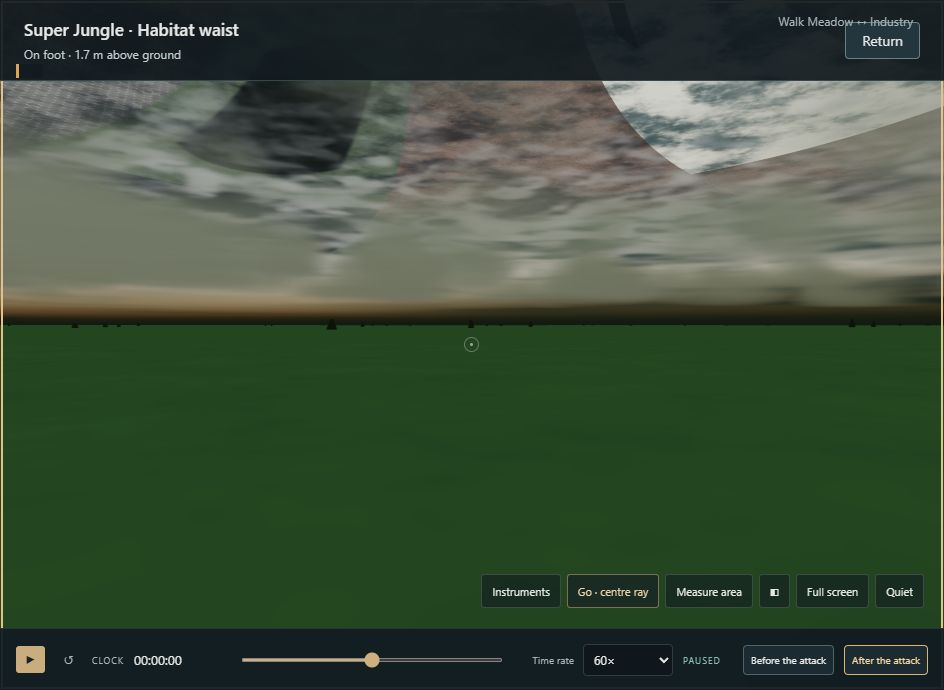

# Industry streaming, Super Jungle and replaceable renderers

The far side of the seed 713 Border station gives us three places to compare at a known scale. Super Jungle supplies the ground under the walker, Border draws a 48 km building with a 4 m service door, and Meadow draws the same building beside its grass. Industry provides a fourth test in which thousands of distant structures compete for the same frame. [Return walk](../examples/border-crossing/outfall-return.mp4) · [Measurements](../examples/border-crossing/outfall-return.json)

## Measurements from the Outfall return build

These measurements used Chrome and WebGL 2 on ALPHA's RTX 5080. The Industry camera was fixed, the process clock was paused and the 960 × 540 canvas was sampled at 128 × 72. A pixel counted as changed when its mean absolute RGB difference exceeded 12 on the 0–255 scale. This lets us count scenery arriving even when the player stands still.

| Experiment | Previous build | Outfall return build |
| --- | ---: | ---: |
| 85 m over Industry, first 180 frames with more than 1% of pixels changing | 2 | 2 |
| 1,400 m over Industry, same test | 7 | 7 |
| Largest single change at 1,400 m | 817 of 9,216 pixels | 817 of 9,216 pixels |
| Six short out-and-back flights across one plant's 195 m detail boundary, frames with uploads | 12 | 0 |
| Bytes uploaded during those six round trips | 13,719,456 | 0 |
| Border hall mesh, triangle vertices before packing | 42,120 | 94,248 |
| Resident hall and freight geometry, two buffer uploads on either build | 1,734,048 bytes | 1,294,320 bytes |
| Border hall mesh assembly, median warm build | 7.15 ms | 2.85 ms |
| Station draw, median across seven shaded views at 960 × 540 | 0.16 ms | 0.18 ms |

Industry now keeps the resident detail level across a small band on either side of a threshold. The band is 8% in either direction. An approaching player still resolves machinery, while a brief turn near the boundary can reuse the same GPU buffer. On the cold high-altitude view, the renderer settled at 315 draws and 30,635,676 tracked buffer bytes. At 85 m it settled at 143 draws and 20,191,212 bytes.

The first version with both pipe galleries could exhaust Meadow's 8 MiB buffer budget on seed 23. The station now stores four corners, one normal and one tint per flat face. The GPU uses the same six corner indices to draw the two triangles of every face. That keeps both galleries and their materials, reduces resident geometry by 25% against the older, simpler hall and leaves room for Meadow. Comparing the two ways of drawing the new station gave identical RGB pixels at all seven camera positions.

We alternated the old and new worktrees across three trials each. The table reports medians of the per-trial medians. Each trial included ten warm assemblies. Draw timings include browser and driver overhead and synchronize each group of eight draws with a one-pixel readback. Whole-game frame intervals, integrated GPUs and native clients need their own measurements.

## Industry from skyline to service lane

The 52-second capture starts 1,400 m above the works. The route descends across 4.2 km, turns back at 85 m, lands in the hot bar district and continues 63 m on foot. Watch the silos beside the service lane as the camera approaches. The last turn looks back beneath the feed line. The capture uses the ordinary flight and walking controls at real speed. [Watch the film](../examples/industry-field/skyline-to-service-lane.mp4) · [Camera trace, hashes and measurements](../examples/industry-field/field-run.json)

| ALPHA, Chrome and WebGL 2 at 960 × 540 | Outfall return build | Industry field build |
| --- | ---: | ---: |
| Stationary at 1,400 m, frames changing over 1% of samples | 7 of 180 | 0 of 180 |
| Largest stationary change at 1,400 m | 817 of 9,216 | 0 of 9,216 |
| Largest stationary change at 85 m | 145 of 9,216 | 6 of 9,216 |
| Settled draw calls at 1,400 m | 315 | 86 |
| Settled tracked buffers at 1,400 m | 30.64 MB | 3.30 MB |
| First picture, median of three fresh launches | 1.513 s | 1.442 s |
| Controls ready, same launches | 1.529 s | 1.459 s |
| First 4.2 km descent, bytes uploaded | 160.82 MB | 6.10 MB |
| First descent, peak tracked buffers | 51.68 MB | 4.92 MB |
| First descent, 95th-percentile render CPU time | 3.60 ms | 0.50 ms |
| First descent, 95th-percentile GPU time | 4.04 ms | 4.40 ms |
| First descent, 95th-percentile frame interval | 16.8 ms | 16.8 ms |
| Six short reversals across the legacy 195 m threshold | 0 upload bytes | 0 upload bytes |

At a fixed camera, each sampled pixel counts once when its mean RGB difference from the previous frame exceeds 12 on the 0–255 scale. Machinery was paused for these measurements. The film runs the machinery. The separate timing route retraced the descent in reverse, repeated it, then flew low, landed, walked and restored the saved position. It uploaded 6.11 MB on the second descent, down from 132.85 MB. GPU figures use non-disjoint timer queries on ALPHA's RTX 5080. MB are decimal and cover tracked WebGL buffers. Measurements on other GPUs remain open.

### What stays in view

A district's scale, angle, pod temperature and six clear service lanes determine its floor at every distance. The GPU draws slab joints, lane markings, paired drains and the boulevard from that address. A test sampled 168 hex centres in six districts, including one tens of billions of metres from home. All 168 matched the CPU reference exactly. A separate first-frame view found 1,729 visible machinery pixels on a 129 × 129 patch of floor.

The same metre-scale solids define a hall roof, tank, flare stack or gantry for distant drawing and local collision. The field renderer batches copies of each design. It selects a wider area than the visible cone to cover camera motion between updates. Major structures feather into the distant field between 2.95 and 4.20 km. Local fittings resolve between 360 and 215 m. The floor continues through the haze beyond them. A near view adds hydraulic presses with exposed dies, inspection windows, louvres, tower ladders and projected shadows. The material shaders reuse the Outfall's poured concrete and steel grate. [See the press floor on foot](../examples/industry-field/process-lane.jpg)

The WebGL module reads the factory solids, camera pose and metre coordinates. The world still owns collision, routing, process time and saved addresses. Another renderer can replay the recorded camera samples against the same geometry. The current client still shares Meadow's sky and shell. The small increase in GPU time on the descent gives a replacement renderer a concrete comparison.

Run `node tools/measure-industry-streaming.cjs <output-directory>` for the fixed cameras and short reversal. Run `node tools/measure-industry-approach.cjs <output-directory>` for the measured flight, return and walk. Add `--startup` for an individual cold launch or `--film` for the 720p capture. Both tools operate on the current working directory, so the same scripts can measure the earlier checkout. The comparison uses `9236a53` and the renderer in `36cf33a`. `npm run test:industry:field` checks floor colours, visible solids, resource release and agreement with a full sky draw.

## First Super Jungle walk

Today the native Super Jungle and Dark Age Forest share their broad ground pattern. Super Jungle's generic near props use a seeded 128 m lattice, five sides and heights of 3–7 m. Meadow already has a more developed vegetation system. Simply adding more instances of the current Jungle shape would still leave the canopy missing from the horizon.

On seed 713 we turned away from the station and walked 502 m. At 164 samples along that route, the 25 resident ground chunks held the same 100 distinct prop IDs. These counts cover the loaded neighbourhood. The frame shows how little of that geometry reads as vegetation at eye height.

Use a 500 m walk starting at the last outward-film position and heading away from the far apron. Let the walker see canopy crowns against the station wall, pass between trunks and buttress roots, and look down into shade-tolerant undergrowth. Generate one set of addressed trees. Use those same crowns for distant silhouettes and the same trunks for walking collision. Preserve the 96 m transition onto the paved apron. Turn back, reload at a marked trunk and repeat the walk in shade. Judge the silhouettes and frame times before extending the recipe across the habitat.

## What a replacement renderer must consume

The station already supplies a practical starting point. Its Atlas address generates the surveyed model, its movement solver owns support and clearance, and its view has load, draw and dispose operations. Main uses that view on a regional canvas, Border uses it indoors, and Meadow draws it into the depth buffer of its own scene. Industry shares Meadow's shell and sky. Its field renderer owns the local projection, logarithmic depth, buffers and shaders, and consumes the same addressed solids as the walking model.

| Owned by the world and simulation | Supplied by each rendering module |
| --- | --- |
| Seed, plot and station address, local metre axes, persistent object identities | GPU buffers, instance or cluster layout, streaming cache and disposal |
| Camera pose and lens, clock, shade state, terrain height and solid extents | Projection and depth implementation, lighting, material shaders and drawing |
| Doors, routes, clearance, freight timetable, controller input and save data | A picture for a given world sample and diagnostics for its cost |

Use the existing WebGL 2 station as the reference. Feed a second module the same camera trace, world time, material parameters and geometry. Start with the far look-back, both sides of a door and the freight bridge. Check the roof silhouette at kilometres, jambs and pipe occlusion at metres, eye height at both handoffs and the saved station after restarting. Record cold and warm frame intervals, GPU time where available, peak bytes and teardown for each module on the same hardware and viewport.

A WebGPU module or an installed native viewer can enter this comparison independently. The first worthwhile port is this one route. Keep whichever module gives the better picture within the measured frame and memory budget for its scene. A native pilot can consume the same trace and a copy of the same save before any wider client migration. [Earlier renderer review](Observatory-Renderer-Review-2026-09-14.md)

### Reproduce the measurements

Run `node tools/measure-industry-streaming.cjs <output-directory>` and `node tools/sample-station-surfaces.cjs <output-directory>` from the checkout being measured. To compare an older revision, invoke the new scripts by absolute path with the older checkout as the working directory. Both open real WebGL scenes and write screenshots and numeric samples. The baseline for this comparison is `2f79f43`.
