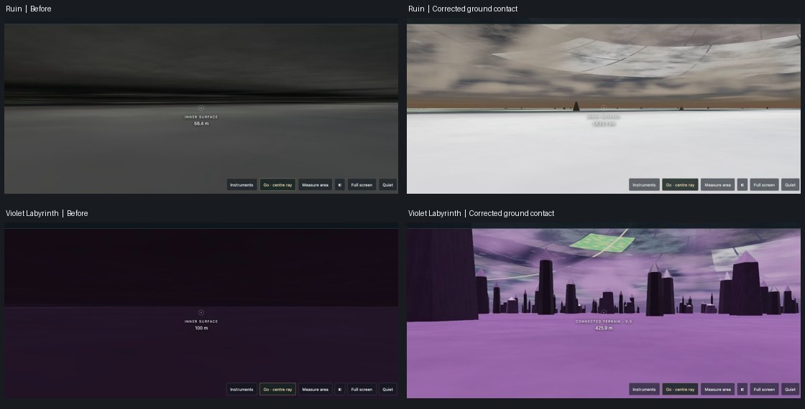

# Biome transitions on foot and in flight

The final build completed all **48 filmed routes**. Each of the 28 walkers crossed its surveyed outlet, reached the expected habitat on supported ground and moved 1.87–3.17 m on the first 0.95-second press of W. The largest horizontal error at an outlet was 0.045 mm. All twelve directed flights between the four installed packs arrived.

The tunnel mouth can still give away the handoff. A nearby City building can have a different silhouette from the view painted through the mouth. Cold destinations can also hold the departure image while ground prepares. The recordings preserve those moments.

[Download all 48 MP4s, camera traces, review sheets and checksums](https://github.com/JoeCauley/sphere-observatory/releases/download/transition-films-44875365674/Sphere-Transition-Survey.zip) · [Per-film measurements](../examples/transitions/audit.json) · [Camera poses at every flagged frame](../examples/transitions/camera-cuts.json) · [Earlier comparison recordings](https://github.com/JoeCauley/sphere-observatory/releases/tag/transition-films-44871660792)

## What the sample covers

On world seed 23, the planner traced 51 complete great-circle circuits and checked 801 changes of habitat. The bearings include random and targeted crossings of the installed regions. It skipped breaches and open wounds. The installed-world sample favours rare directed pairs and includes all 17 surveyed owners as both an arrival and a departure. The placed-only tests enter and leave the same City footprint with its local detail absent.

| Atlas configuration | Model circuits | Passages | Distinct directed pairs observed | Walking films |
| --- | ---: | ---: | ---: | ---: |
| No optional packs installed | 12 | 175 | 57 | 4 |
| City placed, local detail absent | 15 | 228 | 66 | 2 |
| All four packs installed | 24 | 398 | 74 | 22 |

There are twelve ordered pack flights because each of four packs has three other destinations. The eight remaining routes cover four manual descents, hovers, turns and reversals, a walk and liftoff at each lip of the Outfall roof, the Meadow service door and valve, and a descent from a Violet crystal crown to eye height. Each 1,000 km tunnel walk accelerates the middle of the trip using the game’s collision controller. The recorder slows down at both ends and finishes with the ordinary forward key. The service and rooftop films use their normal interactive controls.

Nine signed 360° walks through the live browser crossed 156 rendered tunnels. The largest closure error was 0.18 mm. Two independent Windows browser circuits crossed 33 tunnels and closed within 0.14 mm. All 14 runtime verification jobs passed, including 108 checks of the four pack contracts. [Runtime verification](https://github.com/JoeCauley/sphere-observatory/actions/runs/44875657898). The numerical circuits and the filmed routes answer different questions. A finite set of walks leaves other bearings, clock times and hardware unmeasured.

## What the films changed

| Observation | Change and verification |
| --- | --- |
| W stopped at the Outfall service entrance. | Clear Outfall air had reached code that read an absent cloud layer. The renderer now creates the cloud painter only when a recipe supplies that layer. The service film reaches the pipe gallery and operates the handwheel. |
| A doorway went dark near 7.5 m on descent and lit at the same altitude on ascent. | The surveyed floor sits 7.51 m beyond the nominal shell datum. Sunlight samples the receiving side of the shell while collision keeps the actual floor. A separate Meadow check measured direct sun, penumbra and umbra. The sky pixel changed from RGB (158, 191, 213) to (92, 111, 125) to (22, 27, 37) and returned to its original value when the Shades were disabled. |
| The floor rose above the eye far down a supported tunnel. | A floor plane projected from the entrance accumulated roughly an eye height of error at 713 km. The floor now uses the walker's position as its origin and the walls follow the curve in sections. The renderer checks the floor looking both ways at 0.5, 500, 725, 900 and 999.5 km. |
| A full-screen status card replaced the passage while new ground loaded. Some mouths showed the wrong sunlight. | The outgoing view stays visible with a compact progress indicator. The scenes overlap for 280 ms after the walker has support. Each mouth samples the clock and the position along its chord. 28 final films compared the portal and destination light. |
| The outlet coordinates could pass while the first forward key appeared to do nothing. | Native ground had started the flight-landing animation on a walking transfer. The grounded entry now accepts the first physics tick and keeps a valid eye position while cold tiles prepare. The regression measures actual movement in the walking plane, excluding vertical settling. All 28 final films check it. |
| Several native outlets showed a dark horizon even when the walker moved. | At five recorded addresses the eye was 3.55–5.63 m below the rendered terrain. The cold approach now starts from the procedural height field. Once the mesh is ready, the first frame is aligned to its collision triangle. The 24 native-ground films measured an eye height of 1.71998–1.72004 m at the actual exit. The controller uses a 1.70 m eye height and 0.02 m of collision clearance. |
| Flight reversals and a clear-sky descent exposed changes of renderer. | The regional and local views share Atlas position and bearing. Altitude controls the dissolve, so a hover holds it and climbing reverses it. Meadow mist, industrial vapour, clear Outfall air and the City's thin air use separate rules. No retired habitat images were requested during the filmed routes. |



The paired frames come from the same seeded outlets and bearings, 0.85 seconds before each complete walking film ends. The first forward input is included, so the corrected walker has moved farther from the doorway.

## What the pixels show

Chrome 158.0.8127.37 supplied **23,253 original compositor pictures**. The recordings preserve **31,860 decoded presentation frames** over **22.1 minutes**, with **9,878 timestamped camera samples**. Source cadence across individual films was 9.1–25.8 pictures per second. Each MP4 uses a 24 fps presentation timeline and retains the latest actual picture at each interval. The three README demos are uncut encodings of their full surveyed takes. Together they occupy 6.7 MiB in the repository and load when opened. A SHA-256 fingerprint covers 289 source, pack and capture files.

| README demo | Elapsed time | Original pictures | Pictures/s |
| --- | ---: | ---: | ---: |
| [Outfall to Infinite Industry](../examples/transitions/outfall-to-industry.mp4) | 57.2 s | 999 | 17.5 |
| [Meadow service door and handwheel](../examples/transitions/meadow-service-door.mp4) | 70.4 s | 1,622 | 23.0 |
| [Through the tunnel into Violet Labyrinth](../examples/transitions/into-violet-labyrinth.mp4) | 18.5 s | 306 | 16.5 |

For each adjacent encoded frame, the analyser compares a central rectangle of the world view, clear of the controls. It flags mean channel difference of at least 0.15 together with histogram distance of at least 0.32. It also checks near-black and low-contrast frames, pauses, renderer errors, context loss, requests for old habitat images and full-screen loading overlays. The saved JSON records position, visibility and sunlight around each change. The recording contained 0 near-black central frames and 0 sampled full-screen transit overlays. No recorded route had a page error or lost graphics context.

| Camera state around the 51 flagged changes | Events |
| --- | ---: |
| Accelerated crossing above 24,000 km | 10 |
| Outfall ascent or descent with the wall in view | 4 |
| Entrance to a walking passage | 20 |
| Outlet from a walking passage | 17 |

Sixteen films had no threshold event. These included all four manually flown reversals, both Outfall roof crossings, the complete service-door approach and the Violet crown descent. The 37 walking events correspond to the tunnel coming into view or the receiving habitat taking over. At 9.42 s in the Marsh-to-City film, a nearby facade becomes visible while the City view is at 83% opacity. The walker stays supported, but the skyline seen through the mouth differs visibly from the first street-level view.

In Outfall to Industry, the 5.46 s change came as the camera approached the 1,400 m wall crest. At the nearest camera sample it was 1,234 m above local ground, with clear air and steady direct light. At 23.54 s a bright edge of the shell swept through the frame. By then the camera was 15.8 million km above the surface and the pack view had faded completely. In Violet, the 13.33 s outlet change resolves into distinct crystal spires. The before-and-after frames show what measuring camera position alone had missed.

The Atlas ownership and palette texture takes 66 KiB. During a handoff, the regional surface is capped at 800 × 480 and 25 updates per second. A stationary camera and sun reuse the regional image. The optional cloud painter is capped at 384 × 216. These recordings used desktop Chrome with ANGLE Metal on Apple paravirtual graphics. Frame pacing on a physical base iPhone 16 remains unmeasured.

## Reproduce a route

Install Node.js 20 or newer, desktop Chrome or Playwright Chromium, FFmpeg, and the Python analysis dependencies. Set `SPHERE_NATIVE_BROWSER` to a Chrome executable if needed. `SPHERE_FFMPEG` can point to an FFmpeg executable outside PATH.

```sh
npm ci
npx playwright install chromium
python -m pip install numpy opencv-python-headless Pillow
node --require ./tools/compositor-film.cjs tools/capture-transition-flights.cjs work/films
node --require ./tools/compositor-film.cjs tools/capture-transition-walks.cjs work/films installed
node --require ./tools/compositor-film.cjs tools/capture-transition-walks.cjs work/films empty
node --require ./tools/compositor-film.cjs tools/capture-transition-walks.cjs work/films placed
node --require ./tools/compositor-film.cjs tools/capture-transition-pilots.cjs work/films
python tools/analyze-transition-films.py work/films
python tools/transition-cut-traces.py work/films work/camera-cuts.json
npm test
npm run test:border:browser
npm run test:gallery
```

Set `SPHERE_CLIPS` to comma-separated film IDs to repeat particular routes. Each capture uses an isolated browser and world register. The **Record the transition audit** workflow runs the full sample and saves the evidence as downloadable artifacts.
