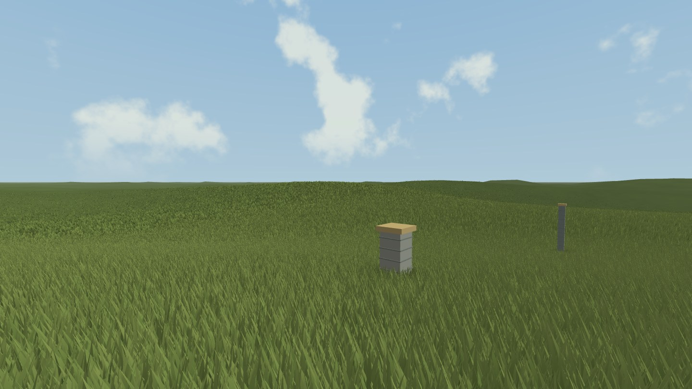
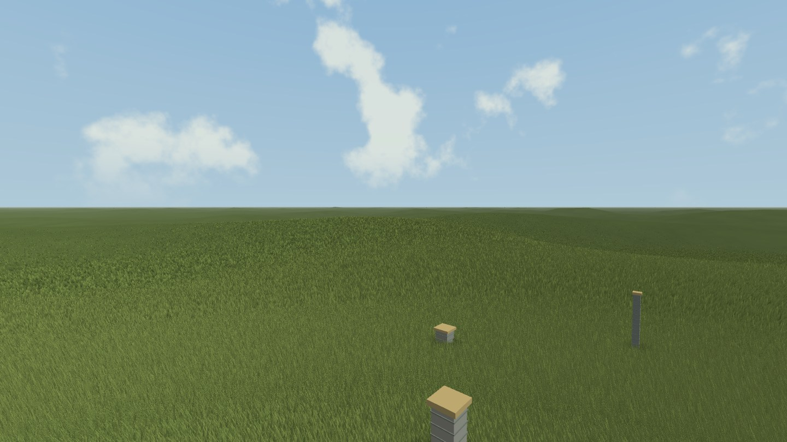
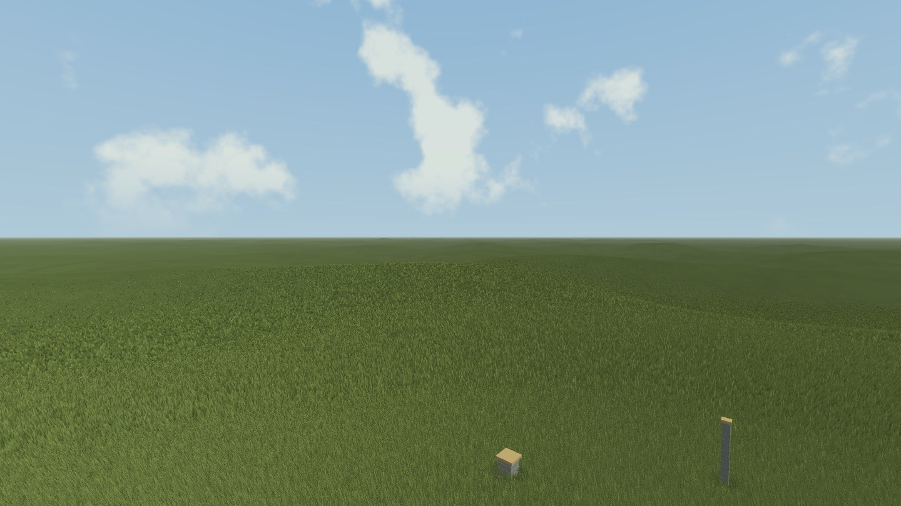
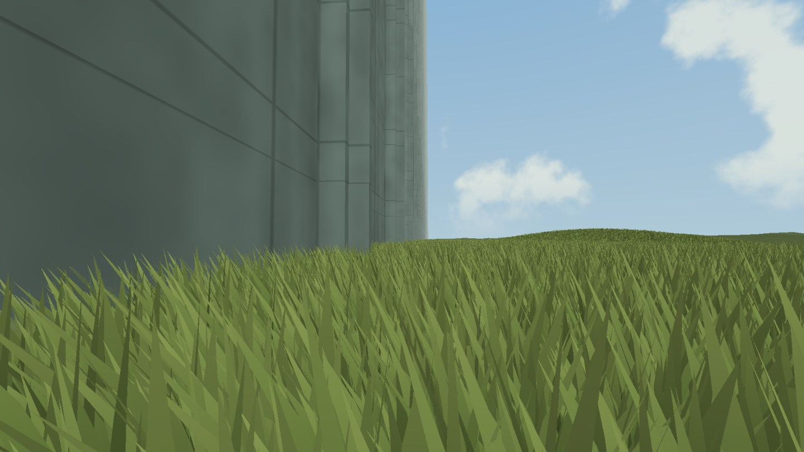
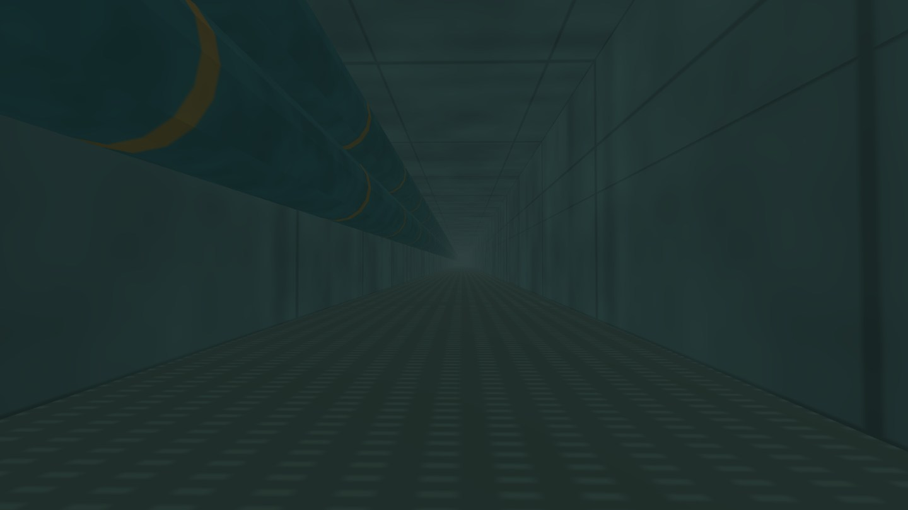

# Biome photographs

The 13 pack photographs come from running WebGL 2 scenes in Observatory 1.8.0. Each uses a 1440 × 810 browser viewport with the floating controls hidden. The capture record identifies each pack version, viewpoint, renderer and image hash. [Pack photographs and capture settings](captures.json)

The Visit card for Violet Labyrinth and the 500 km tunnel marker show what a traveller sees with the controls visible. The browser walking record gives their image sizes and hashes. [Visit card](visit-progress.jpg) · [Tunnel midpoint](outfall-through-tunnel.jpg) · [Walking record](surface-walks.json)

## Meadow to Outfall

Follow a normal-speed cruise over the last 2.7 km of the installed Meadow, cross onto the Outfall apron, descend to the path and walk through the wall. The recording uses the real flight controls and the local Sphere at seed 713. [Watch the crossing](meadow-outfall.webm) · [Flight record](meadow-outfall.json)

## Meadow clearance study

The camera stays at east 15 m, north 10 m with a fixed heading, pitch, lush density, wide reach, local seed 713 and frozen wind phase 17. Clearance is measured above the terrain plus the standing eye height. The two-metre pan turns the same camera through the foreground grass. [Play or download the pan](meadow-pan.webm)

| 2 m | 10 m |
| --- | --- |
|  |  |
| **20 m** | **30 m** |
|  |  |

At 2 m the foreground resolves into individual blades. At 10 m a change in texture density is visible beyond the nearby markers. At 20 and 30 m the contrast between near and distant grass becomes easier to pick out against the hills. The grassbox shader fades with eye clearance from 8 to 36 m. The hero-blade distance blend runs from 22 to 32 m, with its wide-reach extension fading out by 64 m. Those are separate variables a future visual experiment can isolate. This build keeps the Meadow’s accepted grass appearance.

## Other viewpoints

| Place | View |
| --- | --- |
| Infinite Industry | [Seven-hex districts](industry-district.jpg) · [Water works](industry-waterworks.jpg) · [Hot bar transfer](industry-transfer.jpg) |
| Sideways City | [Tower from the street](city-tower.jpg) · [Above the roofs](sideways-city.jpg) |
| The Outfall | [Approach](outfall-approach.jpg) · [Bypass gallery](outfall-gallery.jpg) |

To take the same photographs, install the development dependencies and Chromium, then run `node tools/capture-biome-gallery.cjs <output-directory>` from the repository root. The capture opens a visible browser and uses a disposable server. [Back to the Observatory](../../README.md)

The Outfall wall continues past the survey point 12 km west of its opening. The cross-gallery image looks along the trunk from 1,004 metres east of the valve.

| Exterior wall | Cross-gallery |
| --- | --- |
|  |  |
