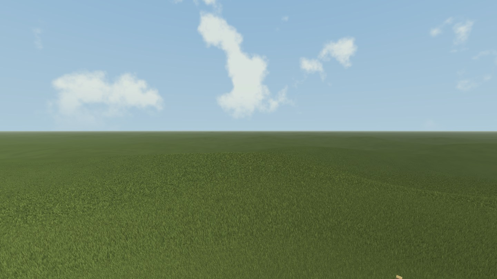

# Biome photographs

Every photograph in the project README comes from a running WebGL 2 scene in this build. The captures use a 1440 × 810 browser viewport with the floating controls hidden. The receipt records the pack version, viewpoint, renderer, image hash and rendering-source fingerprint. [Capture receipt](captures.json)

## Meadow clearance study

The camera stays at east 15 m, north 10 m with a fixed heading, pitch, lush density, wide reach, local seed 713 and frozen wind phase 17. Clearance is measured above the terrain plus the standing eye height. The two-metre pan turns the same camera through the foreground grass. [Play or download the pan](meadow-pan.webm)

| 2 m | 10 m |
| --- | --- |
|  |  |
| **20 m** | **30 m** |
|  |  |

At 2 m the foreground resolves into individual blades. At 10 m a change in texture density is visible beyond the nearby markers. At 20 and 30 m the contrast between near and distant grass becomes easier to pick out against the hills. The grassbox shader fades with eye clearance from 8 to 36 m. The hero-blade distance blend runs from 22 to 32 m, with its wide-reach extension fading out by 64 m. Those are separate variables a future visual experiment can isolate. This build keeps the Meadow’s accepted grass appearance.

## Other viewpoints

| Place | View |
| --- | --- |
| Infinite Industry | [Seven-hex districts](industry-district.jpg) · [Water works](industry-waterworks.jpg) · [Hot bar transfer](industry-transfer.jpg) |
| Sideways City | [Tower from the street](city-tower.jpg) · [Above the roofs](sideways-city.jpg) |
| The Outfall | [Approach](outfall-approach.jpg) · [Bypass gallery](outfall-gallery.jpg) |

To take the same photographs, install the development dependencies and Chromium, then run `node tools/capture-biome-gallery.cjs <output-directory>` from the repository root. The capture opens a visible browser and uses a disposable server. [Back to the Observatory](../../README.md)
